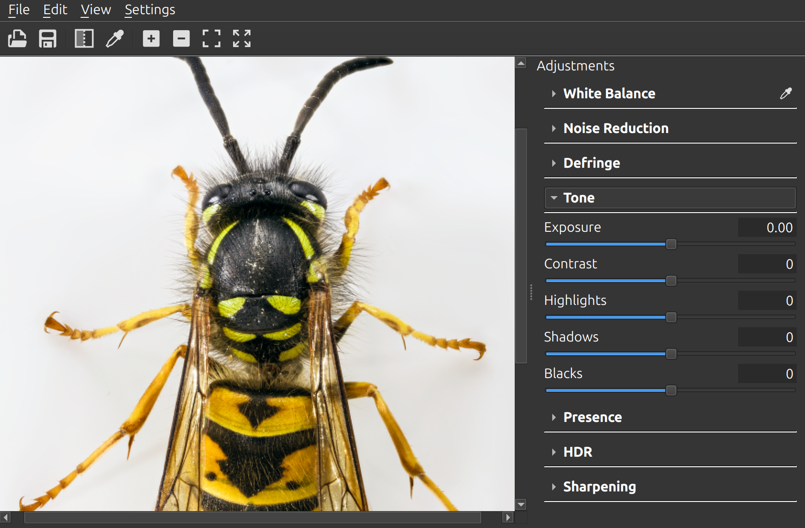

# StepIt Grader

## Table of Contents <!-- omit in toc -->

- [Introduction](#introduction)
- [Prerequisites](#prerequisites)
  - [Ubuntu 24.04](#ubuntu-2404)
  - [macOS](#macos)
  - [Windows 11](#windows-11)
- [Install StepIt Grader](#install-stepit-grader)
  - [Check out the Git Repository](#check-out-the-git-repository)
  - [Install the Libraries](#install-the-libraries)
  - [Build the Project](#build-the-project)
  - [Package for Linux](#package-for-linux)
  - [Use the Engine in Another Program](#use-the-engine-in-another-program)
- [Running the Application](#running-the-application)
  - [Open a Picture](#open-a-picture)
  - [Edit It](#edit-it)
  - [Match the Camera's Look](#match-the-cameras-look)
  - [Save the Settings](#save-the-settings)
  - [Save the Image](#save-the-image)
  - [Choose the Theme](#choose-the-theme)
  - [Keyboard Shortcuts](#keyboard-shortcuts)
- [Grade a Session in Three Steps](#grade-a-session-in-three-steps)
- [Grade from the Command Line](#grade-from-the-command-line)
- [The Tools](#the-tools)
- [The Sidecar](#the-sidecar)
- [Tests](#tests)
- [Troubleshooting](#troubleshooting)
- [Licences](#licences)

## Introduction

StepIt Grader is a desktop application for editing the tones and colours of a picture. It is written in C++ with Qt 6. It has the sliders a photographer uses most, and the picture changes as you move them.

The editor never changes the picture's pixels. It saves your edit as a list of values in a small file next to the picture, called a sidecar. A command-line tool can later apply the same values to many pictures.

With StepIt Grader you can:

- Open a TIFF (8-bit, 16-bit or float, with its ICC profile), a DNG, or a camera raw file such as a Canon CR2.
- Set the white balance by hand, or by clicking an area that should be white or grey.
- Reduce the noise of a high ISO, and remove purple fringes.
- Set the exposure, contrast, highlights, shadows, blacks, tone curve, detail, structure, vibrance and saturation.
- Change the hue, saturation and brightness of eight colour bands.
- Bring back highlights brighter than white with an HDR compression, and sharpen.
- Find the grade that makes raw files look like the JPEGs the camera made from them.
- Zoom from the whole picture up to 800%, with a histogram always in sight.
- Save the settings automatically in an XMP sidecar next to the picture.
- Save the graded picture at full size, as a 16-bit TIFF or a JPEG.
- Grade any number of pictures from the command line with saved settings.

[docs/ARCHITECTURE.md](docs/ARCHITECTURE.md) describes how the code is built.



## Prerequisites

You need CMake 3.22 or later, a C++23 compiler such as GCC 13, and these libraries:

| Library | Version | Where it comes from |
|---|---|---|
| [Qt](https://www.qt.io/download-open-source) | 6.5 or later, 6.11 tested | The Qt online installer. |
| [raw-converter](https://github.com/kineticsystem/raw-converter) | | A Git submodule, built with the editor. |
| [LibRaw](https://www.libraw.org/), [Little CMS](https://www.littlecms.com/), [libtiff](https://libtiff.gitlab.io/libtiff/), [pugixml](https://pugixml.org/) and [GoogleTest](https://github.com/google/googletest) | 0.21.4, 2.17, 4.7.0, 1.15, 1.15.2 | `./install-deps.sh` builds them from source. You can also use your system's packages. |

`./install-deps.sh` needs a C and a C++ compiler, CMake, make, curl and zlib.

> [!NOTE]
> The editor is built and tested on Ubuntu 24.04. The code is written for macOS and Windows too, but it has not been built there yet.

### Ubuntu 24.04

Install the build tools:

```bash
sudo apt install build-essential cmake ninja-build pkg-config curl zlib1g-dev
```

Install the latest Qt 6 with the [Qt online installer](https://www.qt.io/download-open-source). Then tell CMake where Qt is, for example:

```bash
export Qt6_DIR=~/Qt/6.11.0/gcc_64/lib/cmake/Qt6
```

### macOS

1. Install Xcode from the [Apple Developer portal](https://developer.apple.com/download/). It includes the command-line tools. Download the `.xip` file, double-click it, and drag Xcode into the Applications folder.
2. Install CMake and Ninja, for example with [Homebrew](https://brew.sh): `brew install cmake ninja pkg-config`.
3. Install the latest Qt 6 with the [Qt online installer](https://www.qt.io/download-open-source). Then tell CMake where it is, for example:

   ```bash
   export Qt6_DIR=~/Qt/6.11.0/macos/lib/cmake/Qt6
   ```

### Windows 11

1. Download [MSYS2](https://www.msys2.org) and install it.
2. Open the MSYS2 **MINGW64** terminal and update it. If it asks you to restart the terminal, run the command again:

   ```bash
   pacman -Syu
   ```

3. Install the compiler, the build tools and Qt 6:

   ```bash
   pacman -S --needed mingw-w64-x86_64-toolchain mingw-w64-x86_64-cmake mingw-w64-x86_64-ninja \
       mingw-w64-x86_64-pkgconf mingw-w64-x86_64-zlib mingw-w64-x86_64-qt6 make curl git diffutils
   ```

## Install StepIt Grader

### Check out the Git Repository

Clone the repository together with its submodule, raw-converter:

```bash
git clone --recurse-submodules git@github.com:kineticsystem/stepit-grader.git
```

If the submodule is missing, fetch it:

```bash
git submodule update --init
```

### Install the Libraries

Build the libraries once. It takes about half a minute.

```bash
./install-deps.sh
```

The script downloads each library at a fixed version and installs it in its own folder under `deps/`. The build looks there first. There is one script per library in `scripts/`. A library already in `deps/` is skipped; delete its folder to build it again.

### Build the Project

From the repository's root, configure and build:

```bash
cmake -S . -B build -G Ninja -DCMAKE_BUILD_TYPE=Release
cmake --build build
```

The programs are in `build/bin`:

- `stepit-grader`: the editor.
- `stepit-grader-cli`: the command-line tool.
- `stepit-grader-tests`: the tests.

Build in `Release`. In `Debug`, the engine is still optimised, but the rest of the program is not.

### Package for Linux

You can package both programs as an AppImage: a single file that runs on Linux without installing anything.

```bash
./setup/linux/package-stepit-grader.sh
```

The script builds the project and bundles Qt and the other libraries with [linuxdeploy](https://github.com/linuxdeploy/linuxdeploy), which `./install-deps.sh` downloads. It writes `build/linux-package/stepit-grader-<version>-x86_64.AppImage`. Run it like this:

```bash
./stepit-grader-0.1.0-x86_64.AppImage                  # the editor
./stepit-grader-0.1.0-x86_64.AppImage --cli --help     # the command-line tool
```

The AppImage runs on Linux systems at least as recent as the one that built it.

### Use the Engine in Another Program

Another program can use the engine and the slider panel to grade its own pictures. They build on their own and need nothing from `deps/`. Add this repository to your project, for example as a submodule, and put this in your `CMakeLists.txt`:

```cmake
set(STEPIT_GRADER_ENGINE_ONLY ON)
set(STEPIT_GRADER_BUILD_WIDGETS ON)   # the sliders, with Qt 6 Widgets; OFF for the engine alone
add_subdirectory(modules/stepit-grader)
target_link_libraries(my-program PRIVATE stepit-grader::core stepit-grader::widgets)
```

[The Engine in Another Program](docs/ARCHITECTURE.md#the-engine-in-another-program) explains how to use them.

## Running the Application

Start the editor, with or without a picture:

```bash
build/bin/stepit-grader ~/Pictures/IMG_0001.CR2
```

### Open a Picture

Open a picture with **File > Open**, or drop it on the window.

**File > Open Recent** lists the last 10 pictures you opened, newest first. Hover over one to see its full path. **Clear** empties the list. If you choose a picture that has been moved or deleted, it is removed from the list.

A raw file takes a few seconds to open. A 21-megapixel picture from a Canon 5D Mark II takes about 2.5 seconds. If the picture has a sidecar, it opens with its saved settings.

### Edit It

The tools are on the right, grouped in sections. All sections start closed. Click a section's title, for example **Light**, to open it, and click again to close it.

When you move a slider:

- Its value shows next to its name.
- A blue bar on the slider shows how far it is from its default.
- The picture updates at once as a reduced preview. When you stop for 0.3 seconds, it updates at full size. Judge details at 100% on the full-size picture.

Double-click a slider or its name to reset it to its default, which is 0 for most sliders.

The histogram above the sections shows how many pixels are at each brightness, from black on the left to white on the right. Red, green and blue are drawn in colour, and the luminance as a white line. A triangle in a top corner lights up when pixels are clipped at that end. The share of clipped pixels shows below it. The histogram updates with every change, including when you show the original.

**To set the white balance from the picture:**

1. Click the large eyedropper at the top of the **Color** section, or press `W`.
2. Click an area that should be white or grey, such as a grey card or a white wall.

The cursor shows the circle the editor averages: about 10 screen pixels across, at any zoom. Clipped pixels are left out. It sets the temperature and tint so that the area becomes neutral. Then the eyedropper turns off. Press `Esc` to cancel.

**To compare with the original:** click the before-and-after button in the toolbar, or press `\`. The status bar shows **Before** while you see the original. Press `\` again, or move any slider, to go back to your edit.

The toolbar above the picture has the most used actions: open, save, before and after, and the zoom. Each one is also in a menu.

Zoom with the mouse wheel or the **View** menu, and drag the picture with the mouse. Double-click the picture to switch between the whole picture and 100% at the point you click.

### Match the Camera's Look

A raw file looks darker and flatter in the editor than on the camera's screen. The camera shows its own JPEG, processed in its own style. The editor shows the raw data as it is.

**Edit > Match Camera Look…** finds the slider values that make the raw file look like the camera's JPEG. It tries many values and keeps the closest match. It starts from the picture's current settings, so sliders it does not change, such as the highlights or the HDR compression, are taken into account.

What it matches depends on the picture you have open:

| Picture open | What is matched |
|---|---|
| A raw file or a DNG | The picture itself, against the JPEG stored inside it. The status bar tells you when you open one. |
| A TIFF | The raw files the TIFF was made from. The editor asks you to choose them, starting in the TIFF's folder. A TIFF has no camera JPEG, but if it was made from raw files without changes (a merged focus stack, for example), the same grade fits it. |

A window shows the progress. A match takes about half a minute per picture. Click **Stop** to end it early with the best grade found so far.

At the end, the editor shows how far the picture is from the camera's JPEG, before and after the grade. The difference is in CIEDE2000 units: below 1 you cannot see it, and about 2 you can only see side by side. Click **Apply** to set the sliders of the Color, Light, Tone Curve and Color Mixer sections. The other sliders do not change.

The grade is saved in the sidecar like any other edit. You can apply it to other pictures with **File > Load Settings…**, or to many at once with the command-line tool.

> [!IMPORTANT]
> Turn off the camera's Auto Lighting Optimizer for the raw files you match. It changes each JPEG differently, so no single grade can match them.

### Save the Settings

The editor saves your settings automatically, next to the picture:

| Picture | Sidecar |
|---|---|
| A raw file, `IMG_0001.CR2` | `IMG_0001.xmp`, as other raw editors name it |
| A TIFF, `IMG_0001.tif` | `IMG_0001.tif.xmp` |

So a raw file and a TIFF with the same name each have their own sidecar. If a TIFF has only an `IMG_0001.xmp` and no raw file of that name is next to it, the TIFF opens with that file and saves to `IMG_0001.tif.xmp`.

The editor saves 1 second after your last change, so dragging a slider writes the file once. Opening another picture or closing the window saves at once. A picture you open and close without changing gets no sidecar.

The window title shows `*` while there are unsaved changes. If a save fails, the status bar says so, and the editor tries again at your next change. It asks you only when you would lose your edit: when you close the window or open another picture. **File > Save Settings** saves at once.

**File > Load Settings…** (`Ctrl+L`) applies the settings from any sidecar to the open picture. It can be one saved for another picture, or one written by another raw editor. Sliders the file does not mention go to their defaults. This counts as a normal change and is saved a second later.

**Edit > Revert to Opened** brings back the settings the picture had when you opened it, even after a save. **Edit > Revert to Default** resets every slider. Both count as normal changes. There is no undo: once you close the picture, its original settings are gone.

### Save the Image

**File > Save Image…** (`Ctrl+Shift+E`) saves the picture with your edit, at full size. Your settings stay in the sidecar. Choose the type of file in the dialog; the type you chose last is offered first.

| Type | Use it for |
|---|---|
| TIFF, 16 bits, sRGB | The default. Every program and screen expects sRGB. |
| TIFF, 16 bits, Adobe RGB | Printing. It has more greens and cyans. |
| TIFF, 16 bits, ProPhoto RGB | More editing in another program. It is wider than any printer. |
| JPEG, 8 bits, sRGB | Sharing, at high quality. |

TIFFs are compressed without loss and include their ICC profile. The suggested name is the picture's name with `-graded`, in the same folder. The editor never overwrites the original picture. It saves in the background, and the status bar tells you when it is done.

### Choose the Theme

**Settings > Theme** chooses the look:

- **System**: your desktop's style. This is the default.
- **Light**.
- **Dark**: dark grey, easier on the eyes when judging a picture.

The change applies at once and is remembered. On macOS the menus show no icons, because the menu bar stays light in every theme. The toolbar keeps its icons.

### Keyboard Shortcuts

| Keys | What they do |
|---|---|
| `Ctrl+O` | Open a picture. |
| `Ctrl+S` | Save the settings now, without waiting 1 second. |
| `Ctrl+L` | Load the settings from another sidecar. |
| `Ctrl+Shift+E` | Save the picture with your edit. |
| `Ctrl+Shift+R` | Reset every slider to its default. |
| `W` | Pick the white balance from an area. `Esc` cancels. |
| `\` | Switch between the original and your edit. |
| `Ctrl++`, `Ctrl+-` | Zoom in, zoom out. |
| `Ctrl+0` | Fit the picture to the window. |
| `Ctrl+1` | Show it at 100%. |

On macOS, use `Cmd` instead of `Ctrl`.

## Grade a Session in Three Steps

The first time you grade pictures from a camera, with the camera set up as you shoot:

1. **Match.** Open a raw file from the session, or a TIFF made from its raw files. Choose **Edit > Match Camera Look…**. For a TIFF, pick a few of the raw files it was made from.
2. **Apply.** Click **Apply**. The picture's sidecar keeps the grade.
3. **Adjust.** Change whatever else the picture needs, such as the exposure.

After that, with the same camera and settings:

1. **Load the grade.** Open a picture, choose **File > Load Settings…**, and pick the sidecar of a picture you graded before, such as `IMG_0001.xmp`. Every slider is set as in that picture.
2. **Adjust.** Change whatever else the picture needs.
3. **Grade the others.** Load the same sidecar for each picture, or grade them all with the command-line tool: `stepit-grader-cli --settings IMG_0001.xmp`.

## Grade from the Command Line

`stepit-grader-cli` applies saved settings to pictures without opening a window, for example in a script or on a server. For each picture, it applies the settings at full size and writes a 16-bit TIFF with the same name into the output folder.

To grade every picture with the settings saved for one of them:

```bash
build/bin/stepit-grader-cli --settings ~/Pictures/IMG_0001.xmp --output ~/Pictures/graded ~/Pictures/*.CR2
```

Without `--settings`, each picture uses its own sidecar. A picture without a sidecar is written with no edit.

| Option | Default | What it does |
|---|---|---|
| `-s`, `--settings <file.xmp>` | Each picture's own sidecar: `IMG_0001.xmp` for a raw file, `IMG_0001.tif.xmp` for a TIFF | The settings to apply to every picture. Any sidecar the editor saved works. |
| `-o`, `--output <folder>` | Required | The folder for the TIFFs. It is created if missing. Each TIFF is `<folder>/<picture's name>.tif`. |
| `-c`, `--colour-space <name>` | `srgb` | The TIFFs' colour space, with its ICC profile: `srgb`, `adobe-rgb`, `prophoto` or `rec2020-linear`. Use sRGB for screens. Adobe RGB and ProPhoto RGB keep saturated colours for printing. Linear Rec. 2020 is the editor's own working space, for further processing. |
| `--compress` | Off | Compress without loss. The files are about half the size. |
| `--overwrite` | Off | Replace TIFFs already in the output folder. |

The tool never overwrites a picture it reads. It never overwrites an existing TIFF unless you pass `--overwrite`. It also never lets two pictures of the same run write the same TIFF, for example `a.CR2` and `a.tif`. If a picture cannot be read or written, the tool reports it and goes on with the others. It prints each TIFF it writes, and exits with:

| Exit status | Meaning |
|---|---|
| `0` | Every picture was graded. |
| `1` | Some pictures failed. Each one is reported with the reason. |
| `2` | The command line is wrong, or the settings cannot be read. Nothing is graded. |

A 21-megapixel raw file takes about 5 seconds, mostly to develop it.

## The Tools

The tools in the order the panel shows them. [The Effects](docs/ARCHITECTURE.md#the-effects) lists the order in which they are applied; sharpening, for example, comes last. Every tool changes the whole picture.

| Section | Tool | Range | What it does |
|---|---|---|---|
| Color | Temperature | `-100` to `100` | Warmer above 0, cooler below. It starts from the picture's own white balance. |
| | Tint | `-100` to `100` | More magenta above 0, more green below. |
| Light | Exposure | `-5.00` to `5.00` | Brightness in stops. `+1.00` is twice as bright. |
| | Contrast | `-100` to `100` | Moves tones away from middle grey, or toward it. |
| | Highlights | `-100` to `100` | Darkens or brightens only the bright areas. |
| | Shadows | `-100` to `100` | Brightens or darkens only the dark areas. |
| | Blacks | `-100` to `100` | Pushes the darkest tones to black, or lifts black to dark grey. |
| | Vibrance | `-100` to `100` | Saturates dull colours more than vivid ones. |
| | Saturation | `-100` to `100` | Saturates every colour. `-100` is black and white. |
| Tone Curve | Curve Shadows, Curve Darks, Curve Lights, Curve Highlights | `-100` to `100` | Raises or lowers one range of tones, from the darkest to the brightest. The curve is smooth and never goes down. Colours are kept, and white stays white. The curve is drawn above the sliders: original tones along the bottom, new tones up the side, and the borders between ranges dotted. |
| | Shadows Split, Midtones Split, Highlights Split | `5` to `45`, `25` to `75`, `55` to `95` | Where one range ends and the next begins, in on-screen tones. The defaults are `25`, `50` and `75`. |
| Color Mixer | Red Hue … Magenta Hue | `-100` to `100` | Shifts the colours of one band toward the next band. For example, reds turn toward orange above 0 and toward magenta below. There are eight bands: red, orange, yellow, green, aqua, blue, purple and magenta. |
| | Red Saturation … Magenta Saturation | `-100` to `100` | Saturates the colours of one band. `-100` makes them grey. |
| | Red Luminance … Magenta Luminance | `-100` to `100` | Brightens or darkens the colours of one band, by up to one stop. Greys are never changed. |
| Effects | Detail | `-100` to `100` | Contrast of fine texture a few pixels across, such as hairs. |
| | Structure | `-100` to `100` | Contrast of medium shapes, such as a leg against a body. |
| | Sharpness | `0` to `150` | Sharpens the finest edges. Check it at 100%. |
| Noise Reduction | Luminance | `0` to `100` | Smooths the grain of a high ISO, in shadows and highlights alike, while keeping edges sharp. |
| | Luminance Detail | `0` to `100` | How much fine detail the smoothing keeps. The default is `50`. |
| | Color | `0` to `100` | Removes the coloured blotches of a high ISO, mostly in the shadows. Colours do not bleed across edges, and detail is kept. |
| Chromatic Aberration | Purple Amount | `0` to `20` | Removes the colour from purple fringes, which lenses draw along strong edges. Higher values also search a wider band beside the edges. |
| | Purple Hue Low, Purple Hue High | `0` to `100` | The range of hues treated as fringes, from blue (`0`) through purple to magenta (`100`). The default is `30` to `70`. A purple object away from edges keeps its colour. |
| HDR | HDR Compression | `0` to `100` | Brings highlights brighter than white back into the picture, up to 4 stops above white, with a smooth roll-off instead of a hard clip. |
| | Compression Point | `0` to `100` | Where the roll-off starts, from middle grey (`0`) to just below white (`100`). Tones below it do not change. |
| | Local Contrast | `0` to `100` | At `100`, it compresses whole bright areas and keeps their texture, such as clouds in a bright sky. At `0`, it treats every pixel on its own. |

The editor works in linear Rec. 2020 with 32-bit floats. No colour is clipped and no tone is lost between tools. Clipping happens only on the screen.

## The Sidecar

The settings are saved in an XMP file next to the picture: `IMG_0001.xmp` for a raw file, and `IMG_0001.tif.xmp` for a TIFF. Each value is an attribute in the `crs` namespace, which most raw editors use, under the same name they use:

```xml
<x:xmpmeta xmlns:x="adobe:ns:meta/" x:xmptk="stepit-grader">
 <rdf:RDF xmlns:rdf="http://www.w3.org/1999/02/22-rdf-syntax-ns#">
  <rdf:Description rdf:about="" xmlns:crs="http://ns.adobe.com/camera-raw-settings/1.0/"
    crs:ProcessVersion="11.0" crs:HasSettings="True" crs:IncrementalTemperature="0"
    crs:IncrementalTint="0" crs:Exposure2012="-0.35" crs:Contrast2012="0"
    crs:Highlights2012="0" crs:Shadows2012="+45" crs:Blacks2012="0" crs:Texture="0"
    crs:Clarity2012="0" crs:Vibrance="0" crs:Saturation="0" crs:Sharpness="0" />
 </rdf:RDF>
</x:xmpmeta>
```

What this means in practice:

- **The editor reads sidecars from other raw editors** that use the same namespace. It reads the values of its own tools, whether they are stored as attributes or as elements. It ignores other settings, such as a point tone curve (`ToneCurvePV2012`) or lens corrections.
- **Saving keeps the rest of the file.** Ratings, keywords and other data stay. Only the values of the tools change.
- **The same numbers give a similar picture, not the same one, in another editor.** The names and ranges are shared, but each editor processes them its own way.
- **The HDR sliders exist only in this editor**: `HDRToneCompression`, `HDRCompressionPoint` and `HDRLocalContrast`. Other editors ignore them.
- **Temperature and tint are relative** (`IncrementalTemperature` and `IncrementalTint`). They mean the same for a raw file and a TIFF.

## Tests

The tests are one program, `stepit-grader-tests`. Run them with CTest:

```bash
ctest --test-dir build
```

Or run the program directly, which also accepts a filter:

```bash
build/bin/stepit-grader-tests --gtest_filter='EffectsTest.*'
```

Four tests need camera raw samples, which are not in the repository. They read a CR2, a DNG and a CR2's camera JPEG, and match a camera's look. Download the samples once (about 160 MB) into the submodule:

```bash
modules/raw-converter/bin/fetch-samples.sh
```

Without the samples, those four tests are skipped.

## Troubleshooting

**CMake says `Could not find a package configuration file provided by "Qt6"`.** CMake does not know where Qt is. Set `Qt6_DIR`; see [Prerequisites](#prerequisites).

**CMake says `Package 'libraw_r', required by 'virtual:world', not found`, or cannot find TIFF or pugixml.** The libraries are not in `deps/` or on your system. Run `./install-deps.sh`.

**The sliders are slow.** Build in `Release`.

**A picture opens with no edit, and a warning says its settings cannot be read.** Its sidecar is damaged, for example cut short by a full disk or edited by hand. Your first change replaces it with a new one. The damaged file is kept next to it, for example as `IMG_0001.xmp.damaged`, so you can recover it by hand.

## Licences

StepIt Grader is released under the MIT licence; see [`LICENSE`](LICENSE). It uses this software:

| Software | Licence | Role |
|---|---|---|
| [Qt](https://www.qt.io) | LGPL 3 | The user interface. Linked dynamically. |
| [raw-converter](https://github.com/kineticsystem/raw-converter) | MIT | Develops the raw files. |
| [LibRaw](https://www.libraw.org/) | LGPL 2.1 or CDDL 1.0 | Decodes and demosaics raw files, inside raw-converter. Linked dynamically. |
| [Little CMS](https://www.littlecms.com/) | MIT | Converts a TIFF's colours using its ICC profile. |
| [libtiff](https://libtiff.gitlab.io/libtiff/) | libtiff licence, BSD-like | Reads and writes TIFF files. Linked dynamically. |
| [pugixml](https://pugixml.org/) | MIT | Reads and writes the XMP sidecars. Linked statically. |
| [zlib](https://zlib.net/) | zlib licence | Compression for libtiff. The system's copy is used. |
| [GoogleTest](https://github.com/google/googletest) | BSD 3-Clause | The tests. |
| [linuxdeploy](https://github.com/linuxdeploy/linuxdeploy) | MIT | Builds the Linux AppImage. It is not included in the AppImage. |
