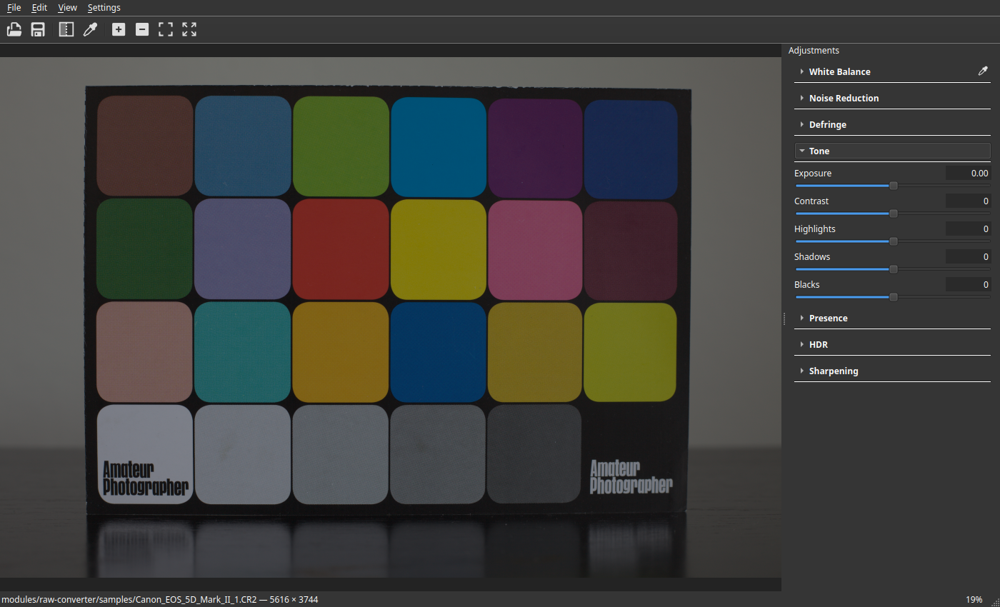

# StepIt Grader

## Table of Contents <!-- omit in toc -->

- [Introduction](#introduction)
- [Prerequisites](#prerequisites)
  - [Ubuntu 24.04](#ubuntu-2404)
  - [macOS](#macos)
  - [Windows 11](#windows-11)
- [Install StepIt Grader](#install-stepit-grader)
  - [Check out the Git Repository](#check-out-the-git-repository)
  - [Install the Libraries](#install-the-libraries)
  - [Build the Project](#build-the-project)
- [Running the Application](#running-the-application)
  - [Open a Picture](#open-a-picture)
  - [Edit It](#edit-it)
  - [Save the Settings](#save-the-settings)
  - [Keyboard Shortcuts](#keyboard-shortcuts)
- [Grade from the Command Line](#grade-from-the-command-line)
- [The Tools](#the-tools)
- [The Sidecar](#the-sidecar)
- [Tests](#tests)
- [Troubleshooting](#troubleshooting)
- [Licences](#licences)

## Introduction

StepIt Grader is a desktop application, in C++ and Qt 6, for the tones and colours of a picture: the few sliders of a Lightroom-like Basic panel, applied to the whole picture, live. It saves the edit, never the pixels: a sidecar of values next to the picture, as Lightroom does, which a command line tool can later apply, unchanged, to many pictures.

With StepIt Grader we can:

- open a TIFF, 8 or 16 bits or float, with its ICC profile, a DNG, or a camera raw file, e.g. a Canon CR2;
- set the white balance, by hand or by picking an area that should be white or grey, remove purple fringing, set the exposure, the contrast, the highlights, the shadows, the blacks, the detail, the structure, the vibrance, the saturation, an HDR compression of the highlights and the sharpness, and see the result as the slider moves;
- zoom from the whole picture to 800%, and drag it around;
- save the settings by itself in an XMP sidecar that Lightroom and Camera Raw can read, and open them again with the picture;
- grade any number of pictures from the command line with those settings, into 16-bit TIFFs in sRGB, Adobe RGB, ProPhoto RGB or linear Rec. 2020.

How it is built is described in [docs/ARCHITECTURE.md](docs/ARCHITECTURE.md).



## Prerequisites

The editor is built with CMake 3.22 or later and a C++23 compiler, e.g. GCC 13, against these libraries:

| Library | Version | Where it comes from |
|---|---|---|
| [Qt](https://www.qt.io/download-open-source) | 6.5 or later, 6.11 tested | The Qt online installer. |
| [raw-converter](https://github.com/kineticsystem/raw-converter) | | A Git submodule, built with the editor. |
| [LibRaw](https://www.libraw.org/) and [Little CMS](https://www.littlecms.com/) | 0.21 and 2.x | `./install-deps.sh`, or the system's packages. |
| [libtiff](https://libtiff.gitlab.io/libtiff/), [pugixml](https://pugixml.org/) and [GoogleTest](https://github.com/google/googletest) | | Lentigram's `lib/`, made by [lentigram-deps](https://github.com/kineticsystem/lentigram-deps), or the system's packages. |

When Lentigram is checked out next to this repository, in `../lentigram`, its `lib/` is used: nothing else to install for libtiff, pugixml and GoogleTest. Another folder is given with `-DLENTIGRAM_LIB=<path>`.

> [!NOTE]
> The editor is built and tested on Ubuntu 24.04. The code is meant for macOS and Windows too, but has not been built there yet.

### Ubuntu 24.04

Install Qt 6 with the online installer, then tell CMake where it is, e.g.:

```bash
export Qt6_DIR=~/Qt/6.11.0/gcc_64/lib/cmake/Qt6
```

Without Lentigram's `lib/`, install the other libraries from Ubuntu:

```bash
sudo apt install build-essential cmake ninja-build pkg-config \
    libtiff-dev libpugixml-dev libgtest-dev libraw-dev liblcms2-dev
```

### macOS

Install Xcode, Qt 6 with the online installer, and the libraries with [Homebrew](https://brew.sh):

```bash
brew install cmake ninja pkg-config libtiff pugixml googletest libraw little-cms2
export Qt6_DIR=~/Qt/6.11.0/macos/lib/cmake/Qt6
```

### Windows 11

Install [MSYS2](https://www.msys2.org), and in its MINGW64 shell, Qt 6 and the libraries:

```bash
pacman -S --needed mingw-w64-x86_64-toolchain mingw-w64-x86_64-cmake mingw-w64-x86_64-ninja \
    mingw-w64-x86_64-qt6 mingw-w64-x86_64-libtiff mingw-w64-x86_64-pugixml \
    mingw-w64-x86_64-gtest mingw-w64-x86_64-libraw mingw-w64-x86_64-lcms2 git
```

## Install StepIt Grader

### Check out the Git Repository

Check out the repository with its submodule, raw-converter:

```bash
git clone --recurse-submodules git@github.com:kineticsystem/stepit-grader.git
```

If the submodule is missing, fetch it with:

```bash
git submodule update --init
```

### Install the Libraries

When the system has no LibRaw and Little CMS, e.g. on a computer without administrator rights, build them into `deps/`, which the build looks in first:

```bash
./install-deps.sh
```

### Build the Project

Configure and build, from the repository's root:

```bash
cmake -S . -B build -G Ninja -DCMAKE_BUILD_TYPE=Release
cmake --build build
```

The programs are in `build/bin`: `stepit-grader`, the editor, `stepit-grader-cli`, the command line, and `stepit-grader-tests`. Build in `Release`: the effects are about ten times slower in `Debug`.

## Running the Application

Start the editor, with a picture or without:

```bash
build/bin/stepit-grader ~/Pictures/IMG_0001.CR2
```

### Open a Picture

Open a picture with **File > Open**, or drop it on the window. **File > Open Recent** lists the last 10 pictures opened, the latest first; hover over one for its full path. **Clear**, at the bottom, empties the list, and a picture moved or deleted since goes from it when chosen. A raw file takes a few seconds to develop: about 2.5 seconds for the 21 megapixels of a Canon 5D Mark II. A picture that has a sidecar opens with its settings.

### Edit It

Move a slider on the right, or type its value. The sections start folded: a click on a section's title, e.g. **Tone**, opens it, and another folds it away. The picture follows at once, on a reduced preview, then, once the sliders stop for 0.3 seconds, in full, which is what to look at at 100%. A double click on a slider or its name puts it back to 0.

To set the white balance from the picture, click the eyedropper next to **White Balance**, or press `W`, then click an area that should be white or grey, e.g. a grey card or a white wall. The cursor shows the circle averaged, about 10 screen pixels across, whatever the zoom; its clipped pixels are left out. The temperature and the tint are set so the area turns neutral, and the eyedropper goes back to dragging. `Esc` cancels.

Zoom with the wheel, around the cursor, or with the **View** menu; drag the picture with the mouse. A double click on the picture switches between the whole picture and 100% where clicked.

### Save the Settings

The editor saves the settings by itself, next to the picture, e.g. `IMG_0001.xmp` for `IMG_0001.CR2`: 1 second after the last change, so a slider dragged writes the file once, when it stops. Opening another picture or closing the window saves at once what is still waiting, without asking. A picture opened and closed without a change gets no sidecar. When we open the picture again, it opens with its sidecar's settings, ready for another change.

The window's title shows `*` while the settings are not written yet: for the second after a change, or until the next change after a save that failed. A failed save is shown in the status bar and tried again at the next change; only when the edit would be lost, on closing the window or opening another picture, does the editor ask whether to go on without it. **File > Save Settings** saves at once.

**Edit > Revert to Opened** goes back to the settings the picture had when it was opened, from its sidecar or none, and **Edit > Reset All** to a picture with no edit. Both are changes like any other, saved in turn.

### Keyboard Shortcuts

| Keys | What they do |
|---|---|
| `Ctrl+O` | Open a picture. |
| `Ctrl+S` | Save the settings now, rather than 1 second after the last change. |
| `Ctrl+Shift+R` | Reset all the sliders. |
| `W` | Pick the white balance from an area; `Esc` cancels. |
| `Ctrl++`, `Ctrl+-` | Zoom in, zoom out. |
| `Ctrl+0` | Fit the picture to the window. |
| `Ctrl+1` | Show it at 100%. |

On macOS, `Cmd` replaces `Ctrl`.

## Grade from the Command Line

`stepit-grader-cli` applies saved settings to pictures without a window, e.g. in a script or on a server: it reads each picture, applies the settings at full size, and writes a 16-bit TIFF with the picture's name into the output folder.

Grade every picture with the settings saved for one of them:

```bash
build/bin/stepit-grader-cli --settings ~/Pictures/IMG_0001.xmp --output ~/Pictures/graded ~/Pictures/*.CR2
```

Without `--settings`, each picture is graded with its own sidecar, or with no edit when it has none.

| Option | Default | What it does |
|---|---|---|
| `-s`, `--settings <file.xmp>` | each picture's own sidecar | The settings for every picture: any sidecar the editor or Lightroom saved. |
| `-o`, `--output <folder>` | required | Where the TIFFs go, made if missing: `<folder>/<picture's name>.tif`. |
| `-c`, `--colour-space <name>` | `srgb` | The TIFFs' colour space, with its ICC profile embedded: `srgb`, `adobe-rgb`, `prophoto` or `rec2020-linear`. sRGB is what every screen assumes; Adobe RGB and ProPhoto RGB keep the saturated colours sRGB clips, for prints; linear Rec. 2020 is the editor's own working space, for more processing. |
| `--compress` | off | Deflate, lossless: about half the size. |
| `--overwrite` | off | Replace the TIFFs already in the output folder. |

It never writes over a picture it reads, nor over a TIFF already there unless given `--overwrite`, nor over the TIFF of another picture of the same run, e.g. `a.CR2` and `a.tif`. A picture that cannot be read or written is reported, and the others are graded. It prints each TIFF written, and ends with:

| Exit status | Meaning |
|---|---|
| `0` | Every picture is graded. |
| `1` | Some are not: each is reported, with the reason. |
| `2` | The command line is wrong, or the settings cannot be read: nothing is graded. |

A raw file of 21 megapixels takes about 5 seconds, most of it to develop.

## The Tools

The tools are applied in this order, from top to bottom. Each changes the whole picture, never one area chosen by hand.

| Section | Tool | Range | What it does |
|---|---|---|---|
| White Balance | Temperature | `-100` to `100` | Warmer above 0, cooler below, from the picture's own white balance. |
| | Tint | `-100` to `100` | More magenta above 0, more green below. |
| Defringe | Purple Amount | `0` to `20` | Takes the colour out of purple fringes, the purple edges a lens draws along strong contrasts. Higher also searches a wider band beside the edges. |
| | Purple Hue Low, Purple Hue High | `0` to `100` | The hues taken for fringes, from blue (`0`) through purple to magenta (`100`); `30` to `70` by default. A purple area away from edges keeps its colour. |
| Tone | Exposure | `-5.00` to `5.00` | Stops of light: `+1.00` is twice as bright. |
| | Contrast | `-100` to `100` | Spreads the tones away from middle grey, or toward it. |
| | Highlights | `-100` to `100` | Darkens, or brightens, the bright areas only. |
| | Shadows | `-100` to `100` | Brightens, or darkens, the dark areas only. |
| | Blacks | `-100` to `100` | Crushes the darkest tones to black, or lifts black to a dark grey. |
| Presence | Detail | `-100` to `100` | The contrast of the fine texture, a few pixels across, e.g. hairs. |
| | Structure | `-100` to `100` | The contrast of the medium shapes, e.g. a leg against a body. |
| | Vibrance | `-100` to `100` | Saturates the dull colours more than the vivid ones. |
| | Saturation | `-100` to `100` | Saturates every colour; `-100` is black and white. |
| HDR | HDR Compression | `0` to `100` | Fits the highlights brighter than white back into the picture, up to 4 stops above it, with a smooth roll-off instead of a clip. |
| | Compression Point | `0` to `100` | Where the roll-off starts: from middle grey (`0`) to just below white (`100`). The tones below are untouched. |
| | Local Contrast | `0` to `100` | At `100`, compresses the brightness of whole areas and keeps the texture within them, e.g. the clouds of a bright sky; at `0`, every pixel on its own. |
| Sharpening | Sharpness | `0` to `150` | Sharpens the finest edges. Look at it at 100%. |

The picture is edited in linear Rec. 2020 with 32-bit floats: no colour is clipped and no tone is lost between the tools, only on the screen.

## The Sidecar

The settings are saved as Lightroom saves them: an XMP file with the picture's name, each value an attribute of the Camera Raw namespace, under Lightroom's own name:

```xml
<x:xmpmeta xmlns:x="adobe:ns:meta/" x:xmptk="stepit-grader">
 <rdf:RDF xmlns:rdf="http://www.w3.org/1999/02/22-rdf-syntax-ns#">
  <rdf:Description rdf:about="" xmlns:crs="http://ns.adobe.com/camera-raw-settings/1.0/"
    crs:ProcessVersion="11.0" crs:HasSettings="True" crs:IncrementalTemperature="0"
    crs:IncrementalTint="0" crs:Exposure2012="-0.35" crs:Contrast2012="0"
    crs:Highlights2012="0" crs:Shadows2012="+45" crs:Blacks2012="0" crs:Texture="0"
    crs:Clarity2012="0" crs:Vibrance="0" crs:Saturation="0" crs:Sharpness="0" />
 </rdf:RDF>
</x:xmpmeta>
```

What that means in practice:

- **The editor reads Lightroom's sidecars**: the values of its tools, whether written as attributes or as elements. Lightroom's other settings, e.g. its tone curve or its lens corrections, are ignored.
- **Saving keeps the rest of the file**, e.g. a rating or keywords: only the values of the tools are replaced.
- **Lightroom reads the editor's sidecar of a raw file**, e.g. a CR2, with **Metadata > Read Metadata from File**. For a DNG or a TIFF, Lightroom reads the settings stored inside the file, which the editor does not write.
- **The same numbers do not give the same picture.** The names and the ranges are Lightroom's, but Adobe's processing is its own: `Shadows2012="+45"` lifts the shadows in both, by different amounts.
- **The HDR sliders are the editor's own**, `HDRToneCompression`, `HDRCompressionPoint` and `HDRLocalContrast`: Lightroom has no such setting, and ignores them.
- **The temperature and the tint are relative**, `IncrementalTemperature` and `IncrementalTint`, as Lightroom writes them for a TIFF. For a raw file, Lightroom uses an absolute temperature in kelvin instead, and ignores these two.

## Tests

The tests are one program, `stepit-grader-tests`. Run them with CTest:

```bash
ctest --test-dir build
```

or the program itself, which also takes a filter:

```bash
build/bin/stepit-grader-tests --gtest_filter='EffectsTest.*'
```

Two tests read camera raw samples, which are not in the repository. Download them once, about 160 MB, into the submodule:

```bash
modules/raw-converter/bin/fetch-samples.sh
```

Without them, those two tests are skipped.

## Troubleshooting

**CMake says `Could not find a package configuration file provided by "Qt6"`.** It does not know where Qt is: set `Qt6_DIR`, see [Prerequisites](#prerequisites).

**CMake says `Package 'libraw_r', required by 'virtual:world', not found`.** LibRaw is neither in the system nor in `deps/`: run `./install-deps.sh`, or install the system's package.

**The link fails with `undefined reference to 'jpeg12_read_raw_data@LIBJPEG_6.2'`.** Lentigram's libtiff is linked with the system's libjpeg instead of Lentigram's libjpeg-turbo. Check that `${LENTIGRAM_LIB}/jpeg/lib` exists: the build adds it to the run path.

**The sliders are slow.** The build is `Debug`: build in `Release`.

## Licences

StepIt Grader is released under the MIT licence, see [`LICENSE`](LICENSE). The software it uses:

| Software | Licence | Role |
|---|---|---|
| [Qt](https://www.qt.io) | LGPL 3 | The user interface, linked dynamically. |
| [raw-converter](https://github.com/kineticsystem/raw-converter) | MIT | Develops the raw files. |
| [LibRaw](https://www.libraw.org/) | LGPL 2.1 or CDDL 1.0 | Decodes and demosaics the raw files, in raw-converter, linked dynamically. |
| [Little CMS](https://www.littlecms.com/) | MIT | Converts the colours of a TIFF from its ICC profile. |
| [libtiff](https://libtiff.gitlab.io/libtiff/) | libtiff licence, BSD-like | Reads the TIFF files. |
| [pugixml](https://pugixml.org/) | MIT | Reads and writes the XMP sidecars. |
| [GoogleTest](https://github.com/google/googletest) | BSD 3-Clause | The tests. |
