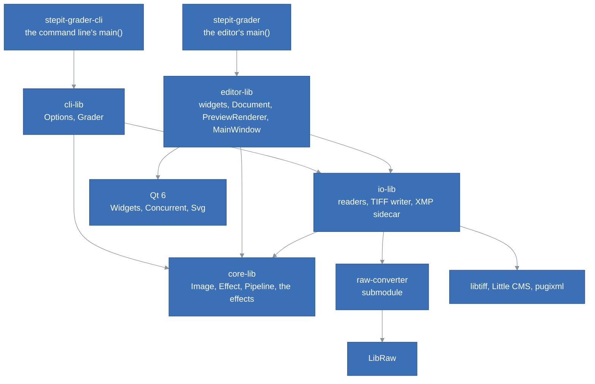
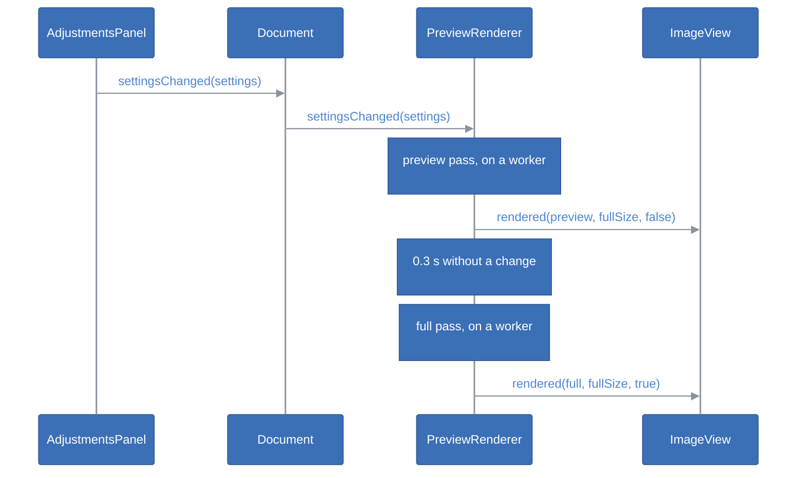

# StepIt Grader Architecture

## Table of Contents <!-- omit in toc -->

- [Introduction](#introduction)
- [The Big Picture](#the-big-picture)
- [The Libraries](#the-libraries)
- [The Engine](#the-engine)
  - [The Image and the Working Space](#the-image-and-the-working-space)
  - [Effects and the Pipeline](#effects-and-the-pipeline)
  - [The Effects](#the-effects)
  - [What the Effects Share](#what-the-effects-share)
  - [Threads and Memory](#threads-and-memory)
- [Reading and Saving](#reading-and-saving)
  - [The Readers](#the-readers)
  - [The XMP Sidecar](#the-xmp-sidecar)
- [The Command Line](#the-command-line)
- [The Editor](#the-editor)
  - [The Widgets](#the-widgets)
  - [The Document](#the-document)
  - [The Preview Renderer](#the-preview-renderer)
  - [The Main Window and main()](#the-main-window-and-main)
- [A Slider Moves](#a-slider-moves)
- [Threads](#threads)
- [Tests](#tests)
- [How to Extend StepIt Grader](#how-to-extend-stepit-grader)
- [Design Decisions and Trade-offs](#design-decisions-and-trade-offs)

## Introduction

This document explains how StepIt Grader is built, what each part is responsible for, and where to start when we want to change something. It assumes we have read the [README](../README.md), built the project and edited a picture once.

It follows one idea: **an edit is a set of named values, never pixels**. The sliders show the values, the sidecar stores them, and the engine turns them into pixels, the same way for any picture. That is what lets the command line grade a whole sequence of pictures with the sidecar of one, exactly as the editor shows it.

## The Big Picture

The code is five static libraries and two programs, the editor and the command line, which share the engine and the files. Each library depends only on those below it, and only the editor's knows Qt.

| Program | What it is |
|---|---|
| `stepit-grader` | The editor, [`src/editor-app/src/main.cpp`](../src/editor-app/src/main.cpp): builds the parts and opens the window. |
| `stepit-grader-cli` | The command line, [`src/cli-app/src/main.cpp`](../src/cli-app/src/main.cpp): grades pictures with saved settings, without a window. |
| `stepit-grader-tests` | Every test, of every library, in one program: [`src/tests`](../src/tests). |

## The Libraries

| Library | Owns | Links | Must never |
|---|---|---|---|
| [`core-lib`](../src/core-lib) | The image in the working space, the `Effect` interface, the `Pipeline`, the fifteen effects, the area sampling, the filters, the colour maths, the threads, the conversion for the screen. | Threads only. | Include Qt, read or write a file, know which effects exist outside `StandardPipeline.cpp`. |
| [`io-lib`](../src/io-lib) | Reading images into the working space, writing them as TIFFs out of it, and the settings in XMP sidecars. | `core-lib`; privately raw-converter, libtiff, Little CMS, pugixml. | Include Qt, change pixels beyond bringing them into the working space, expose a third-party type in a header. |
| [`editor-lib`](../src/editor-lib) | The widgets, the document, the background rendering, the main window and its icons. | `core-lib`, `io-lib`, Qt Widgets, Concurrent and Svg. | Change pixels itself: it asks the engine. Create its own reader, store or pipeline: it is given them. |
| [`editor-app`](../src/editor-app) | `main()`. | `editor-lib`. | Hold any logic beyond choosing the parts. |
| [`cli-lib`](../src/cli-lib) | The command line's options and the grading of many pictures. | `core-lib`, `io-lib`. | Include Qt, print: it reports results, `main()` prints them. |
| [`cli-app`](../src/cli-app) | `main()`. | `cli-lib`. | Hold any logic beyond choosing the parts and printing. |

`core-lib` is about 2,500 lines, `io-lib` 1,150, `editor-lib` 2,000, `cli-lib` 300 and the tests 1,750.

## The Engine

### The Image and the Working Space

[`core::Image`](../src/core-lib/include/core/Image.h) is RGB, 32-bit float per sample, interleaved, in **linear Rec. 2020 with a D65 white**: the working space. 1.0 is the white the input could record; values above it and below 0 are kept until the screen or an output clips them. `core::Plane` is one channel of floats, e.g. a luminance.

Linear, so that the exposure is a multiplication and blurs mix light as light mixes. Rec. 2020, as raw-converter develops into it, so a raw file needs no conversion, and wide enough for every colour a camera records. Float, so no tool clips or bands what the next one needs.

A new image's or plane's values are undefined until written, see [Threads and Memory](#threads-and-memory).

### Effects and the Pipeline

An [`Effect`](../src/core-lib/include/core/Effect.h) is one adjustment. It owns its parameters and how it changes the image, and nothing else:

| Member | What it does |
|---|---|
| `section()` | The section of the tools panel it belongs to, e.g. `"Tone"`. |
| `parameters()` | Its [`Parameter`](../src/core-lib/include/core/Parameter.h)s: id, label, range, default, decimals. |
| `isIdentity(settings)` | Whether it would change nothing; by default, when every parameter is at its default. |
| `apply(image, settings, context)` | Changes the image in place. Safe to call from several threads at once. |

[`Settings`](../src/core-lib/include/core/Settings.h) maps parameter ids to values. A parameter without a value has its default: an empty `Settings` changes nothing, and a parameter added later reads as its default from an old sidecar.

The `RenderContext` carries `scale`, the size of the image rendered against the full picture, e.g. 0.33 for the preview. An effect that works at a size measured in pixels of the full picture, e.g. the 1-pixel radius of the sharpening, multiplies it by `scale`, so the preview looks as the full picture does. An effect that works at a fraction of the picture, e.g. the structure's hundredth of the diagonal, measures it on the image it is given.

The [`Pipeline`](../src/core-lib/include/core/Pipeline.h) holds the effects in order and knows only the interface. `render()` copies the image, skips the effects at their defaults, and asks a `cancelled` callback before each effect, so a render whose settings are already old stops early. Which effects exist and their order is decided in one place, [`makeStandardPipeline()`](../src/core-lib/src/StandardPipeline.cpp).

### The Effects

One header in [`include/core/effects`](../src/core-lib/include/core/effects) and one source in [`src/effects`](../src/core-lib/src/effects) each, in the order the pipeline applies them. The parameter id is the name Lightroom gives the setting.

| Effect | Parameter ids | How it works |
|---|---|---|
| `WhiteBalanceEffect` | `IncrementalTemperature`, `IncrementalTint` | A Bradford adaptation from a white shifted from D65, along the black-body locus by up to 100 mired for the temperature, and across it in CIE 1960 *uv* for the tint. 0 and 0 is exactly D65, so it changes nothing. `neutralFor()` inverts the model: the temperature, by bisection on *u*, which depends on it alone, then the tint from *v*, both in whole steps, clamped to the sliders' range. |
| `LuminanceNoiseEffect` | `LuminanceSmoothing`, `LuminanceNoiseReductionDetail` | The guided filter, self-guided, on the square root of the luminance, where a sensor's noise, growing with the square root of the light, is about the same in the shadows and the highlights: one threshold cleans both. The threshold grows to 0.03 at 100, the radius from 1 to 4 pixels of the full image; the detail puts back up to 40% of what was smoothed. Each pixel is scaled to its cleaned luminance, so the colours stay. Identity at amount 0, whatever the detail. |
| `ColorNoiseEffect` | `ColorNoiseReduction` | Oklab's a and b smoothed by the guided filter guided by Oklab's L, over up to 16 pixels of the full image: the colour follows the edges of the luminance, where it changes by more than about 0.02, and does not bleed across them. L is untouched, so the luminance and its detail are. Blended in up to an amount of 25, so the first steps are gentle. |
| `DefringeEffect` | `DefringePurpleAmount`, `DefringePurpleHueLo`, `DefringePurpleHueHi` | Takes the Oklab chroma away from a pixel whose hue is in the range, 0 to 100 mapped to 240 to 360 degrees, from blue to magenta, and which lies near a strong edge: the luminance changing by 0.5 to 1.5 stops across a band beside it, 1 to 7 pixels of the full picture as the amount grows. The change across the band, not per pixel, so the preview finds the same fringes. Identity at amount 0, whatever the hues. |
| `ExposureEffect` | `Exposure2012` | Every value times 2^exposure. |
| `ContrastEffect` | `Contrast2012` | On the log luminance, in stops from middle grey: `L + c × 3 tanh(L / 3)`. The most in the mid-tones, levelling off beyond 3 stops, so blacks and whites are not thrown away. |
| `HighlightsEffect` | `Highlights2012` | Up to 1.5 stops on the areas from grey to 3 stops above, judged on the area luminance. |
| `ShadowsEffect` | `Shadows2012` | Up to 2 stops on the areas from grey to 4 stops below, judged the same way. |
| `BlacksEffect` | `Blacks2012` | Below 0, `Y² / (Y + b)`: a smooth toe to black. Above 0, a neutral lift that fades out by middle grey. |
| `DetailEffect` | `Texture` | The band between two Gaussian blurs of the log luminance, σ 1 and 4 pixels of the full picture, boosted or smoothed. Below about 0.05 stops, taken for noise and left alone. |
| `StructureEffect` | `Clarity2012` | The log luminance against its guided filter over a hundredth of the diagonal, boosted or reduced. The guided filter keeps strong edges out of the smoothing, so they draw no halo. |
| `VibranceEffect` | `Vibrance` | The Oklab chroma scaled, less and less up to a chroma of 0.25. |
| `SaturationEffect` | `Saturation` | The Oklab chroma scaled: `-100` is grey. |
| `ToneCompressionEffect` | `HDRToneCompression`, `HDRCompressionPoint`, `HDRLocalContrast` | An exponential shoulder above a knee, from middle grey to 0.9, with a slope of 1 at the knee, that brings up to 4 stops above white to white. On each pixel's brightest channel, so the hues stay and no channel clips. With local contrast, the curve compresses the brightness of the area, a guided filter over a hundredth of the diagonal, and the pixel's difference from it is kept. Identity at amount 0, whatever the other two. The editor's own ids: Lightroom has no such setting. |
| `SharpnessEffect` | `Sharpness` | An unsharp mask of 1 pixel of the full picture on the log luminance, with a noise threshold. |

Every effect but the white balance, the colour noise, the defringe and the colour ones changes the luminance only: it computes a change in stops per pixel and multiplies the pixel's three values by it, so the colours stay. The constants that set how strong each one is, e.g. `STRENGTH`, are at the top of its source, named and explained.

### What the Effects Share

| File | What it holds |
|---|---|
| [`Luminance.h`](../src/core-lib/include/core/Luminance.h) | `logLuminance()`, in stops from middle grey; `applyStops()`; `areaLuminance()`, what the highlights and the shadows both call bright and dark, so they agree; `smoothstep()`. |
| [`Filters.h`](../src/core-lib/include/core/Filters.h) | `boxBlur()`, linear in the size whatever the radius; `gaussianBlur()`, three box blurs; `guidedFilter()` (He et al., 2010), self-guided or guided by another plane, e.g. the colour guided by the luminance. |
| [`Color.h`](../src/core-lib/include/core/Color.h) | The matrices of Rec. 2020, sRGB and Bradford, the black-body locus (Kim et al., 2002), CIE 1960 *uv*, and Oklab (Ottosson, 2020), whose matrix is scaled so the working white is exactly neutral. |
| [`Sampling.h`](../src/core-lib/include/core/Sampling.h) | `meanColour()`: the mean of the pixels within a radius, leaving out those with a channel at 0.98 or above, clipped, and counting them. |
| [`Geometry.h`](../src/core-lib/include/core/Geometry.h) | `downscale()` by a whole factor, averaging blocks; `orient()` from the TIFF/EXIF orientation. |
| [`Display.h`](../src/core-lib/include/core/Display.h) | `toSrgb8()`: to sRGB, clipped, through a table of the sRGB curve. For the screen only. |

### Threads and Memory

[`parallelFor()`](../src/core-lib/include/core/Parallel.h) splits a range over a pool of threads started once, one per core. Any thread may submit work, and waits by running what is queued, so the preview and the full render share the pool. A chunk's completion is counted and signalled under its group's lock: the submitter's group lives on its stack, and must outlive the last signal.

Two choices keep the effects from waiting on memory rather than computing:

- **`Samples` leaves new values uninitialised.** Filling a plane of 84 MB with zeros took longer than the box blur that writes it.
- **`main()` keeps glibc from returning large blocks to the kernel**, with `mallopt`. Otherwise every plane freed comes back zeroed, page by page: half the time of a preview.

On the 21 megapixels of a Canon 5D Mark II, on a 10-core i9, with every effect but the HDR compression on: about 130 ms for the preview, 1,872 × 1,248, and 1.4 seconds for the full picture; the HDR compression adds about 0.3 seconds to the full picture. The guided filter's effects, the highlights, the shadows and the structure, and the detail's two blurs take most of it.

## Reading and Saving

### The Readers

An [`ImageReader`](../src/io-lib/include/imageio/ImageReader.h) reads one kind of file into the working space, turned upright. It says which extensions it reads, and throws `imageio::Error` with the file's name and the reason when it cannot.

| Reader | What it reads | How |
|---|---|---|
| [`TiffReader`](../src/io-lib/src/TiffReader.cpp) | `.tif`, `.tiff`: RGB or grey, 8 or 16 bits, 32-bit float, contiguous or planar. | libtiff, then Little CMS from the file's ICC profile to linear Rec. 2020, several rows at a time. Without a profile: sRGB, or linear Rec. 2020 in float. |
| [`RawReader`](../src/io-lib/src/RawReader.cpp) | `.dng` and the camera raw formats LibRaw reads. | raw-converter's `readRawFile()` and `renderImage()` into Rec. 2020: demosaiced, white balanced as shot, nothing else. |
| [`ImageLoader`](../src/io-lib/include/imageio/ImageLoader.h) | What its readers read. | The first reader that reads the file. `makeStandardImageReader()` gives the TIFF and the raw readers. |

### The TIFF Writer

[`TiffWriter`](../src/io-lib/include/imageio/TiffWriter.h) writes an image of the working space as a 16-bit RGB TIFF in a [`ColourSpace`](../src/io-lib/include/imageio/ColourSpace.h): sRGB, Adobe RGB (1998), ProPhoto RGB or linear Rec. 2020. Little CMS converts it, several rows at a time, clipping what is outside the space or above white, and the space's ICC profile is embedded, so every program that reads the file knows its colours. Deflate with a horizontal predictor when asked. The file is written under a hidden temporary name, `.<name>.part`, then renamed over the old one, so a failure never leaves half a file nor harms the one it would replace.

The profiles, of the working space and of the four colour spaces, are made in one place, [`ColourProfiles.cpp`](../src/io-lib/src/ColourProfiles.cpp), private to `io-lib`, for the reader and the writer alike. Adobe RGB and ProPhoto RGB are made from their published primaries, white and gamma, and named "compatible": the names are Adobe's and Kodak's.

### The XMP Sidecar

A [`SettingsStore`](../src/io-lib/include/imageio/SettingsStore.h) says where the settings of an image are, loads them and saves them. [`XmpSidecar`](../src/io-lib/src/XmpSidecar.cpp) is the one there is, built on pugixml:

- **Where**: the image's name with `.xmp`, as Lightroom names the sidecar of a raw file.
- **Reading**: every `rdf:Description` that binds the Camera Raw namespace, whatever its prefix, and each parameter as an attribute or an element named by its id.
- **Writing**: the existing file is read, the values of the parameters replaced, `crs:ProcessVersion="11.0"` added when missing, so Lightroom reads the tone controls with their 2012 meaning, and everything else kept. Values are formatted as Lightroom writes them: `+0.50`, `-12`, `0`. The file is written to `<name>.xmp.tmp` and renamed over the sidecar, so a failure never leaves half a file.

The parsing and the writing are free functions, `xmp::parse()` and `xmp::write()`, on strings, so the tests need no file. `XmpSidecar::loadFile()` reads the settings of an XMP file of any name, e.g. one saved for a picture and applied to others.

## The Command Line

`stepit-grader-cli` grades pictures with saved settings, without a window. It is a console program on every system, linking `cli-lib`, `io-lib` and `core-lib`, without Qt, so it prints, even on Windows, and runs where there is no screen.

- [`parseOptions()`](../src/cli-lib/include/cli/Options.h) turns the arguments into `Options`, or a message for what is wrong with them; `usage()` is the help.
- [`Grader`](../src/cli-lib/include/cli/Grader.h) grades the pictures, one after the other, each at full size with `RenderContext{1.0}`: the effects already use every core. It is given its `ImageReader`, its `SettingsStore` and its `Pipeline`, so the tests give it fakes. For each picture it returns a `GradeResult`, and reports it as it goes through a callback: graded, or why not. It refuses to write over the picture itself, over a TIFF already there without `--overwrite`, or over a TIFF written earlier in the same run.
- [`main()`](../src/cli-app/src/main.cpp) reads `--settings` once, before any picture, so settings that cannot be read stop the run with status 2; makes the standard pipeline, reader and sidecar store; prints each result; and exits with 0 when every picture is graded and 1 when some are not.

The editor and the command line make the same picture of the same settings: one pipeline, one reader, one sidecar, and the full size in both.

## The Editor

## The Editor

### The Widgets

Each widget is reusable: it is given what it shows, knows nothing of who uses it, and reports what the user did with signals.

| Widget | What it does | Signals |
|---|---|---|
| [`ImageView`](../src/editor-lib/include/editor/widgets/ImageView.h) | Shows a `QImage`, centred, fitted or zoomed to 800%, dragged with the mouse, zoomed by the wheel around the cursor. It paints only the visible part, and reduces the image once per zoom with area averaging. The image may stand for a larger one: `setImage(preview, fullSize)` keeps the zoom relative to the full size, so the full picture replacing the preview does not move the view. In pick mode, `setPickMode(true)`, a click reports a point instead of dragging, with a circle of `PICK_RADIUS`, 5 screen pixels, under the cursor; `Esc` leaves it. It does not know what the point is for. | `zoomChanged`, `fileDropped`, `pointPicked`, in pixels of the full image with the radius in the same pixels, `pickCancelled` |
| [`ParameterSlider`](../src/editor-lib/include/editor/widgets/ParameterSlider.h) | A name, a slider and a box for one value; a double click puts the default back. | `valueChanged`, only for the user's changes, never for `setValue()`. |
| [`CollapsibleSection`](../src/editor-lib/include/editor/widgets/CollapsibleSection.h) | A bold title with an arrow above widgets that fold away when it is clicked; `addHeaderWidget()` puts a widget, e.g. a tool's button, on the right of the title. | `expandedChanged`, only for the user's clicks, never for `setExpanded()`. |
| [`RecentFilesMenu`](../src/editor-lib/include/editor/widgets/RecentFilesMenu.h) | The files opened last, the latest first, numbered `&1` to `&9` with their full path as a tooltip, then Clear; disabled while empty. It keeps the list but does not store it: `setFiles()` gives it, `filesChanged` reports it. Lentigram's menu stores its own list; this one is given it, so it needs no settings file in its tests. | `fileSelected`, with the full path; `filesChanged`, for `addFile()`, `removeFile()` and `clearFiles()`, never for `setFiles()`. |
| [`AdjustmentsPanel`](../src/editor-lib/include/editor/widgets/AdjustmentsPanel.h) | One `CollapsibleSection` per section it is given, with a `ParameterSlider` per parameter, in a scroll area. It knows parameters, not effects, and opens and closes sections when asked, without remembering them. `setControlsEnabled()` enables or disables the sliders only: disabling the whole panel would disable its titles and its scroll bar too. | `settingsChanged`, with every value; `sectionExpandedChanged`, with the section's title. |

[`pickWhiteBalance()`](../src/editor-lib/include/editor/WhiteBalancePicker.h) turns a point picked into settings: it samples the document's image, the picture before any edit, which is what the white balance, first in the pipeline, sees; asks `WhiteBalanceEffect::neutralFor()`; and returns the settings with the two values changed, or a message for the user when the area is clipped, black or outside the picture. A function, so the tests need no window. [`themedIcon()`](../src/editor-lib/include/editor/Icons.h) gives an icon of Lentigram's, e.g. `zoom-in`, from [`resources/icons`](../src/editor-lib/resources/icons), built into the library as a Qt resource: as in Lentigram, each has a drawing for a light theme, dark grey, and one for a dark theme, light grey, chosen by the lightness of the window's colour. Two drawings, not one painted in the theme's colour, as some icons have two tones, e.g. the before and after's two halves. Qt's SVG module draws them, not an icon plugin, which would have to be shipped beside the program on Windows and macOS. The SVGs are Lentigram's, without Inkscape's data.

[`applyTheme()`](../src/editor-lib/include/editor/Theme.h) gives the application a `Theme`: **System**, the desktop's style as the application started with it; **Light**, Qt's Fusion; or **Dark**, Fusion with Lentigram's dark palette, and disabled icons grey rather than darkened out of sight, as in Lentigram's `DarkStyle`. Fusion draws the same on every system, so the dark colours do too. The style is a `QProxyStyle` around Fusion, which gives its `standardPalette()`. An icon keeps the drawing of the theme it was made in, so the main window remembers each action's icon name and makes the icons again after a change.

`sectionsOf()`, in [`Sections.h`](../src/editor-lib/include/editor/Sections.h), groups the parameters of a pipeline by section, so the panel needs no pipeline.

### The Document

[`Document`](../src/editor-lib/include/editor/Document.h) is the picture being edited: its path, its pixels, and three sets of settings: those it was opened with, those its sidecar holds, and the current ones. It is given its `ImageReader`, its `SettingsStore`, the parameters and the delay before it saves, 1 second by default, so the tests give it fakes and 200 ms.

- `open()` first saves what waits to be saved, then reads the image and its sidecar on a worker thread, and ends with `opened()` then `settingsChanged()`, or `openFailed()` with the reader's message. The sliders stay live while it reads, so `finishOpening()` saves once more before it takes the new picture: a change made meanwhile belongs to the old one.
- `setSettings()`, `resetSettings()` and `revertSettings()` emit `settingsChanged()` only when a value changes, and `modifiedChanged()` when the settings start or stop differing from what the sidecar holds, or from the defaults without a sidecar. `revertSettings()` goes back to the settings the picture was opened with.
- Each change that leaves the settings different from the sidecar restarts a single-shot `QTimer`; when it fires, `save()` runs. A slider dragged restarts it at every step, so the file is written once, a second after it stops. A change back to what the sidecar holds stops the timer: nothing is written, and a picture opened and closed without a change gets no sidecar.
- `save()` writes through the store, if the settings differ from the sidecar, and emits `saved()` or `saveFailed()`. It returns false only when the store failed. After a failure the settings stay modified and the timer is not restarted: the next change tries again, rather than a loop writing to a full disk every second.

### The Preview Renderer

[`PreviewRenderer`](../src/editor-lib/include/editor/PreviewRenderer.h) renders the settings off the user interface's thread, in two passes, each ending with `rendered(image, fullSize, full)`:

1. **The preview**, at once: the picture reduced to at most 2,048 pixels on its longer side, made once per picture. While one runs, newer settings wait, and only the latest is rendered next.
2. **The full picture**, once the settings have not changed for 0.3 seconds.

The last two pictures rendered in full are kept, with their settings. Settings rendered already are shown in full at once, without a pass: switching between the picture before its edit, rendered with no settings, and after takes no time once both are made. A new picture empties them.

A counter, shared with the passes, goes up with every change. A full pass compares it before each effect and stops when it is stale, and a pass's result is shown only if it is still the latest. Every full pass, stale or not, is waited for when the renderer is destroyed.

### The Main Window and main()

[`MainWindow`](../src/editor-lib/src/MainWindow.cpp) holds the `ImageView` in the middle, the `AdjustmentsPanel` in a dock on the right, and, as Lentigram, a fixed toolbar above with the actions used most: open, save, before and after, the eyedropper and the zoom, and a Settings menu with the theme, kept in `QSettings` under `theme` and applied by `main()` before the window is made, every section folded at the start and the sliders disabled until a picture is open, the menus and the status bar, and connects the parts, which know nothing of each other:

| From | Signal | To |
|---|---|---|
| `AdjustmentsPanel` | `settingsChanged` | `Document::setSettings` |
| `Document` | `settingsChanged` | `AdjustmentsPanel::setSettings`, `PreviewRenderer::render` |
| `Document` | `opened` | `PreviewRenderer::setSource`, the panel enabled |
| `Document` | `modifiedChanged` | the window's `*`: settings not written yet, waiting or after a failure |
| `Document` | `saved` | the status bar, for 3 seconds |
| `Document` | `saveFailed` | the status bar, for 15 seconds, without a dialog |
| **File > Save Settings**, `Ctrl+S` | `triggered` | `Document::save`, at once |
| **Edit > Revert to Opened** | `triggered` | `Document::revertSettings` |
| `PreviewRenderer` | `rendered` | `ImageView::setImage` |
| `ImageView` | `fileDropped` | `MainWindow::openFile` |
| `RecentFilesMenu`, **File > Open Recent** | `fileSelected` | `MainWindow::openFile`, which removes a file that no longer exists |
| `RecentFilesMenu` | `filesChanged` | `QSettings`, under `recentPictures`, given back with `setFiles()` when the window opens |
| `Document` | `opened` | `RecentFilesMenu::addFile`: only a picture that opened is listed |
| **Pick White Balance**, `W`, and its button in the White Balance title | `toggled` | `ImageView::setPickMode` |
| `ImageView` | `pointPicked` | `pickWhiteBalance()`, then `Document::setSettings`; the action unchecked: one pick, then back to dragging |
| `ImageView` | `pickCancelled` | the action unchecked |
| **Before and After**, `\\`, and its button in the toolbar | `toggled` | `PreviewRenderer::render`, with no settings for before and the document's for after; **Before** in the status bar |
| `Document` | `settingsChanged`, while before | the action unchecked, without a signal: a change is seen on the edit |

Before another picture is opened, or the window closed, `settingsSaved()` calls `Document::save()` so nothing waits. It asks only when that save fails, whether to go on without the edit: there, and only there, the edit would be lost.

[`main()`](../src/editor-app/src/main.cpp) is the composition root: it makes the standard pipeline, the standard reader, the XMP sidecar, the document, the renderer and the window, and gives each its parts.

## A Slider Moves

A slider dragged sends a change for every step: each starts a preview if none is running, or replaces the one waiting. The full pass starts only once the slider stops.

## Threads

| What | Where it runs | How its result comes back |
|---|---|---|
| The window, the widgets, the document's state | The main thread. | |
| Reading a picture and its sidecar | `QtConcurrent::run`, from `Document::open()`. | `QFutureWatcher::finished`, on the main thread. |
| A preview or a full pass | `QtConcurrent::run`, from `PreviewRenderer`. | `QMetaObject::invokeMethod` on the main thread, guarded by a `QPointer` to the renderer. |
| Inside an effect, a reader or the screen conversion | `core::parallelFor`'s pool. | The caller waits for its chunks, helping with them. |
| Saving a sidecar | The main thread: a few kB. | |

## Tests

All the tests are in one program, [`src/tests`](../src/tests), with GoogleTest and Qt Test, as in Lentigram: it links every library, so it also catches what only shows once they are together. [`Main.cpp`](../src/tests/Main.cpp) makes one `QApplication`, offscreen. Run them with `ctest --test-dir build`, or `build/bin/stepit-grader-tests`.

| Folder | Test cases | What they cover |
|---|---|---|
| [`core`](../src/tests/core) | 37 | Every effect at its defaults changes nothing; the luminance noise smooths sensor grain to under 40% on both sides of an edge that stays as steep, its detail puts grain back, and a grey stays grey; the colour noise removes the blotches without changing the lightness, and keeps red and blue to their sides of an edge; the guided filter by another plane follows the guide's edges; parameter ids unique, defaults in range; each effect moves the picture the right way, e.g. the highlights change the bright side of a step and leave the dark one; the defringe greys a purple fringe beside an edge, keeps a purple patch away from edges and a green fringe, and finds the same fringe in a preview a third of the size; a warm and a cool grey turned neutral by the white balance found for them, a grey needing none, black giving none, a cast beyond the sliders clamped; the HDR curve untouched below its knee, smooth at it, rising to white, the highlights brought below white with their hue, and local contrast keeping the texture of bright areas; the area sampling's disc and clipped pixels; the box blur, the guided filter's edge without overshoot; Oklab round trip; D65 adapted to D65; middle grey as sRGB 118; downscale and orientation; a cancelled render. |
| [`io`](../src/tests/io) | 18 | A 16-bit linear Rec. 2020 TIFF read unchanged; an untagged 8-bit TIFF taken for sRGB; orientation; a broken file reported; readers chosen by extension; a Canon CR2 and a DNG, when the samples are there; the sidecar's formatting, a Lightroom sidecar read, elements with another prefix, an update that keeps everything else, a round trip on disk, a sidecar that is not XML; the TIFF writer in each of the four colour spaces read back through its embedded profile, white clipped, a file replaced whole without a temporary file left, a folder that does not exist; the colour spaces' names. |
| [`editor`](../src/tests/editor) | 32 | The slider emits the user's changes only, and resets on a double click; a section folds on a click on its title, and reports the user's clicks only; the panel's sections fold and report it, and still fold and scroll with the sliders disabled; the recent files menu keeps the latest first, without duplicates and up to its maximum, shows numbered names with the paths as tooltips, reports the file chosen with its path, removes and clears; every icon is built in, with a drawing for each theme; the dark theme is Fusion with Lentigram's grey, greys disabled icons, and System gives the desktop's style back; the themes' names; the renderer shows settings rendered already at once, from the pictures it keeps, and forgets them for a new picture; the view in pick mode reports the click in pixels of the full image and leaves pick mode with `Esc`; the picker sets the white balance of a warm card and keeps the other values, and explains a clipped or black area; the sections follow the pipeline; the panel emits every value; the view fits, zooms, and keeps the zoom when the full picture replaces the preview; the document, with a fake reader and store, opens with the saved settings, reports what it cannot read, tracks the changes not written yet; saves a change after the delay and not before, many quick changes once, nothing without a change, at once on request and before another picture opens; reverts to the settings it was opened with and saves that; reports a failed save and tries again at the next change; the renderer sends a preview then the full picture, and only one full pass for many quick changes. |
| [`cli`](../src/tests/cli) | 7 | Every option read, the defaults, what is wrong reported with a message, `--` before a name with a dash; the grader, with a fake reader and store, applies the settings given to every picture, or each picture's own sidecar, or none; never writes over the picture, nor over a TIFF without `--overwrite`; reports a picture that fails and grades the others, and refuses a second picture of the same name. |

The 97 tests take about 10 seconds, most of it reading the two raw samples and waiting for the document's saves, which [`fetch-samples.sh`](https://github.com/kineticsystem/raw-converter/blob/main/bin/fetch-samples.sh) of raw-converter downloads; without them, those two are skipped.

What has no automated test, and how to check it by hand:

| Part | How to check it |
|---|---|
| The look of the effects | Open a raw file, move each slider to both ends, and look for halos along strong edges, banding in skies, and colour shifts in greys. |
| The menus and the dialogs | Open, change, wait a second: the sidecar is there and the `*` gone; change and close at once: the sidecar has the change; make the folder read-only and change: the status bar says it cannot save and the `*` stays, and closing asks whether to leave the edit unsaved; drop a JPEG: it says it cannot open it. |
| Lightroom reading the sidecar | Save the settings of a CR2, then in Lightroom Classic, **Metadata > Read Metadata from File**. |

## How to Extend StepIt Grader

| To... | Change... |
|---|---|
| Add an effect, e.g. Whites | A header in `include/core/effects` and a source in `src/effects`, with its `Parameter`, ideally under Lightroom's name, and its `section()`: a new section appears in the panel, folding like the others; one line in `makeStandardPipeline()`; the source in `core-lib`'s `CMakeLists.txt`; a test in `EffectsTest.cpp` that it changes nothing at its defaults and moves the right way. The panel, the sidecar and the renderer need nothing. |
| Change how strong an effect is | The constants at the top of its source. |
| Read another kind of file, e.g. JPEG | A class implementing `ImageReader`, added in `makeStandardImageReader()`. |
| Keep the settings elsewhere, e.g. inside a DNG | A class implementing `SettingsStore`, given to the `Document` in `main()`. |
| Write another format, e.g. PNG | A writer beside `TiffWriter` in `io-lib`, and an option in `parseOptions()` to choose it. |
| Add an output colour space, e.g. Display P3 | A value of `ColourSpace`, its name in `ColourProfiles.cpp`, and its profile in `profiles::of()`. |
| Change the preview's size or delay | The arguments of `PreviewRenderer` in `main()`. |
| Change the delay before a save | The `saveDelay` argument of `Document` in `main()`. |

## Design Decisions and Trade-offs

**A pipeline of small effects behind one interface.** Each effect is one file that knows nothing of the others, the panel, the renderer or the sidecar, and the pipeline knows only the interface: adding one is a new file and one line. The price: each effect computes its own luminance, about 2 ms of a preview each, rather than sharing one.

**The HDR compression on the brightest channel.** A curve on the luminance would let a bright, saturated colour keep a channel above white, which then clips to another hue. On the brightest channel, every channel ends at or below white with its ratios intact. The price: saturated highlights are compressed more than grey ones of the same luminance.

**Lightroom's names as the parameter ids.** The sidecar needs no table from our names to Lightroom's, and an old sidecar reads the same as long as the ids stay. The price: an id cannot be renamed without breaking old sidecars, and a tool Lightroom does not have still goes in Lightroom's namespace.

**Lightroom's file, not Lightroom's look.** The sidecar is the same format, with the same names and ranges, so the two read each other's values. Adobe's processing is not published: the same values give a similar picture, not the same one.

**The white balance picked on the picture before any edit.** The white balance is the first effect, so the colour it must neutralise is the one in the document's image, and the exposure, the contrast or the HDR compression picked after cannot skew it. The price: a pick on an area the defringe would grey is measured with its fringe. The area is a disc of 5 screen pixels, so it is about the same on the screen at any zoom, and wider in the picture when zoomed out.

**Relative temperature and tint, for every file.** A raw file is developed with the white balance the camera recorded, then adjusted as a TIFF would be. One meaning for every picture, which a batch needs. The price: Lightroom ignores them for a raw file, where it uses an absolute temperature.

**Changes in stops, on the luminance.** The tone and detail effects change each pixel's three values by the same factor, so the colours stay as they are, and a change is the same for a dark and a bright part. The price: a very saturated colour can go out of gamut as it brightens, which only the screen clips.

**An edge-preserving filter for the local effects.** The guided filter keeps strong edges out of the smoothing the highlights, the shadows and the structure work on, so they draw no halo, and it runs in time linear in the picture whatever the radius. The price: near an edge, within its radius, an area is judged a little by the other side.

**A preview, then the full picture.** A 21-megapixel picture takes about a second with every effect on: too slow to follow a slider. The preview follows it, the full picture follows it once it stops. The price: an effect that works at the scale of a pixel, the sharpening and part of the detail, shows only in the full pass.

**Our own thread pool.** An effect calls `parallelFor` about ten times, and two renders can run at once. The price: about 150 lines that must stay correct, which the sanitizers check.

**Lentigram's libraries.** libtiff, pugixml and GoogleTest are already built for the three systems in Lentigram's `lib/`. The price: a dependency on a folder next to the repository, with the system's packages as the fallback, and Lentigram's libtiff needs Lentigram's libjpeg-turbo on the run path.

**LibRaw and Little CMS built by a script.** raw-converter finds them with pkg-config. `install-deps.sh` builds them into `deps/` where no package can be installed, e.g. without administrator rights. LibRaw is built without OpenMP, which Apple's compiler lacks: a raw file takes about 2.5 seconds to develop.

**A command line of its own, not the editor's window with options.** A program with a window is a GUI program on Windows: it cannot print to the console it was started from. A console program without Qt also runs on a server or in a container without a screen. The price: two programs to build and ship, sharing everything but `main()`.

**sRGB by default, wide gamut on request.** sRGB is what every viewer assumes, so a TIFF in it looks right everywhere. Prints reach colours sRGB clips: Adobe RGB and ProPhoto RGB keep them, and their profile says so to any program that reads the file. The price: a ProPhoto TIFF looks dull in a program that ignores the profile.

**Saved by itself, a second after the last change.** An edit is a few values, and the sidecar a few kB: writing it costs nothing, while an edit lost to a forgotten save, or to a "Save the settings?" answered wrong, costs the work. So the document saves without asking, and a picture always reopens as it was left. The delay lets a slider dragged write once, when it stops, not at each of its steps. The window's `*` keeps its usual meaning, "not written yet", which with auto-save is the second after a change, and after a failure, the one sign that stays once the status bar's message is gone. The price: there is no "close without saving"; trying a change is keeping it, and **Edit > Revert to Opened** is the way back to the picture as it was opened. An edit made in another program on the same sidecar while the picture is open is overwritten at the next change.

**No undo yet.** Revert and Reset cover the common cases: the settings are values, and an undo would be a list of `Settings`, in the `Document`.
