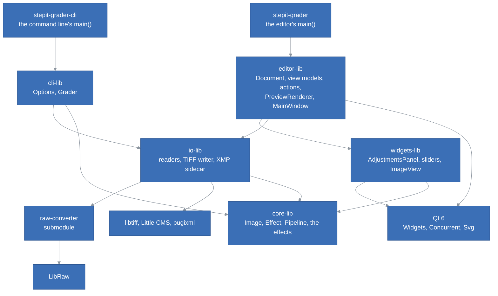
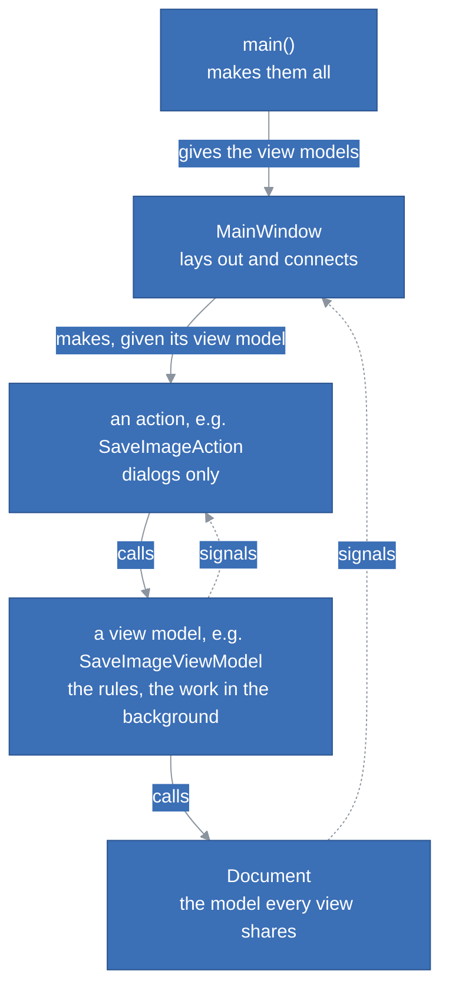
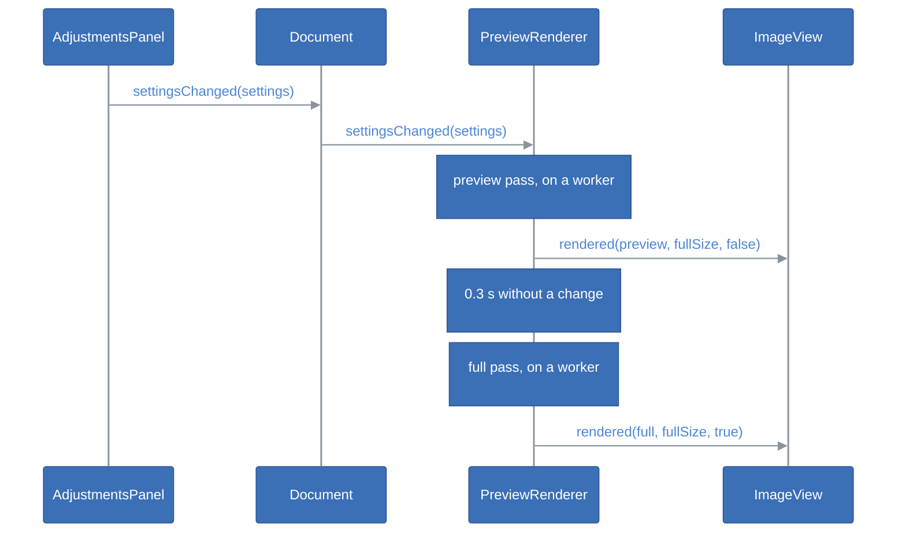

# StepIt Grader Architecture

## Table of Contents <!-- omit in toc -->

- [Introduction](#introduction)
- [The Big Picture](#the-big-picture)
- [The Libraries](#the-libraries)
- [The Engine](#the-engine)
  - [The Image and the Working Space](#the-image-and-the-working-space)
  - [Effects and the Pipeline](#effects-and-the-pipeline)
  - [The Effects](#the-effects)
  - [What the Effects Share](#what-the-effects-share)
  - [Threads and Memory](#threads-and-memory)
  - [Matching a Camera's Look](#matching-a-cameras-look)
- [Reading and Saving](#reading-and-saving)
  - [The Readers](#the-readers)
  - [The TIFF Writer](#the-tiff-writer)
  - [Replacing a File](#replacing-a-file)
  - [The XMP Sidecar](#the-xmp-sidecar)
- [The Command Line](#the-command-line)
- [The Editor](#the-editor)
  - [The Widgets](#the-widgets)
  - [The Document](#the-document)
  - [The Preview Renderer](#the-preview-renderer)
  - [Models, View Models and Views](#models-view-models-and-views)
  - [The Main Window and main()](#the-main-window-and-main)
- [The Engine in Another Program](#the-engine-in-another-program)
- [A Slider Moves](#a-slider-moves)
- [Threads](#threads)
- [The Packages and the CI](#the-packages-and-the-ci)
- [Tests](#tests)
- [How to Extend StepIt Grader](#how-to-extend-stepit-grader)
- [Design Decisions and Trade-offs](#design-decisions-and-trade-offs)

## Introduction

This document explains how StepIt Grader is built, what each part does, and where to start when you want to change something. It assumes you have read the [README](../README.md), built the project and edited a picture. [Review.md](Review.md) judges how well it is built and lists its known weaknesses.

The design follows one idea: **an edit is a set of named values, never pixels**. The sliders show the values. The sidecar stores them. The engine turns them into pixels, the same way for every picture. This is why the command-line tool can grade a whole series of pictures with one sidecar and get exactly what the editor shows.

## The Big Picture

The code has six static libraries and two programs: the editor and the command-line tool. Both programs share the engine and the file handling. Each library depends only on the libraries below it. Only the widgets library and the editor library use Qt.



| Program | What it is |
|---|---|
| `stepit-grader` | The editor, [`src/editor-app/src/main.cpp`](../src/editor-app/src/main.cpp). It builds the parts and opens the window. |
| `stepit-grader-cli` | The command-line tool, [`src/cli-app/src/main.cpp`](../src/cli-app/src/main.cpp). It grades pictures with saved settings, without a window. |
| `stepit-grader-tests` | All the tests of all the libraries, in one program: [`src/tests`](../src/tests). |

## The Libraries

| Library | Owns | Links | Must never |
|---|---|---|---|
| [`core-lib`](../src/core-lib) | The image in the working space, the `Effect` interface, the `Pipeline` and the seventeen effects. Also the area sampling, the filters, the colour maths, the threads, the conversion for the screen, and `core::match`, the search that matches a camera's look. | Threads only. | Include Qt. Read or write a file. Know which effects exist, outside `StandardPipeline.cpp`. |
| [`io-lib`](../src/io-lib) | Reading images into the working space, writing TIFFs, and storing settings in XMP sidecars. | `core-lib`; privately raw-converter, libtiff, Little CMS and pugixml. | Include Qt. Change pixels beyond bringing them into the working space. Expose a third-party type in a header. |
| [`widgets-lib`](../src/widgets-lib) | The reusable widgets: the slider panel and its sections, the slider style, the image view, the curve and histogram views, and `SectionUtils::sectionsOf()`. | `core-lib`, Qt Widgets. | Know the editor, a file or a document. Each widget is given what it shows and reports with signals. |
| [`editor-lib`](../src/editor-lib) | The document, background rendering, the white balance picker, the view models and actions, saving the graded picture, the camera match and its window, the main window, the recent files menu, themes and icons. | `core-lib`, `widgets-lib`, `io-lib`, Qt Widgets, Concurrent and Svg. | Change pixels itself; it asks the engine. Create its own reader, store or pipeline; it is given them. Read or write a file, or render, on the main thread. Let a model or a view model call a view. |
| [`editor-app`](../src/editor-app) | `main()`. | `editor-lib`. | Hold any logic beyond choosing the parts. |
| [`cli-lib`](../src/cli-lib) | The command-line options and the grading of many pictures. | `core-lib`, `io-lib`. | Include Qt. Print: it returns results, and `main()` prints them. |
| [`cli-app`](../src/cli-app) | `main()`. | `cli-lib`. | Hold any logic beyond choosing the parts and printing. |

Sizes: `core-lib` is about 3,750 lines, `io-lib` 1,350, `widgets-lib` 1,650, `editor-lib` 3,700, `cli-lib` 300, and the tests 4,400.

`core-lib` is built with `-O2` even in a Debug build, except with MSVC. Without the optimiser its per-pixel loops are about ten times slower: too slow to follow a slider while you debug the rest of the program.

## The Engine

### The Image and the Working Space

[`core::Image`](../src/core-lib/include/core/Image.h) holds RGB pixels as interleaved 32-bit floats. Its colour space is **linear Rec. 2020 with a D65 white**, called the working space. 1.0 is the brightest white the input could record. Values above 1 and below 0 are kept until the screen or an output file clips them. `core::Plane` holds one channel of floats, such as a luminance.

Why this space:

- **Linear**, so exposure is a multiplication and blurs mix light the way light mixes.
- **Rec. 2020**, because raw-converter develops into it, so raw files need no conversion. It is also wide enough for every colour a camera records.
- **Float**, so no tool clips or bands what the next tool needs.

A new image or plane starts with undefined values until they are written; see [Threads and Memory](#threads-and-memory).

### Effects and the Pipeline

An [`Effect`](../src/core-lib/include/core/Effect.h) is one adjustment. It owns its parameters and the way it changes the image, nothing else:

| Member | What it does |
|---|---|
| `section()` | The section of the tools panel it belongs to, for example `"Light"`. |
| `parameters()` | Its [`Parameter`](../src/core-lib/include/core/Parameter.h)s: id, label, range, default and decimals. |
| `isIdentity(settings)` | Whether it would change nothing. By default, this is true when every parameter is at its default. |
| `isPointwise()` | Whether each pixel comes out from itself alone, so the effect gives the same pixels on any set of them. False by default; the white balance, exposure, contrast, blacks, tone curve, vibrance, saturation and colour mixer say true. The camera match uses it to render only the pixels it compares. |
| `apply(image, settings, context)` | Changes the image in place. It is safe to call from several threads at once. |

[`Settings`](../src/core-lib/include/core/Settings.h) maps parameter ids to values. A parameter without a value has its default. So an empty `Settings` changes nothing, and a parameter added later reads as its default from an old sidecar.

`RenderContext` carries `scale`: the size of the rendered image compared to the full picture, for example 0.33 for the preview. Some effects work at a size measured in pixels of the full picture, such as the 1-pixel radius of the sharpening. They multiply that size by `scale`, so the preview looks like the full picture. Other effects work at a fraction of the picture, such as the structure's hundredth of the diagonal. They measure it on the image they are given.

The [`Pipeline`](../src/core-lib/include/core/Pipeline.h) holds the effects in order and knows only the interface. `render()` copies the image and skips effects that are at their defaults. Before each effect it calls a `cancelled` callback, so a render whose settings are already out of date stops early. The list of effects and their order is defined in one place: [`makeStandardPipeline()`](../src/core-lib/src/StandardPipeline.cpp).

The tools panel shows the sections in its own order, given by [`standardSectionOrder()`](../src/core-lib/src/StandardPipeline.cpp): Color, Light, Tone Curve, Color Mixer, Detail, Noise Reduction, Chromatic Aberration, HDR. The white balance comes first because it is the first thing you set. This is mostly the order in which the effects run, with two exceptions:

- Noise reduction and chromatic aberration run before the light effects, but the panel shows them after, because they are set less often.
- Sharpening, in Detail, runs last, on the finished picture.

The white balance also runs first, so it neutralises the colours as shot, before the other effects change them.

### The Effects

Each effect has one header in [`include/core/effects`](../src/core-lib/include/core/effects) and one source in [`src/effects`](../src/core-lib/src/effects). The table lists them in the order the pipeline applies them. Each parameter id is the setting's name in the sidecar's XMP namespace, the same name other raw editors use.

| Effect | Parameter ids | How it works |
|---|---|---|
| `WhiteBalanceEffect` | `IncrementalTemperature`, `IncrementalTint` | A Bradford adaptation from a white shifted away from D65. The temperature moves it along the black-body locus, by up to 100 mired. The tint moves it across the locus, in CIE 1960 *uv*. At 0 and 0 the white is exactly D65, so nothing changes. `neutralFor()` inverts the model: it finds the temperature by bisection on *u*, which depends on the temperature alone, then the tint from *v*. Both are whole steps, clamped to the sliders' range. |
| `LuminanceNoiseEffect` | `LuminanceSmoothing`, `LuminanceNoiseReductionDetail` | A self-guided filter on the square root of the luminance. Sensor noise grows with the square root of the light, so on this scale it is about the same in shadows and highlights, and one threshold cleans both. At 100 the threshold is 0.03 and the radius 4 pixels of the full image (1 pixel at the lowest setting). The detail slider puts back up to 40% of what was smoothed. Each pixel is scaled to its cleaned luminance, so colours are kept. At amount 0 nothing changes, whatever the detail. |
| `ColorNoiseEffect` | `ColorNoiseReduction` | Smooths Oklab's a and b with a guided filter guided by Oklab's L, over up to 16 pixels of the full image. The colour follows the luminance edges (changes of more than about 0.02) and does not bleed across them. L is untouched, so the luminance and its detail stay. The effect is blended in up to an amount of 25, so the first steps are gentle. |
| `DefringeEffect` | `DefringePurpleAmount`, `DefringePurpleHueLo`, `DefringePurpleHueHi` | Removes the Oklab chroma of a pixel when two things are true. Its hue is in the chosen range: 0 to 100 maps to 240 to 360 degrees, from blue to magenta. And it lies near a strong edge, where the luminance changes by 0.5 to 1.5 stops across a band beside it. The band is 1 to 7 pixels of the full picture, growing with the amount. The change is measured across the band, not per pixel, so the preview finds the same fringes. At amount 0 nothing changes, whatever the hues. |
| `ExposureEffect` | `Exposure2012` | Multiplies every value by 2^exposure. |
| `ContrastEffect` | `Contrast2012` | Works on the log luminance, in stops from middle grey: `L + c × 3 tanh(L / 3)`. The change is strongest in the mid-tones and levels off beyond 3 stops, so blacks and whites are kept. |
| `HighlightsEffect` | `Highlights2012` | Changes by up to 1.5 stops the areas from grey to 3 stops above, judged on the area luminance. |
| `ShadowsEffect` | `Shadows2012` | Changes by up to 2 stops the areas from grey to 4 stops below, judged the same way. |
| `BlacksEffect` | `Blacks2012` | Below 0: `Y² / (Y + b)`, a smooth fall to black. Above 0: a neutral lift that fades out by middle grey. |
| `ToneCurveEffect` | `ParametricShadows`, `ParametricDarks`, `ParametricLights`, `ParametricHighlights`, `ParametricShadowSplit`, `ParametricMidtoneSplit`, `ParametricHighlightSplit` | A curve on the sRGB-encoded luminance, as the screen shows it, so the four regions look even. The splits (25, 50 and 75 by default) divide the tones into shadows, darks, lights and highlights. Each slider moves the middle of its region by up to half the region's width. The curve is a monotone cubic (Fritsch and Carlson) through black, the four middles and white, so it never goes down. Its knots are kept apart, so it never goes flat. A table of 4,096 gains is built once per render. Black stays black, and white and above are left alone for the HDR compression. With the four regions at 0 nothing changes, whatever the splits. |
| `DetailEffect` | `Texture` | Boosts or smooths the band between two Gaussian blurs of the log luminance, with σ of 1 and 4 pixels of the full picture. Changes below about 0.05 stops are treated as noise and left alone. |
| `StructureEffect` | `Clarity2012` | Boosts or reduces the difference between the log luminance and its guided filter, over a hundredth of the diagonal. The guided filter keeps strong edges out of the smoothing, so there are no halos. |
| `VibranceEffect` | `Vibrance` | Scales the Oklab chroma, less and less as the chroma approaches 0.25. |
| `SaturationEffect` | `Saturation` | Scales the Oklab chroma. `-100` is grey. |
| `ColorMixerEffect` | `HueAdjustment<Band>`, `SaturationAdjustment<Band>`, `LuminanceAdjustment<Band>`, for `Red`, `Orange`, `Yellow`, `Green`, `Aqua`, `Blue`, `Purple`, `Magenta` | Eight bands, each centred on the Oklab hue of the pure sRGB colour it is named after, computed once. A colour between two bands takes both, blended with a smoothstep, so there is no seam. The hue turns by up to 30 degrees. The Oklab chroma is scaled, and `-100` is grey. The luminance moves by up to 1 stop, by multiplying the whole pixel. Below an Oklab chroma of 0.02 a colour counts as grey and is left alone; the effect is full from 0.04. |
| `ToneCompressionEffect` | `HDRToneCompression`, `HDRCompressionPoint`, `HDRLocalContrast` | An exponential shoulder above a knee, which can be anywhere from middle grey to 0.9. The slope is 1 at the knee, and up to 4 stops above white are brought down to white. It works on each pixel's brightest channel, so hues are kept and no channel clips. With local contrast, the curve compresses the brightness of the area (a guided filter over a hundredth of the diagonal) and keeps the pixel's difference from it. At amount 0 nothing changes, whatever the other two. These ids are the editor's own: other raw editors have no such setting. |
| `SharpnessEffect` | `Sharpness`, `SharpenRadius` | An unsharp mask on the log luminance, with a noise threshold. The radius, the raw editors' 0.5 to 3 pixels of the full picture, 1 by default, is the Gaussian's sigma. A radius of 1 shows nothing on a preview reduced to less than half the picture, as the blur below half a pixel is skipped; a wider one shows. Identity at a sharpness of 0, whatever the radius. |

All effects except the white balance, the colour noise, the defringe and the colour effects change only the luminance. They compute a change in stops for each pixel, and multiply the pixel's three values by it, so colours are kept. The constants that set each effect's strength, such as `STRENGTH`, are at the top of its source file, named and explained.

### What the Effects Share

| File | What it holds |
|---|---|
| [`Luminance.h`](../src/core-lib/include/core/Luminance.h) | `logLuminance()`, in stops from middle grey; `applyStops()`; `areaLuminance()`, which the highlights and the shadows both use to decide what is bright and what is dark, so they agree; `smoothstep()`. |
| [`Filters.h`](../src/core-lib/include/core/Filters.h) | `boxBlur()`, whose time does not depend on the radius; `gaussianBlur()`, made of three box blurs; `guidedFilter()` (He et al., 2010), self-guided or guided by another plane, for example the colour guided by the luminance. |
| [`Color.h`](../src/core-lib/include/core/Color.h) | The matrices of Rec. 2020, sRGB and Bradford; the black-body locus (Kim et al., 2002); CIE 1960 *uv*; and Oklab (Ottosson, 2020), whose matrix is scaled so the working white is exactly neutral. It also has the single sRGB curve, `srgbEncode()` and `srgbDecode()`, used by the screen, the tone curve and the camera JPEG decoding. `srgbToXyz()` is computed as the inverse of the XYZ-to-sRGB matrix, so the two always agree. |
| [`Sampling.h`](../src/core-lib/include/core/Sampling.h) | `meanColour()`: the mean of the pixels within a radius. It leaves out clipped pixels (a channel at 0.98 or above) and counts them. |
| [`Geometry.h`](../src/core-lib/include/core/Geometry.h) | `downscale()` by a whole factor, averaging blocks; `orient()`, from the TIFF/EXIF orientation. |
| [`Display.h`](../src/core-lib/include/core/Display.h) | `toSrgb8()`: converts to clipped 8-bit sRGB through a table of the sRGB curve. For the screen only. |

### Threads and Memory

[`parallelFor()`](../src/core-lib/include/core/Parallel.h) splits a range of work over a pool of threads, one per core, started once and never destroyed: the system ends the threads with the process, as joining them while the process exits deadlocks on Windows. Any thread can submit work. While it waits, it runs queued work itself, so the preview and the full render share the pool.

Two details matter for correctness:

- Each chunk's completion is counted and signalled while holding its group's lock. The group lives on the submitter's stack, so it must outlive the last signal.
- If a chunk throws, for example `std::bad_alloc` on a picture too large for memory, the other chunks are not disturbed. The pool keeps the first exception and skips the chunks that have not started. Once every chunk has ended, `parallelFor()` rethrows the exception on the calling thread.

Two choices stop the effects from waiting on memory:

- **`Samples` leaves new values uninitialised.** Filling an 84 MB plane with zeros took longer than the box blur that writes it.
- **`main()` stops glibc from returning large blocks to the kernel**, with `mallopt`. Otherwise every freed plane comes back zeroed, page by page, which costs half the time of a preview.

Timings on a 21-megapixel Canon 5D Mark II picture, on a 10-core i9, with every effect on except the HDR compression: about 130 ms for the 1,872 × 1,248 preview, and 1.4 seconds for the full picture. The HDR compression adds about 0.3 seconds to the full picture. Most of the time goes to the effects that use the guided filter (highlights, shadows and structure) and to the detail's two blurs.

### Matching a Camera's Look

[`core::match`](../src/core-lib/include/core/CameraMatch.h) finds the slider values that make raw pictures look like the JPEGs the camera made from them: the camera's look, as a grade. It runs inside the programs, in C++, so the AppImage needs nothing else installed.

- **What is compared.** One `Sample` per picture, made by `makeSample()`. It holds the raw picture in the working space, reduced by the editor to 1,000 pixels on its long side, and up to `SAMPLE_PIXELS`, 25,000, pixels of the camera's JPEG, the same pixels on every run. On real pictures 25,000 fit as well as 100,000, for a quarter of the work. Clipped JPEG pixels (a channel at 98% or more) are left out, because they say nothing about the camera's curve.
- **The difference.** Each trial grades the samples with the pipeline and converts them to sRGB clipped to [0, 1], as the screen shows them. It then takes the mean CIEDE2000 difference from the JPEGs (Sharma et al., 2005). Below 1, a difference is invisible.
- **What a trial renders.** When every effect a trial can run is pointwise (`Effect::isPointwise()`: each pixel comes out from itself alone), `fit()` packs each sample's compared pixels into a row and renders only those. That holds for every searched slider's effect, so it fails only when the base settings turn on an effect that looks at neighbours, such as the shadows or the noise reduction; then the whole reduced picture is rendered. In each stage, the effects before the first one that owns a searched slider do the same in every trial, so the samples go through them once at the start of the stage. Both give exactly the differences of a full render.
- **The search.** Run in stages. Each stage searches its own sliders while the others stay at their best values so far, in two steps:
  - Levenberg-Marquardt gets close in few trials. It measures how each pixel's L\*a\*b\* difference changes with each slider, one slider at a time, and moves every slider at once. The L\*a\*b\* difference is used here because, unlike CIEDE2000, it is smooth, so its slopes say where to go.
  - A Nelder-Mead simplex, of at most 300 trials, then polishes the mean CIEDE2000 difference, the one the user is shown.
  - The search starts from `Options::base`, for example the picture's own settings. Sliders that no stage searches keep their base values throughout, so the grade fits the picture as it will be shown. `Result::settings` holds only the searched sliders.
  - The searched sliders start from their defaults, whatever their base values. `Result::errorBefore` is the difference with the base alone.
  - `standardStages()` first searches the tone: exposure, contrast, blacks, saturation, vibrance, white balance and the tone curve. Then it searches the colour mixer's 24 sliders.
  - The exposure starts where the median brightness matches.
  - Each slider's range, default and decimals come from its `Parameter`. One search step is a fortieth of the range, and values are rounded to the slider's decimals. So every trial is a value the panel can show, and a value tried twice is not graded again.
- **Progress and stopping.** `Options::progress` is called after every trial with the stage, the number of trials and the best difference so far. `Options::stopped` is checked before every trial. Once it returns true, the search returns its best values so far and sets `Result::stopped`.

The local tools (highlights, shadows, structure and HDR compression) are left out. Their result depends on the picture's content, so values fitted on one picture would do something different on the next.

On three raw pictures from a 2009 Canon, matched together on a 12-thread machine, a whole search of about 800 trials takes 10 seconds, plus about 3 seconds to read each raw file.

## Reading and Saving

### The Readers

An [`ImageReader`](../src/io-lib/include/imageio/ImageReader.h) reads one kind of file into the working space and turns it upright. It lists the extensions it reads. When it cannot read a file, it throws `imageio::Error` with the file name and the reason.

| Reader | What it reads | How |
|---|---|---|
| [`TiffReader`](../src/io-lib/src/TiffReader.cpp) | `.tif` and `.tiff`: RGB or grey, 8-bit, 16-bit or 32-bit float, contiguous or planar. | libtiff reads the file. Little CMS converts it from the file's ICC profile to linear Rec. 2020, several rows at a time. Without a profile, integer files are taken as sRGB and float files as linear Rec. 2020. |
| [`RawReader`](../src/io-lib/src/RawReader.cpp) | `.dng` and the camera raw formats LibRaw reads. | raw-converter's `readRawFile()` and `renderImage()` develop it into Rec. 2020: demosaiced, white balanced as shot, nothing else. `readCameraShot()`, and `RawShotReader` behind the [`CameraShotReader`](../src/io-lib/include/imageio/CameraShotReader.h) interface, also return the largest camera JPEG in the file, as stored, and the orientation that turns it upright like the picture. |
| [`ImageLoader`](../src/io-lib/include/imageio/ImageLoader.h) | Whatever its readers read. | Uses the first reader that accepts the file. `makeStandardImageReader()` returns one with the TIFF and raw readers. |

### The TIFF Writer

[`TiffWriter`](../src/io-lib/include/imageio/TiffWriter.h) writes a working-space image as a 16-bit RGB TIFF in a [`ColourSpace`](../src/io-lib/include/imageio/ColourSpace.h): sRGB, Adobe RGB (1998), ProPhoto RGB or linear Rec. 2020.

- Little CMS converts the image, several rows at a time. It clips colours outside the space and values above white.
- The space's ICC profile is embedded, so every program that reads the file knows its colours.
- On request, the file is compressed with Deflate and a horizontal predictor.
- The file is written whole under its own hidden temporary name, then put in place of the old file by [`imageio::files::replace()`](../src/io-lib/include/imageio/Files.h). So a failure never leaves half a file and never harms the file it would replace. See [Replacing a File](#replacing-a-file).

All the profiles, for the working space and the four colour spaces, are made in one place: [`ColourProfiles.cpp`](../src/io-lib/src/ColourProfiles.cpp), private to `io-lib` and shared by the reader and the writer. Adobe RGB and ProPhoto RGB are built from their published primaries, white point and gamma, and are named "compatible", because the names belong to Adobe and Kodak.

### Replacing a File

Every file the programs write goes through [`imageio::files`](../src/io-lib/include/imageio/Files.h): TIFFs, sidecars and the editor's JPEGs.

- `temporaryFor()` returns a hidden name beside the target, unique to each call, for example `.IMG_0001.tif.<clock>.<n>.part`. Two saves of the same file, even from two programs, never share a temporary file.
- `replace()` renames the temporary file over the target. Some systems do not rename over an existing file. There, the old file is first renamed to a `.old` name. If the new file then cannot take its place, the old one is moved back. The old file is deleted only once the new one is in place. On any failure, the temporary file is removed. The target is always either the old file or the new one, never missing.

### The XMP Sidecar

A [`SettingsStore`](../src/io-lib/include/imageio/SettingsStore.h) knows where an image's settings are, and loads and saves them. `loadFile()` reads a settings file with any name, such as a sidecar saved for another picture. `extension()` gives the file extension, for open dialogs. [`XmpSidecar`](../src/io-lib/src/XmpSidecar.cpp) is the only implementation, built on pugixml.

- **Where.**
  - For a camera raw file or a DNG: the name with `.xmp` instead of the extension, `IMG_0001.xmp`, as raw editors name it.
  - For any other image, such as a TIFF: the whole name plus `.xmp`, `IMG_0001.tif.xmp`. So a raw file and a TIFF with the same name in one folder each have their own sidecar.
  - `formerLocation()` gives the other name a TIFF's sidecar may have, `IMG_0001.xmp`. `load()` reads it when `IMG_0001.tif.xmp` is missing, unless a raw file with the same name owns it. A save always writes `IMG_0001.tif.xmp` and leaves the other file alone.
- **Reading.** It reads every `rdf:Description` that binds the `crs` namespace, `http://ns.adobe.com/camera-raw-settings/1.0/`, whatever its prefix. Each parameter can be an attribute or an element named by its id.
- **Writing.**
  - It reads the existing file, replaces the parameter values, and keeps everything else.
  - It adds `crs:ProcessVersion="11.0"` if missing, so other editors read the tone controls with the meaning this editor gives them.
  - Values are formatted as raw editors write them: `+0.50`, `-12`, `0`.
  - The file is written whole to a temporary file and put in place with `imageio::files::replace()`, like a TIFF.
  - A sidecar that is not valid XMP cannot be updated. It is replaced with a new one, and copied first to `<name>.xmp.damaged` (named by `damagedCopy()`), in case it still holds something useful.

Parsing and writing are free functions on strings, `xmp::parse()` and `xmp::write()`, so the tests need no files. `XmpSidecar::loadFile()` reads an XMP file of any name, for example one saved for one picture and applied to others.

## The Command Line

`stepit-grader-cli` grades pictures with saved settings, without a window. It is a console program on every system. It links `cli-lib`, `io-lib` and `core-lib` but not Qt, so it can print even on Windows, and it runs where there is no screen.

- [`parseOptions()`](../src/cli-lib/include/cli/Options.h) turns the arguments into `Options`, or into a message saying what is wrong. `usage()` returns the help text.
- [`Grader`](../src/cli-lib/include/cli/Grader.h) grades the pictures one after the other, each at full size with `RenderContext{1.0}`; the effects already use every core. It is given its `ImageReader`, `SettingsStore` and `Pipeline`, so the tests can give it fakes. For each picture it returns a `GradeResult` and reports it through a callback: graded, or why not. It refuses to write over the picture itself, over an existing TIFF without `--overwrite`, or over a TIFF written earlier in the same run.
- [`main()`](../src/cli-app/src/main.cpp) reads `--settings` once, before any picture, so unreadable settings stop the run with status 2. It builds the standard pipeline, reader and sidecar store, prints each result, and exits with 0 when every picture is graded and 1 when some are not.

The editor and the command-line tool produce the same picture from the same settings: they share the pipeline, the reader and the sidecar, and both render at full size.

## The Editor

### The Widgets

The widgets are a library of their own, [`widgets-lib`](../src/widgets-lib), included as `widgets/...`. Each one is reusable: it is given what it shows, knows nothing about who uses it, and reports the user's actions with signals.

| Widget | What it does | Signals |
|---|---|---|
| [`ImageView`](../src/widgets-lib/include/widgets/ImageView.h) | Shows a `QImage`, centred, fitted, or zoomed up to 800%. You drag it with the mouse and zoom with the wheel around the cursor. It paints only the visible part, and reduces the image once per zoom with area averaging. The image can stand for a larger one: `setImage(preview, fullSize)` keeps the zoom relative to the full size, so the view does not move when the full picture replaces the preview. In pick mode (`setPickMode(true)`), a click reports a point instead of dragging, and a circle of `PICK_RADIUS` (5 screen pixels) follows the cursor. `Esc` leaves pick mode. The view does not know what the point is for. | `zoomChanged`; `fileDropped`; `pointPicked`, in pixels of the full image, with the radius in the same pixels; `pickCancelled`. |
| [`ParameterSlider`](../src/widgets-lib/include/widgets/ParameterSlider.h) | A name, a value shown as text, and a slider, which is the only way to change it. The value is formatted for the locale with the parameter's decimals. Double-clicking the name, the value or the slider resets the default. The slider is drawn by [`SliderStyle`](../src/widgets-lib/include/widgets/SliderStyle.h) as a thin line with a large empty circle, like raw editors draw it. The style is set on the slider alone, and `SliderStyle::apply()` gives the same look to any other slider. It uses the slider's palette, so it follows the theme. The style tells Qt where the circle is, so you can grab it anywhere inside. The circle's ring takes the highlight colour while held or hovered. `SliderStyle::setDefaultValue()`, which `ParameterSlider` calls with its default, makes the line wider and highlighted from the default to the circle, to show how far the slider moved. A move smaller than the circle's radius stays hidden under it. The wheel scrolls the panel rather than moving a slider given the style: an event filter of the style leaves the wheel's event unaccepted, so Qt passes it to the slider's parents, up to the scroll area; otherwise a turn meant to scroll the long panel would move whichever slider passed under the mouse. | `valueChanged`, only for the user's changes, never for `setValue()`. |
| [`CollapsibleSection`](../src/widgets-lib/include/widgets/CollapsibleSection.h) | A bold title with an arrow, above widgets that fold away when you click it. The title is a button that always stays checked, so the style draws it the same way open or closed, and the sections stand apart. Whether it is open is stored separately. The widgets sit 8 pixels below the title so the first slider does not crowd it. `addHeaderWidget()` puts a widget, such as a tool button, on the right of the title. `addWidgetFirst()` puts one above those already added. | `expandedChanged`, only for the user's clicks, never for `setExpanded()`. |
| [`HistogramView`](../src/widgets-lib/include/widgets/HistogramView.h) | Draws a `Histogram`, which `HistogramUtils::histogramOf()` counts from a `QImage` as the screen shows it, 8 bits per channel. Red, green and blue are filled and overlaid, and the Rec. 709 luminance is a line. The tallest level sets the height, ignoring the two ends: a clipped picture piles pixels there and would flatten everything else. A triangle in each top corner lights up when at least 0.01% of the pixels have a channel at 0 or 255, with their share shown below it. `HistogramUtils::histogramOf()` samples pictures larger than 500,000 pixels on an even grid, so the full picture costs no more than the preview: a few milliseconds. | None. |
| [`CurveView`](../src/widgets-lib/include/widgets/CurveView.h) | Draws a tone curve given as points from (0, 0) to (1, 1). It draws a grid of quarters, the diagonal dashed (where nothing changes), and the borders between regions dotted, in its palette's colours, with the curve in the highlight colour. It is a little less tall than wide, leaving room for the slider below. It only displays: it knows no effect, and the sliders change the curve. | None. |
| [`AdjustmentsPanel`](../src/widgets-lib/include/widgets/AdjustmentsPanel.h) | One `CollapsibleSection` for each section it is given, with a `ParameterSlider` for each parameter, inside a scroll area. It knows parameters, not effects. It opens and closes sections when asked, without remembering them. `setControlsEnabled()` enables or disables only the sliders; disabling the whole panel would also disable the titles and the scroll bar. `addSectionHeaderWidget()` puts a widget on the right of a section's title. `addSectionWidget()` puts one above a section's sliders, such as the curve. `addHeading()` puts a bold, centred heading above a slider to name the group it starts, such as Hue in the colour mixer or Sharpening above Sharpness and its Radius; centred, it reads as a group's name and not as one more slider's. `sectionTitles()` lists the titles in the order shown. | `settingsChanged`, with every value; `sectionExpandedChanged`, with the section's title. |

[`WhiteBalanceUtils::pickWhiteBalance()`](../src/editor-lib/include/editor/WhiteBalanceUtils.h) turns a picked point into settings. It samples the document's image, which is the picture before any edit and what the white balance sees, since it runs first. It calls `WhiteBalanceEffect::neutralFor()`, and returns the settings with the two values changed. If the area is clipped, black, or outside the picture, it returns a message for the user instead. It is a plain function, so the tests need no window.

[`IconUtils::themedIcon()`](../src/editor-lib/include/editor/IconUtils.h) returns one of the editor's icons, such as `zoom-in`, from [`resources/icons`](../src/editor-lib/resources/icons), built into the library as a Qt resource. Each icon has two drawings: dark grey for a light theme and light grey for a dark one. The choice depends on the lightness of the window colour. There are two drawings, not one recoloured, because some icons have two tones, such as the two halves of before-and-after. Qt's SVG module draws them. An icon plugin is not used, because it would have to be shipped beside the program on Windows and macOS.

[`ThemeUtils::applyTheme()`](../src/editor-lib/include/editor/ThemeUtils.h) gives the application a `Theme`:

- **System**: the desktop's style, as it was when the application started.
- **Light**: Qt's Fusion style.
- **Dark**: Fusion with a dark grey palette. Disabled icons are greyed out rather than darkened out of sight.

Fusion looks the same on every system, so the dark colours do too. The style is a `QProxyStyle` around Fusion, which provides its `standardPalette()`. An icon keeps the drawing of the theme it was created in. So the main window remembers each action's icon name, and recreates the icons when the theme changes.

`SectionUtils::sectionsOf()`, in [`SectionUtils.h`](../src/widgets-lib/include/widgets/SectionUtils.h), groups a pipeline's parameters by section, so the panel needs no pipeline. Within a section, parameters keep the pipeline's order. So Light shows exposure, contrast, highlights, shadows and blacks, then vibrance and saturation; and Effects shows texture, clarity, then sharpness. Sections listed in the given order come first, in that order. The others follow in pipeline order. `main()` passes `standardSectionOrder()`.

[`RecentFilesMenu`](../src/editor-lib/include/editor/RecentFilesMenu.h) belongs to the editor, in `editor-lib`. It is part of a program's menus, not of grading, and `widgets-lib` holds only what another program needs to grade.

- It lists the files opened last, newest first, numbered `&1` to `&9`, with the full path as a tooltip, followed by Clear. It is disabled when empty.
- It holds the list but does not store it: `setFiles()` sets it and `filesChanged` reports it. So its tests need no settings file.
- It emits `fileSelected` with the full path. It emits `filesChanged` for `addFile()`, `removeFile()` and `clearFiles()`, but never for `setFiles()`.

### The Document

[`Document`](../src/editor-lib/include/editor/Document.h) is the picture being edited: its path, its pixels, and three sets of settings. These are the settings it was opened with, the settings its sidecar holds, and the current ones. It is given its `ImageReader`, its `SettingsStore`, the parameters, and the delay before it saves (1 second by default). The tests give it fakes and 200 ms.

Every file read and write runs on `m_files`, a `QThreadPool` with one thread. So file access never blocks the window, and requests run in the order they were made. A save of a picture is written before the same picture is read again. Settings requested from a file before another picture opens are read before it. The destructor waits for this work, because it reports back to the document.

- **`open()`** first asks to save anything waiting. Then it reads the image and its sidecar, and ends with `opened()` then `settingsChanged()`, or with `openFailed()` and the reader's message.
  - An unreadable sidecar does not stop the picture opening. The picture opens with no edit and not modified, and `sidecarUnreadable()` follows `opened()` with the store's message. The sidecar is left alone until the first change.
  - The sliders stay usable while the picture reads. So `finishOpening()` asks for a save once more before taking the new picture: a change made meanwhile belongs to the old one.
- **`setSettings()`, `resetSettings()` and `revertSettings()`** emit `settingsChanged()` only when a value changes. They emit `modifiedChanged()` when the settings start or stop differing from the sidecar, or from the defaults when there is no sidecar. `revertSettings()` returns to the settings the picture was opened with.
- **`mergeSettings()`** sets the values it is given and leaves the others alone: a grade for some sliders on top of the picture's own. The camera match and the eyedropper apply their results with it.
- **Saving on a timer.** Each change that makes the settings differ from the sidecar restarts a single-shot `QTimer`. When it fires, `save()` runs. Dragging a slider restarts the timer at every step, so the file is written once, a second after the slider stops. A change back to what the sidecar holds stops the timer. Then nothing is written, and a picture opened and closed without a change gets no sidecar.
- **`save()`** asks the store to write the current path and settings, if they differ from the sidecar, and returns at once. `finishSaving()` ends with `saved()` or `saveFailed()`.
  - `isSaving()` is true until the last requested save ends. A save of settings already being written is not requested twice.
  - The settings stay modified until the save ends, and after it if they changed meanwhile. Those changes wait for the next save.
  - After a failure, the settings stay modified and the timer is not restarted. The next change tries again. This avoids a loop writing to a full disk every second.
- **`loadSettings()`** applies the settings from another file, read with the store's `loadFile()` in the background. Every value comes from the file, and values it lacks go to their defaults. It counts as a normal change, so it is saved and reverted like one. It ends with `settingsLoaded()`, or with `settingsLoadFailed()` and the store's message, leaving the settings as they were. If another picture opened meanwhile, it ends with nothing, because the settings were not for that picture. Without a picture open, it returns false at once.

### The Preview Renderer

[`PreviewRenderer`](../src/editor-lib/include/editor/PreviewRenderer.h) renders the settings off the user-interface thread, in two passes. Each pass ends with `rendered(image, fullSize, full)`:

1. **The preview**, at once. It uses the picture reduced to at most 2,048 pixels on its longer side. The reduction is made once per picture, by the first preview pass, so `setSource()` returns at once. While a preview runs, newer settings wait, and only the latest is rendered next.
2. **The full picture**, once the settings have not changed for 0.3 seconds.

The renderer keeps the last two full pictures with their settings. If the requested settings match one of them, it shows that picture at once, without a pass. So switching between the original (rendered with no settings) and the edit is instant once both exist. A new picture clears them.

A counter, shared with the passes, goes up with every change. A full pass checks it before each effect and stops if it is stale. A pass's result is shown only if it is still the latest. The renderer's destructor waits for every full pass, stale or not.

A change also stops a running preview at its next effect, so the latest settings start sooner. If a slider moves twice, only the second position is rendered. But a dragged slider sends a change every few milliseconds, and stopping every preview would show nothing until the drag ends. So a preview is stopped **at most once between two pictures shown** (`m_previewStopped`). During a drag, the picture still updates as often as a preview can be made. A new picture (`setSource()`), or settings shown from the kept pictures, stop the preview regardless of the count, since its result is no longer needed.

### Models, View Models and Views

The editor's code has three layers. This way a rule can be tested without a window, and a dialog can change without touching a rule.

- **The model** is the `Document`, shared by every view: the picture, its settings and its files.
- **A view model** holds the rules of one feature, such as which file the picture may be saved to, and does its background work. It is given the document and whatever else it needs, such as the pipeline or a reader. It shows no widget: it answers calls and reports results with signals only. View models live in [`viewmodel/`](../src/editor-lib/include/editor/viewmodel).
- **A view** is a widget or an action. It is given its view model and calls it. It asks the user questions with its dialogs, and shows what the view model's signals report. Each menu action with its own rules is a `QAction` in [`actions/`](../src/editor-lib/include/editor/actions).

A model or a view model never calls a view, and never knows one. A test drives a view model the way its action would, with fake readers and stores for the document, and checks its signals.



[`main()`](../src/editor-app/src/main.cpp) creates the view models, like it creates the document, and gives them to `MainWindow`. The window creates each action with its view model, adds it to a menu, and enables it once a picture is open. The window also listens to view-model signals that the status bar displays.

| Menu | View | View model | Its signals |
|---|---|---|---|
| **File > Save Image…**, `Ctrl+Shift+E` | [`SaveImageAction`](../src/editor-lib/include/editor/actions/SaveImageAction.h) | [`SaveImageViewModel`](../src/editor-lib/include/editor/viewmodel/SaveImageViewModel.h) | `saved(path)`, `saveFailed(message)` |
| **Edit > Match Camera Look…** | [`MatchCameraLookAction`](../src/editor-lib/include/editor/actions/MatchCameraLookAction.h) | [`CameraLookViewModel`](../src/editor-lib/include/editor/viewmodel/CameraLookViewModel.h) | `finished(summary)`, `failed(message)`, and the `ProgressMonitor`'s `status` while it runs |
| **Pick White Balance**, `W`, and its button at the top of the Color section | [`PickWhiteBalanceAction`](../src/editor-lib/include/editor/actions/PickWhiteBalanceAction.h) | [`WhiteBalanceViewModel`](../src/editor-lib/include/editor/viewmodel/WhiteBalanceViewModel.h) | `picked(message)`, `failed(message)` |
| **File > Open…**, **Open Recent**, a dropped file, and closing the window | [`OpenAction`](../src/editor-lib/include/editor/actions/OpenAction.h) (its `fileChosen` goes to `MainWindow::openFile()`, like a recent or dropped file); `closeEvent()` | [`LeavePictureViewModel`](../src/editor-lib/include/editor/viewmodel/LeavePictureViewModel.h) | `opening(path)`, `readyToClose()`, `editWouldBeLost(fileName)` |

**Save Image…** The [`SaveImageAction`](../src/editor-lib/include/editor/actions/SaveImageAction.h) holds only the dialogs. It asks for a file and a type from [`ImageExportUtils::imageFormats()`](../src/editor-lib/include/editor/ImageExportUtils.h), and says why a file was refused or a save failed. The rules belong to [`SaveImageViewModel`](../src/editor-lib/include/editor/viewmodel/SaveImageViewModel.h), which is given the document, the renderer's pipeline and a `QSettings`, so the tests can reach them:

- It suggests `<name>-graded.<suffix>` beside the picture.
- It offers the last-used format first, stored under `imageFormat`.
- It adds the format's suffix to a name without one.
- It refuses the picture's own file.
- It runs `ImageExportUtils::saveImage()` off the main thread. That function grades the document's picture at full size, then writes it with `imageio::TiffWriter` (16 bits, Deflate, with its ICC profile), or as an 8-bit sRGB JPEG of quality 95 with Qt. The JPEG is also written to a temporary file and put in place the same way.

The window shows `saved()` in the status bar.

**Match Camera Look…** The [`MatchCameraLookAction`](../src/editor-lib/include/editor/actions/MatchCameraLookAction.h) holds only the dialogs. The rules belong to [`CameraLookViewModel`](../src/editor-lib/include/editor/viewmodel/CameraLookViewModel.h), which is given the document, the renderer's pipeline and a `CameraShotReader`, so the tests can use a fake reader.

1. If the reader can read the open picture (a raw file or a DNG, which contains its camera JPEG), the picture itself is matched. Otherwise the action asks for the raw files the picture was made from, since a TIFF has no JPEG. Opening a raw file shows a hint in the status bar.
2. The view model runs [`CameraLookUtils::matchCameraLook()`](../src/editor-lib/include/editor/CameraLookUtils.h) off the main thread, one match at a time. It reads each file with the reader, decodes the camera JPEG with Qt, refuses a JPEG whose shape differs from the picture's, reduces both, and makes the samples.
3. It calls `core::match::fit()` with the picture's settings at the start of the match as `Options::base`. Sliders the search does not change keep their values throughout, so the grade fits the picture as it will be shown, with its highlights or HDR compression for example. The result holds only the searched sliders.
4. Progress is reported as a [`Status`](../src/editor-lib/include/editor/ProgressMonitor.h), a message and a value from 0 to 100, through a `ProgressMonitor` whose signal reaches the main thread through a queued connection. The match checks `isStopped()` between steps. A [`WaitingDialog`](../src/editor-lib/include/editor/WaitingDialog.h) shows the status with a progress bar. Its Stop button, or its close button, asks the task to stop. The dialog stays until the task ends.
5. When the match ends, the view model merges the grade into the picture's settings with `Document::mergeSettings()`, without asking. The searched sliders change; the others stay. A grade the user does not like is undone like any edit, for example by resetting the sliders.
6. It then emits `finished(summary)`. The summary is one line: the sections whose sliders the match set (from `sectionsSet()`, from the search stages and the pipeline), and the difference from the camera's JPEG before and after. It is empty while a match runs and after a match fails. The action closes the waiting window, and the `StatusBarMediator` shows the summary for 20 seconds. The save of the grade follows a second later, so the mediator does not show the document's routine **Saved** message while the summary is up.

**Pick White Balance.** The [`PickWhiteBalanceAction`](../src/editor-lib/include/editor/actions/PickWhiteBalanceAction.h) is checkable, and is given the view model and the `ImageView`. When checked, it puts the view in pick mode. When the view reports a point (`pointPicked`), the action passes it to the view model and unchecks itself: one pick, then back to dragging. `Esc` (`pickCancelled`) also unchecks it. The window holds the action, so its key works anywhere in the window. [`WhiteBalanceViewModel::pick()`](../src/editor-lib/include/editor/viewmodel/WhiteBalanceViewModel.h) runs `WhiteBalanceUtils::pickWhiteBalance()` off the main thread, on the document's image and settings. If another picture was opened meanwhile, it drops the result. Otherwise it merges only the temperature and tint with `Document::mergeSettings()`, keeping the other values as they are by then. The window shows its message in the status bar for 6 seconds.

**Leaving the picture**, to open another one or to close the window, is handled by [`LeavePictureViewModel`](../src/editor-lib/include/editor/viewmodel/LeavePictureViewModel.h).

- `open()` refuses some files at once: a file that no longer exists (`Missing`), a file the document cannot read (`NotAPicture`), and any file while another is opening (`Busy`). The window explains why. For `Missing` it also removes the file from the recent list. It shows a warning for the first two and a status-bar message for `Busy`.
- Otherwise, it asks for `Document::save()` and remembers what to do next. It does it once no save is running and nothing is waiting to be written, following the document's `saved` and `saveFailed` signals. A change made during the save is written in turn. A new request replaces one still waiting.
- Only when the last save failed, so the edit would be lost, does it emit `editWouldBeLost()`. The window asks the user, then calls `discard()` to go on without the edit, or `stay()` to drop the request.
- `close()` returns true at once when nothing is waiting to be written. Otherwise the window ignores the close event, and closes again, through a queued connection, on `readyToClose()`.

Three more actions have no rules of their own to test, so they have no view model. They are given the document or the renderer they call.

| Menu | View | What it does |
|---|---|---|
| **File > Load Settings…**, `Ctrl+L` | [`LoadSettingsAction`](../src/editor-lib/include/editor/actions/LoadSettingsAction.h) | Asks for a settings file through `FileUtils`, then calls `Document::loadSettings()`. |
| **View > Before and After**, `\\`, and its toolbar button | [`BeforeAfterToggleAction`](../src/editor-lib/include/editor/actions/BeforeAfterToggleAction.h) | When checked, the renderer shows the picture with no settings; when unchecked, with the document's. A settings change unchecks it without emitting `toggled()`. `beforeShown()` reports each change, for **Before** in the status bar. |
| **Settings > Theme** | [`ThemeMenu`](../src/editor-lib/include/editor/ThemeMenu.h), a menu like `RecentFilesMenu` | Checks the theme stored in the `QSettings` it is given. Choosing a theme applies it, stores it, and emits `themeChanged()`, on which the window redraws its icons. |

To add an action of this kind, see [How to Extend StepIt Grader](#how-to-extend-stepit-grader).

### The Main Window and main()

[`MainWindow`](../src/editor-lib/src/MainWindow.cpp) lays out the parts, which know nothing of each other. `main()` creates them all and gives them to the window: the document (the model every view shares), the renderer, and the four view models in [`viewmodel/`](../src/editor-lib/include/editor/viewmodel). A view is given its model and calls it. A model never calls a view; it reports with signals.

- **In the middle**: the `ImageView`.
- **On the right**: a dock without a title. At the top is a `HistogramView`, outside the panel's scroll area so it stays in sight. It is recounted from every image the renderer sends, including the original. Below it is the `AdjustmentsPanel`. All sections start closed, and the sliders are disabled until a picture is open.
- **In the panel**: three widgets that belong to the window.
  - The eyedropper, 28 pixels, at the top of the Color section above the temperature and tint it sets. It is in no menu or toolbar. The window holds its action, so its key, `W`, works anywhere.
  - A `CurveView` above the Tone Curve sliders, redrawn from `ToneCurveEffect::knots()`, `curve()` and `splits()` on every settings change.
  - The headings Hue, Saturation and Luminance in the colour mixer, and Sharpening in the detail.
- **Above**: a fixed toolbar with the most used actions: open, save, before and after, and the zoom.
- **The menus**: File, Edit, View and Settings. The theme, under Settings, is stored in `QSettings` under `theme` and applied by `main()` before the window is created.
- **Below**: the status bar.

Everything the editor keeps between sessions in `QSettings` is stored under keys from [`SessionProperties`](../src/editor-lib/include/editor/SessionProperties.h): the dialogs' start folders, the recent pictures, the last save format and the theme. The keys are all in one header, grouped as `Files` and `Options`, so no two parts use the same key. A key is never renamed, because the value stored under it would be lost.

The open dialogs go through [`FileUtils`](../src/editor-lib/include/editor/FileUtils.h). `getOpenFile()` and `getOpenFiles()` start in the folder stored under a `SessionProperties::Files` key, or in a fallback folder, and store the folder of the file chosen.

- **Open…** stores `LAST_FOLDER`.
- **Load Settings…** stores `LAST_SETTINGS_FOLDER`, and starts in the picture's folder the first time.
- **Match Camera Look…** stores nothing, and starts in the picture's folder every time, because the raw files are usually there.

The window makes no connections between the parts itself. Four mediators in [`mediators/`](../src/editor-lib/include/editor/mediators) each keep two or more parts in step, and the window creates them after its layout.

| Mediator | Connects | Does |
|---|---|---|
| [`DocumentPanelMediator`](../src/editor-lib/include/editor/mediators/DocumentPanelMediator.h) | `Document`, `AdjustmentsPanel`, `CurveView`, `PreviewRenderer` | A moved slider sets the document's settings. The document's settings set the sliders, redraw the tone curve and are rendered. An opened picture becomes the renderer's source and enables the sliders. |
| [`PreviewMediator`](../src/editor-lib/include/editor/mediators/PreviewMediator.h) | `PreviewRenderer`, `ImageView`, `HistogramView` | Shows each rendered picture and recounts its histogram. |
| [`StatusBarMediator`](../src/editor-lib/include/editor/mediators/StatusBarMediator.h) | The status bar; and, through its `follow…()` methods, the document, the renderer, the image view and the view models | Creates the bar's labels: the picture and its size, **Before**, **Preview** or **Rendering…**, and the zoom. Shows a message for each thing done, saved or failed. Holds the wait cursor while a picture opens. |
| [`DialogsMediator`](../src/editor-lib/include/editor/mediators/DialogsMediator.h) | `Document`, `LeavePictureViewModel` | Shows the warnings for a picture that cannot be opened and for settings that cannot be read or loaded. Asks the question when leaving a picture would lose its edit, and passes the answer to the view model. |

The status-bar mediator is created, and starts following the document, before the dialogs mediator. So on a failed open, the cursor is restored before the warning appears.

| From | Signal | To |
|---|---|---|
| `AdjustmentsPanel` | `settingsChanged` | `Document::setSettings` |
| `Document` | `settingsChanged` | `AdjustmentsPanel::setSettings`, `PreviewRenderer::render` |
| `Document` | `opened` | `PreviewRenderer::setSource`; the panel is enabled |
| **File > Load Settings…**, `Ctrl+L` | `triggered` | `LoadSettingsAction`: an open dialog for `*.xmp`, starting in the folder settings were last loaded from, then `Document::loadSettings` |
| `Document` | `settingsLoaded`, `settingsLoadFailed` | The status bar; a warning |
| `Document` | `sidecarUnreadable` | A warning: the picture opens with no edit, and the first change replaces the sidecar and keeps the damaged one |
| `Document` | `modifiedChanged` | The window's `*`: settings not written yet, because a save is waiting or failed |
| `Document` | `saved` | The status bar, for 3 seconds, unless a camera match's result is showing |
| `Document` | `saveFailed` | The status bar, for 15 seconds, without a dialog |
| **Edit > Revert to Opened** | `triggered` | `Document::revertSettings`: the settings the picture had when opened, even after other settings were saved |
| **Edit > Revert to Default**, `Ctrl+Shift+R` | `triggered` | `Document::resetSettings`: every slider at its default |
| **File > Save Settings**, `Ctrl+S` | `triggered` | `Document::save`, at once, in the background |
| `PreviewRenderer` | `rendered` | `ImageView::setImage` |
| `ImageView` | `fileDropped` | `MainWindow::openFile`, which calls `LeavePictureViewModel::open()` |
| `RecentFilesMenu`, **File > Open Recent** | `fileSelected` | `MainWindow::openFile`, which removes a file that no longer exists |
| `RecentFilesMenu` | `filesChanged` | `QSettings`, under `recentPictures`; given back with `setFiles()` when the window opens |
| `Document` | `opened` | `RecentFilesMenu::addFile`: only pictures that opened are listed |
| `WhiteBalanceViewModel` | `picked`, `failed` | The status bar, for 6 seconds |
| `CameraLookViewModel` | `finished` | The status bar, for 20 seconds, while the document's saves say nothing |
| `LeavePictureViewModel` | `opening` | The wait cursor, and **Opening…** in the status bar |
| **Before and After**, `\\`, and its toolbar button | `toggled`, `beforeShown` | `BeforeAfterToggleAction`: `PreviewRenderer::render` with no settings for before and the document's for after; **Rendering…**, and **Before** in the status bar while showing the original |
| `Document` | `settingsChanged`, while showing the original | The action is unchecked without a signal: a change is shown on the edit |

Before another picture opens, or the window closes, any waiting settings are written. See **Leaving the picture** in [Models, View Models and Views](#models-view-models-and-views).

[`main()`](../src/editor-app/src/main.cpp) is the composition root. It creates the standard pipeline, the standard reader, the XMP sidecar store, the document, the renderer, the four view models and the window, and gives each its parts. `SaveImageViewModel` gets the application's `QSettings`, and `CameraLookViewModel` gets a `RawShotReader`.

## The Engine in Another Program

Another program can use the engine and the slider panel to grade its own pictures, without the rest. With `STEPIT_GRADER_ENGINE_ONLY` on, the project, added with `add_subdirectory()`, builds only `core-lib`. With `STEPIT_GRADER_BUILD_WIDGETS` and Qt 6 Widgets, it also builds `widgets-lib`. It looks for nothing in `deps/`: no readers, no raw-converter, no programs, no tests.

```cmake
set(STEPIT_GRADER_ENGINE_ONLY ON)
set(STEPIT_GRADER_BUILD_WIDGETS ON)
add_subdirectory(modules/stepit-grader)
target_link_libraries(my-program PRIVATE stepit-grader::core stepit-grader::widgets)
```

The program converts its pictures to the working space (linear Rec. 2020, in float) and renders them with `makeStandardPipeline()`. It shows the sliders, in the editor's order, with `AdjustmentsPanel{SectionUtils::sectionsOf(*pipeline, core::standardSectionOrder())}`; the panel's `settingsChanged` gives the values to keep. Like the editor, it should render off its main thread, and pass a `cancelled` callback to `Pipeline::render()` so a render made obsolete by a newer change stops at its next effect.

## A Slider Moves



A dragged slider sends a change for every step. Each change starts a preview if none is running, or replaces the one waiting. It stops the running preview, at most once until a picture is shown. The full pass starts only once the slider stops.

## Threads

The view models run their work through [`ConcurrentUtils::run(context, work, done)`](../src/editor-lib/include/editor/ConcurrentUtils.h). It runs `work` on Qt's global pool, then calls `done` with the result on the thread of `context` (the view model), from its event loop. If the view model no longer exists by then, nothing is called. The document has its own mechanism: a watcher for opening, and its one-thread pool, which reports back through a queued call, for the sidecars.

| What | Where it runs | How its result comes back |
|---|---|---|
| The window, the widgets, the document's state | The main thread. | |
| Reading a picture and its sidecar | `QtConcurrent::run` on the document's one-thread pool, from `Document::open()`. | `QFutureWatcher::finished`, on the main thread. |
| Saving a sidecar, loading another file's settings | `QtConcurrent::run` on the same pool, after earlier reads and writes, from `Document::save()` and `loadSettings()`. | `QMetaObject::invokeMethod` on the document, queued. The destructor waits for the pool. |
| Saving the image | `ConcurrentUtils::run()`, from `SaveImageViewModel::save()`. | Its callback, on the main thread. |
| Matching a camera's look | `ConcurrentUtils::run()`, from `CameraLookViewModel::start()`. Each trial's effects run on `core::parallelFor`'s pool. | Its `Status` through the `ProgressMonitor`'s signal, queued to the main thread; its result through the callback, on the main thread. |
| Counting the histogram | The main thread, from the image each pass sends: at most 500,000 pixels, a few milliseconds. | |
| Measuring the picked white balance | `ConcurrentUtils::run()`, from `WhiteBalanceViewModel::pick()`. | Its callback, on the main thread. |
| Reducing the picture for the preview | The first preview pass, in `PreviewRenderer`. | With the pass's result, kept unless another picture arrived meanwhile. |
| A preview or a full pass | `QtConcurrent::run`, from `PreviewRenderer`. | `QMetaObject::invokeMethod` on the main thread, guarded by a `QPointer` to the renderer. |
| Inside an effect, a reader or the screen conversion | `core::parallelFor`'s pool. | The caller waits for its chunks and helps run them. |

## The Packages and the CI

StepIt Grader runs on Ubuntu 24.04 or later, Windows 11 and macOS 26 or later. Each system has a packaging script in `setup/`, which builds the project on its own, without the tests, and packages both programs with Qt and the other libraries. None is signed.

### The Linux AppImage

[`setup/linux/package-stepit-grader.sh`](../setup/linux/package-stepit-grader.sh) makes one AppImage holding both programs, using the steps in [`common.sh`](../setup/linux/common.sh):

1. Build the project into `build/linux-package`, without the tests, and install it into an `AppDir`.
2. Bundle the programs, Qt and every library they need with linuxdeploy and its Qt plugin, which `install-deps.sh` downloads into `deps/linuxdeploy`. Qt's GTK3 theme is added for the desktop's fonts and dialogs, and the offscreen display platform for running headless.
3. Replace linuxdeploy's `AppRun` with [`AppRun-stepit-grader.sh`](../setup/linux/AppRun-stepit-grader.sh), which starts the editor, or the command-line tool with `--cli`. Then make the AppImage.

The application's icon and desktop file are in [`src/editor-app/resources`](../src/editor-app/resources), installed by CMake.

### The macOS DMG

[`setup/mac/package-stepit-grader.sh`](../setup/mac/package-stepit-grader.sh) makes `StepItGrader.app` and its DMG, using the steps in [`common.sh`](../setup/mac/common.sh):

1. Build the project into `build/macos-package`, universal (`arm64;x86_64`). The oldest macOS it runs on is `CMAKE_OSX_DEPLOYMENT_TARGET` in `CMakeLists.txt`, the only place it is set: `install-deps.sh`, which builds the libraries of `deps/` for both architectures and checks them with `lipo`, and the script read it from there.
2. Lay out the bundle: the editor and `stepit-grader-cli` in `Contents/MacOS`, the icon `stepit-grader.icns`, an `Info.plist` and a `qt.conf`.
3. Run `macdeployqt` on both programs, with the folders of `deps/`, to copy Qt and the libraries into `Contents/Frameworks`. Then make every library's install name `@rpath`, remove the build machine's run paths, and copy any library of a library that `macdeployqt` missed.
4. Sign the bundle ad hoc, as macOS requires once its files have changed, and make the DMG with `hdiutil`.

### The Windows Installer

[`setup/win/package-stepit-grader.sh`](../setup/win/package-stepit-grader.sh), in an MSYS2 MINGW64 shell, uses the steps in [`common.sh`](../setup/win/common.sh):

1. Build the project into `build/win-package`.
2. Run `windeployqt6` for Qt, then follow the programs' DLLs with `ldd`, recursively, and copy those of `deps/` and of MinGW into `deploy-stepit-grader`, and check that none is missing.
3. Zip the folder, and make the installer with Inno Setup from [`setup.iss`](../setup/win/setup.iss). Its `AppId` must never change: Windows knows the installed program by it, to update it.

### The CI

[`.github/workflows/ci.yml`](../.github/workflows/ci.yml) runs on every pull request, on `main` and on tags `v*`, with one job for each system and one that checks the format with clang-format:

| Job | Runner | Qt | After the tests |
|---|---|---|---|
| Ubuntu 24.04 | `ubuntu-24.04` | `install-qt-action` | The AppImage. |
| macOS | `macos-latest` | `install-qt-action`, universal | The DMG; then both programs must have both architectures, and the command line must start, natively and as Intel. |
| Windows | `windows-latest`, its own MSYS2 in `C:\msys64` | MSYS2's | The installer and the ZIP; then the command line must start with Windows' own DLLs alone on the `PATH`. |

`deps/` is cached under the hash of `install-deps.sh` and `scripts/`, and saved as soon as it is built, so a later failure does not build it again. `ctest` stops a test after two minutes. Each job keeps its packages as the run's artifacts. On a tag `v<version>`, the Release job checks that the tag is the version of `CMakeLists.txt` and publishes the packages as the release of that version.

## Tests

All the tests are in one program, [`src/tests`](../src/tests), using GoogleTest and Qt Test. It links every library, so it also catches problems that only show when they work together. [`Main.cpp`](../src/tests/Main.cpp) creates one offscreen `QApplication`. Run the tests with `ctest --test-dir build`, or run `build/bin/stepit-grader-tests`.

| Folder | Test cases | What they cover |
|---|---|---|
| [`core`](../src/tests/core) | 63 | The effects, the colour maths, the filters, the camera match and the thread pool. |
| [`io`](../src/tests/io) | 28 | Replacing files, the readers, the TIFF writer and the XMP sidecar. |
| [`editor`](../src/tests/editor) | 110 | The widgets, the document, the renderer, the view models, the actions, the mediators and the utilities. |
| [`cli`](../src/tests/cli) | 7 | The options and the grader. |

**`core`** checks that:

- The sRGB curve round-trips and has its known values; sRGB to XYZ takes white to D65.
- `parallelFor` covers its range once. It rethrows a range's exception after every range has ended, whether thrown on another thread or the calling one, and its threads still serve the next call.
- CIEDE2000 matches its reference pairs. White and black convert correctly to L\*a\*b\*, and brighter than white counts as white.
- A sample leaves out clipped pixels, keeps at most its count (the same pixels on every run), and refuses a JPEG of another size.
- The match finds the grade that made a JPEG. It fits over the settings it is given and returns only the sliders it searched. It finds the same grade, with the same differences, whether it renders only the pixels it compares or every pixel through every effect. It stops when asked with its best so far, reports progress in order to the end, and its standard stages name sliders of the pipeline.
- Every effect at its defaults changes nothing, each pointwise effect gives every pixel the same result alone in a row as in the picture, parameter ids are unique and defaults are in range, and each effect moves the picture the right way (for example, the highlights change the bright side of a step and leave the dark side).
- The tone curve's splits stay in order with room between them. The curve moves its own region and no other, keeps colours, leaves white and above alone, never goes down (even with the splits crossed), and changes nothing when only the splits move.
- The colour mixer's bands follow the colour wheel and use the raw editors' ids. A band changes only its own colours: it turns the hue, scales the chroma and moves the luminance by a stop. Greys stay grey with every slider at its end.
- The luminance noise reduction smooths sensor grain to under 40% on both sides of an edge, which stays as steep. Its detail slider puts grain back, and a grey stays grey.
- The colour noise reduction removes blotches without changing lightness, and keeps red and blue on their own sides of an edge. The guided filter, guided by another plane, follows the guide's edges.
- The defringe greys a purple fringe beside an edge, keeps a purple patch away from edges and a green fringe, and finds the same fringe in a preview a third of the size.
- The white balance found for a warm grey and a cool grey makes them neutral. A grey needs none, black gives none, and a cast beyond the sliders is clamped.
- The HDR curve is untouched below its knee, smooth at it, and rises to white. It brings highlights below white with their hue, and local contrast keeps the texture of bright areas.
- The area sampling uses a disc and leaves out clipped pixels. The box blur and the guided filter's edge show no overshoot.
- Oklab round-trips, D65 adapted to D65 changes nothing, middle grey shows as sRGB 118, downscale and orientation work, and a cancelled render stops.

**`io`** checks that:

- Each write gets its own hidden temporary file. A file is replaced whole, and a new file is put in place, with no temporary file left. A failure leaves the existing file and no temporary file.
- A raw file and a TIFF with the same name each get their own sidecar. A TIFF reads a sidecar named without its extension unless a raw file of the same name owns it, and saves under its own name.
- A sidecar that is not XMP is replaced on save and kept beside it as it was.
- The readers read a camera shot with its JPEG (with the samples), a 16-bit linear Rec. 2020 TIFF unchanged, and an untagged 8-bit TIFF as sRGB. They handle orientation, report a broken file, and are chosen by extension. A Canon CR2 and a DNG read correctly (with the samples).
- The sidecar formats values correctly, reads only whole numbers, with a point in every locale, reads another raw editor's sidecar and elements with another prefix, keeps everything else on update, round-trips on disk, handles a file that is not XML, and loads a sidecar of any name.
- The TIFF writer writes each of the four colour spaces, read back through the embedded profile, clips white, replaces a file whole without leaving a temporary file, and reports a missing folder. The colour spaces' names round-trip.

**`editor`** checks that:

- The document, with a fake reader and store, opens with the saved settings, reports what it cannot read, and opens a picture with an unreadable sidecar with no edit, writing the sidecar only after a change. It tracks unsaved changes and merges values over its settings.
- The document saves a change after the delay and not before; many quick changes once; nothing without a change; at once on request; and before another picture opens. It reverts to the opened settings and saves that, even after another file's settings were loaded and saved over them. It reports a failed save and retries at the next change.
- The document saves and loads off the calling thread, writes the same settings once when asked twice, keeps a change made during a save as modified and writes it next, and drops settings requested for a picture left while another opened. It loads another file's settings as a change, reports a file it cannot load with the settings unchanged, and loads nothing without a picture.
- The renderer reduces the preview in its first pass, not in `setSource()`; sends a preview, then the full picture; makes only one full pass for many quick changes; shows already-rendered settings at once from the pictures it keeps, and forgets them for a new picture. With deliberately slow effects, it stops a preview made obsolete by a change or a new picture, and still shows pictures while a slider is dragged.
- The save view model suggests a name beside the picture, offers the last-used format, adds the format's suffix, and refuses the picture's own file (with and without suffix) and a save with no picture. Saved images read back as a TIFF with the grade in it and as a JPEG; a file that cannot be written is reported; the formats are offered.
- The camera-look view model, with a fake reader, matches the open picture only when it is a raw file, offers the reader's raw files in either case, finds a grade and applies it without asking over a slider it does not set, reports a raw file without a JPEG, runs one match at a time, applies nothing and forgets the last grade after a failed match, and names the sections a match sets. The camera's JPEG comes upright in linear sRGB; a JPEG of another shape is refused and one of another size is scaled. A raw file is matched and stops when asked (with the samples), and a file that is not raw is reported. The waiting window follows the status, asks to stop from its button and its close button, and waits for the task.
- Leaving a picture, with files on disk: it opens at once with nothing to write, writes the edit before opening another, refuses a missing file, a non-picture and a second open while one is opening, opens the last picture requested during a save, asks when a failed save would lose the edit and stays or leaves as answered, closes at once with nothing to write or after the edit is written, and writes a change made meanwhile first.
- The white balance view model sets temperature and tint for a warm picture and keeps other values, explains a pick outside the picture, and does nothing without a picture. The picker neutralises a warm card, keeps the other values, and explains a clipped or black area. The view in pick mode reports the click in full-image pixels and leaves pick mode on `Esc`.
- The mediators keep the document and the panel in step and render the opened picture; show a rendered picture with its histogram; and name the picture and its size in the status bar, with **Rendering…**, **Preview** and **Before** as they happen.
- Before and After shows the original until the edit changes, then unchecks itself without `toggled()`. The theme menu checks the stored theme and stores the one chosen. `ConcurrentUtils` runs work off the main thread and returns its result on it, not after its context is gone, and runs work without a result. The open dialogs start in their fallback folder until one is stored, store the chosen file's folder but not a cancelled dialog's, and store nothing without a key.
- The widgets: a slider shows like any widget, emits only the user's changes, shows its value as text with no edit box, resets on double-click, marks how far it moved from its default on the side it moved, is drawn as a plain line with an empty circle, is grabbed near the circle's edge without moving and moves on a press on the line; `SliderStyle::apply()` styles a plain `QSlider` the same way. The wheel leaves a styled slider alone and its event unaccepted, while a plain `QSlider` still takes it. A section folds on a click on its title, reports only the user's clicks, and draws its title the same open or closed, with sliders at least 8 pixels below it. A heading names its group and stands apart. A widget added to a section goes above its sliders and folds with them, and an unknown section takes nothing. The panel gives section titles in display order, emits every value, folds and reports its sections, and still folds and scrolls with the sliders disabled. The sections follow the pipeline or the given order, with the standard order and contents checked. The histogram counts each level, the luminance and the clipped pixels at each end, samples large images on a grid, and reads any format as the screen shows it; its view lights only the clipped end's triangle. The curve view draws the given curve and the diagonal. The image view fits, zooms, and keeps the zoom when the full picture replaces the preview.
- The recent files menu keeps the newest first, without duplicates, up to its maximum; shows numbered names with paths as tooltips; reports the chosen file's path; and removes and clears. Every icon is built in with a drawing for each theme. The dark theme is Fusion in dark grey and greys disabled icons; System restores the desktop's style; the themes' names round-trip.

**`cli`** checks that every option is read, the defaults apply, errors are reported with a message, and `--` works before a name starting with a dash. With a fake reader and store, the grader applies the given settings to every picture, or each picture's own sidecar, or none. It never writes over a picture, or over a TIFF without `--overwrite`. It reports a failing picture and grades the others, and refuses a second picture with the same name.

The 199 test cases make 202 runs, because the TIFF writer's round trip runs once per colour space. They take about 10 seconds without the raw samples, mostly waiting for the document's saves. The four tests that read the samples are skipped without them; [`fetch-samples.sh`](https://github.com/kineticsystem/raw-converter/blob/main/bin/fetch-samples.sh) in raw-converter downloads them.

What has no automated test, and how to check it by hand:

| Part | How to check it |
|---|---|
| The look of the effects | Open a raw file, move each slider to both ends, and look for halos along strong edges, banding in skies, and colour shifts in greys. |
| The camera match in the window | Open a raw file and choose **Edit > Match Camera Look…**. The window follows the trials, **Stop** ends with the best grade so far, and the grade found is applied at once, with what it found in the status bar. Open a TIFF: the same command asks for raw files. |
| The menus and the dialogs | Open a picture, change it, wait a second: the sidecar exists and the `*` is gone. Change it and close at once: the sidecar has the change, and the window closes once it is written. Change it and open another picture at once: the first sidecar has the change. Make the folder read-only and change it: the status bar says it cannot save, the `*` stays, and closing asks whether to leave the edit unsaved. Drop a JPEG: the editor says it cannot open it. |

## How to Extend StepIt Grader

| To... | Change... |
|---|---|
| Add an effect, such as Whites | Add a header in `include/core/effects` and a source in `src/effects`. Give it its `Parameter`, named as other raw editors name the setting when there is one, and its `section()`. Use an existing section, such as Light, or a new one; add a new one to `standardSectionOrder()` where the panel should show it. Add one line to `makeStandardPipeline()` and the source to `core-lib`'s `CMakeLists.txt`. Add a test in `EffectsTest.cpp` that it changes nothing at its defaults and moves the picture the right way. The panel, the sidecar and the renderer need no change. |
| Change how strong an effect is | Change the constants at the top of its source file. |
| Read another kind of file, such as JPEG | Implement `ImageReader` and add it in `makeStandardImageReader()`. |
| Store the settings elsewhere, such as inside a DNG | Implement `SettingsStore` and give it to the `Document` in `main()`. |
| Write another format, such as PNG | Add a writer beside `TiffWriter` in `io-lib`, an option in `parseOptions()` to choose it, and a format in `ImageExportUtils::imageFormats()` for **Save Image…**. |
| Fit other sliders to a camera's look | Add their ids to a `Stage` in `core::match::standardStages()`. Only global tools: a local one would fit one picture only. |
| Add an output colour space, such as Display P3 | Add a `ColourSpace` value, its name in `ColourProfiles.cpp`, and its profile in `profiles::of()`. |
| Change the preview's size or delay | Change the arguments of `PreviewRenderer` in `main()`. |
| Change the delay before a save | Change the `saveDelay` argument of `Document` in `main()`. |
| Remember a choice between sessions, such as the last zoom | Add a key to `SessionProperties`, under `Files` or `Options`, and read and write it with `QSettings`. Never type a key where it is used. |
| Add helper functions with no state, such as for icons | Put them in a namespace named after their topic, `<Topic>Utils`, in `<Topic>Utils.h` and `.cpp`, like `IconUtils`, `ThemeUtils` or `HistogramUtils`. Add a comment before the namespace saying what the functions are for. Never put them at global scope. In `core-lib` and `io-lib`, use a topic namespace inside the library's own, like `core::color`. |
| Add a reusable widget | Add a header in `include/widgets` and a source in `src` of `widgets-lib`, both listed in its `CMakeLists.txt`. It must know nothing of the editor. Add a test in `WidgetsTest.cpp`. A widget that belongs to the editor, such as a menu, goes in `editor-lib`, like `RecentFilesMenu`. |
| Add a menu action with its own rules, such as Export a Contact Sheet | Add a view model in `viewmodel/`, given the document and what else it needs. It holds the rules and the work, run with `ConcurrentUtils::run()`, or in the document's pool if it touches a file, and it reports with signals. Add an action in `actions/`: a `QAction` given the view model, holding the dialogs. List both in `editor-lib`'s `CMakeLists.txt`. `main()` creates the view model and gives it to `MainWindow`, which creates the action, adds it to a menu and enables it once a picture opens. Test the view model with the fakes in `testutils/Fakes.h`. |
| Add a menu action that only calls the document, such as Revert to Opened | Add a `QAction` in `MainWindow::createActions()`, connected to the document's slot. Once it needs to ask something, such as a file, make it an action class in `actions/`, given the document, like `LoadSettingsAction`. |
| Match the camera look of another kind of file | Implement `CameraShotReader` and give it to `CameraLookViewModel` in `main()`. |

## Design Decisions and Trade-offs

**A pipeline of small effects behind one interface.** Each effect is one file that knows nothing of the others, the panel, the renderer or the sidecar. The pipeline knows only the interface. Adding an effect is one new file and one line. The price: each effect computes its own luminance, about 2 ms of a preview each, instead of sharing one.

**HDR compression on the brightest channel.** A curve on the luminance would let a bright, saturated colour keep one channel above white, which then clips to a different hue. On the brightest channel, every channel ends at or below white with its ratios intact. The price: saturated highlights are compressed more than grey ones of the same luminance.

**A search, not a camera profile, to match the camera's look.** The camera's look is found as values of the editor's own sliders, including the tone curve and the colour mixer, by trying them against the camera's JPEG. It needs no camera profile and no file from the camera maker or another editor. The result is an ordinary grade that the panel shows and the sidecar stores. The price: the sliders are not a free-form curve or colour table, so some differences remain, about 2 in CIEDE2000 on a colour chart. The search also takes a few seconds per picture; the window shows its progress, and the user can stop it with the best grade so far.

**Each action is a view model and a view.** An action's rules (which file it may write, which files it reads, how its result combines with the picture's settings) live in a view model with no widget, so a test can reach them without a dialog. The action keeps the dialogs, which only a person can answer. A view model reports with signals and never calls a view, so it can be tested alone and a second view could follow it. The price: two classes per action, and one more pair for the window to connect.

**The `crs` namespace names as parameter ids.** The sidecar needs no table mapping the editor's names to the file's names, and an old sidecar reads the same as long as the ids do not change. The price: an id can never be renamed without breaking old sidecars, and even the editor's own tools must use that namespace.

**A common file format, not a common look.** The sidecar uses the namespace most raw editors use, with the same names and ranges, so they read each other's values. Each editor processes them its own way, so the same values give a similar picture, not the same one.

**The white balance is picked on the picture before any edit.** The white balance is the first effect, so the colour it must neutralise is the one in the document's image. Exposure, contrast or HDR compression set later cannot skew it. The price: a pick on an area the defringe would grey out is measured with its fringe. The sampled area is a disc of 5 screen pixels, so it looks the same on screen at any zoom, and covers more of the picture when zoomed out.

**Relative temperature and tint for every file.** A raw file is developed with the camera's recorded white balance, then adjusted like a TIFF. Every picture has the same meaning for the values, which batch grading needs. The price: an editor that stores an absolute temperature for raw files ignores these two values.

**Changes in stops, on the luminance.** The tone and detail effects multiply each pixel's three values by the same factor. So colours are kept, and a change is the same for dark and bright parts. The price: a very saturated colour can go out of gamut as it brightens; only the screen clips it.

**An edge-preserving filter for the local effects.** The guided filter keeps strong edges out of the smoothing that highlights, shadows and structure rely on, so there are no halos. Its time grows with the picture size, not the radius. The price: within its radius of an edge, an area is judged partly by the other side.

**A preview, then the full picture.** A 21-megapixel picture takes about a second with every effect on, which is too slow to follow a slider. The preview follows the slider, and the full picture follows once it stops. The price: effects at the scale of a pixel, such as sharpening and part of the detail, show only in the full pass.

**Our own thread pool.** An effect calls `parallelFor` about ten times, and two renders can run at once. The price: about 150 lines that must stay correct, which the sanitizers check.

**The project builds its own libraries.** `install-deps.sh` runs one script per library, `scripts/<library>/install-<library>.sh`, which downloads it, verifies it and installs it into `deps/<library>`. A find module per library in `cmake/`, such as `FindTIFF.cmake`, looks in `deps/<library>` first, then on the system. pugixml and GoogleTest are static. LibRaw is shared, as its LGPL licence requires. libtiff is shared too, because Qt's TIFF plugin also needs it, under the name `libtiff.so.5`, which the script links. The price: half a minute to build them once, and libtiff without JPEG support.

**A separate command-line program, not the editor with options.** A program with a window is a GUI program on Windows and cannot print to the console it was started from. A console program without Qt also runs on a server or in a container with no screen. The price: two programs to build and ship, sharing everything except `main()`.

**sRGB by default, wide gamut on request.** Every viewer assumes sRGB, so an sRGB TIFF looks right everywhere. Prints can reach colours that sRGB clips. Adobe RGB and ProPhoto RGB keep them, and their embedded profile tells any program that reads the file. The price: a ProPhoto TIFF looks dull in a program that ignores the profile.

**Saved automatically, one second after the last change.** An edit is a few values and the sidecar a few kB, so writing it costs nothing. Losing an edit to a forgotten save, or to a wrong answer to "Save the settings?", costs the work. So the document saves without asking, and a picture always reopens as it was left. The delay means a dragged slider writes once, when it stops. The window's `*` keeps its usual meaning, "not written yet": with automatic saving, that is the second after a change, or after a failed save, when it is the only sign left once the status-bar message is gone. The price: there is no "close without saving"; trying a change keeps it. **Edit > Revert to Opened** is the way back to the picture's original grade, even after a save. An edit made by another program to the same sidecar while the picture is open is overwritten at the next change.

**Every file is read and written in order, off the main thread.** A sidecar is a few kB, but on a network folder or a sleeping disk a write can take seconds, and the window would freeze. One thread keeps the order without locks: a picture's save reaches the disk before the same picture is read again. The price: an action that leaves the picture, opening another or closing, waits for the save through signals instead of a call that returns, and a save may wait behind the read of a large raw file.

**The engine as a package of its own.** `core-lib` and `widgets-lib` need nothing but the standard library, threads and Qt Widgets. So another program can grade its pictures with the same engine and sliders, with `STEPIT_GRADER_ENGINE_ONLY`, instead of a copy that drifts apart. The price: the widgets' names are the editor's, without their own namespace, and the engine's `core` namespace is a generic name inside a bigger program.

**No undo.** Revert to Opened and Revert to Default cover the common cases. Since the settings are values, an undo would be a list of `Settings` in the `Document`. The price: if you replace a grade and close the picture, the old grade is gone, because the next open treats the replacement as the original.
