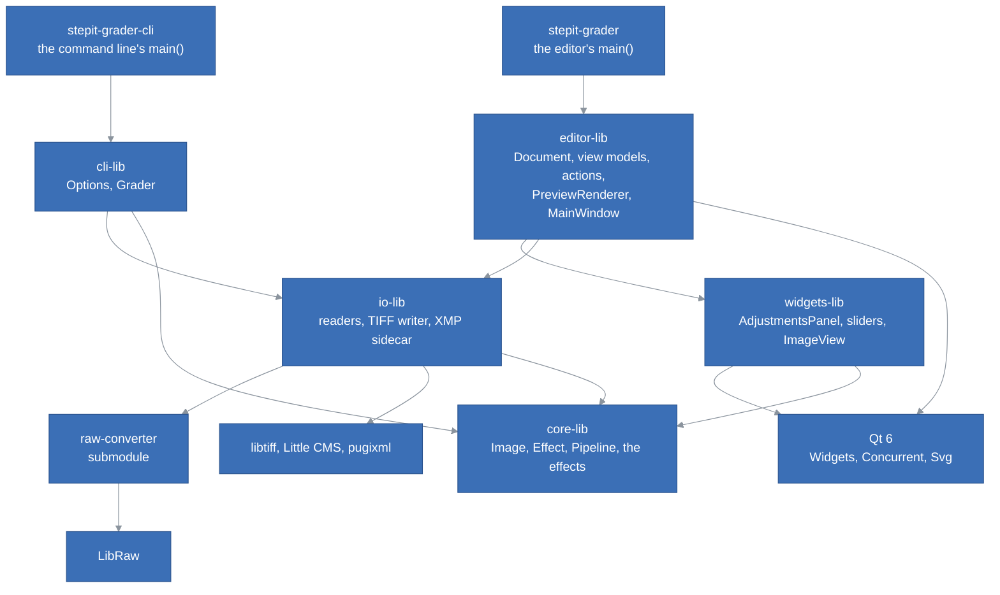
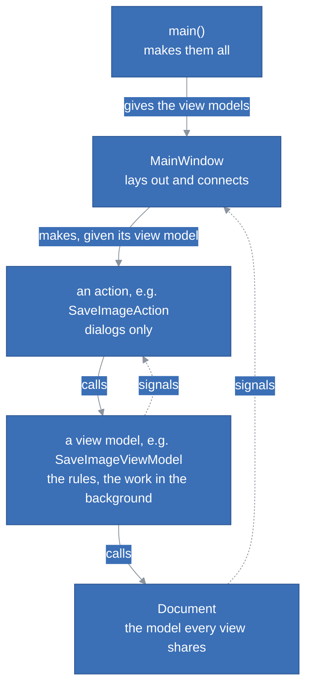
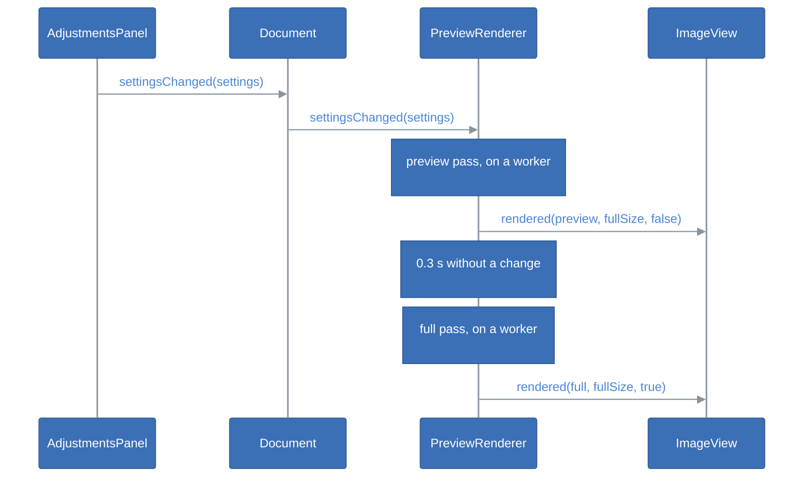

# StepIt Grader Architecture

## Table of Contents <!-- omit in toc -->

- [Introduction](#introduction)
- [The Big Picture](#the-big-picture)
- [The Libraries](#the-libraries)
- [The Engine](#the-engine)
  - [The Image and the Working Space](#the-image-and-the-working-space)
  - [Effects and the Pipeline](#effects-and-the-pipeline)
  - [The Effects](#the-effects)
  - [What the Effects Share](#what-the-effects-share)
  - [Threads and Memory](#threads-and-memory)
  - [Matching a Camera's Look](#matching-a-cameras-look)
- [Reading and Saving](#reading-and-saving)
  - [The Readers](#the-readers)
  - [Replacing a File](#replacing-a-file)
  - [The XMP Sidecar](#the-xmp-sidecar)
- [The Command Line](#the-command-line)
- [The Editor](#the-editor)
  - [The Widgets](#the-widgets)
  - [The Document](#the-document)
  - [The Preview Renderer](#the-preview-renderer)
  - [Models, View Models and Views](#models-view-models-and-views)
  - [The Main Window and main()](#the-main-window-and-main)
- [The Engine in Another Program](#the-engine-in-another-program)
- [A Slider Moves](#a-slider-moves)
- [Threads](#threads)
- [The Linux AppImage](#the-linux-appimage)
- [Tests](#tests)
- [How to Extend StepIt Grader](#how-to-extend-stepit-grader)
- [Design Decisions and Trade-offs](#design-decisions-and-trade-offs)

## Introduction

This document explains how StepIt Grader is built, what each part is responsible for, and where to start when we want to change something. It assumes we have read the [README](../README.md), built the project and edited a picture once. How well it is built, its known weaknesses and what to do about them, is in [Review.md](Review.md).

It follows one idea: **an edit is a set of named values, never pixels**. The sliders show the values, the sidecar stores them, and the engine turns them into pixels, the same way for any picture. That is what lets the command line grade a whole sequence of pictures with the sidecar of one, exactly as the editor shows it.

## The Big Picture

The code is six static libraries and two programs, the editor and the command line, which share the engine and the files. Each library depends only on those below it, and only the widgets' and the editor's know Qt.



| Program | What it is |
|---|---|
| `stepit-grader` | The editor, [`src/editor-app/src/main.cpp`](../src/editor-app/src/main.cpp): builds the parts and opens the window. |
| `stepit-grader-cli` | The command line, [`src/cli-app/src/main.cpp`](../src/cli-app/src/main.cpp): grades pictures with saved settings, without a window. |
| `stepit-grader-tests` | Every test, of every library, in one program: [`src/tests`](../src/tests). |

## The Libraries

| Library | Owns | Links | Must never |
|---|---|---|---|
| [`core-lib`](../src/core-lib) | The image in the working space, the `Effect` interface, the `Pipeline`, the seventeen effects, the area sampling, the filters, the colour maths, the threads, the conversion for the screen, and the search that matches a camera's look, `core::match`. | Threads only. | Include Qt, read or write a file, know which effects exist outside `StandardPipeline.cpp`. |
| [`io-lib`](../src/io-lib) | Reading images into the working space, writing them as TIFFs out of it, and the settings in XMP sidecars. | `core-lib`; privately raw-converter, libtiff, Little CMS, pugixml. | Include Qt, change pixels beyond bringing them into the working space, expose a third-party type in a header. |
| [`widgets-lib`](../src/widgets-lib) | The reusable widgets: the panel of sliders and its sections, the sliders' style, the image view, the curve and the histogram views, and `SectionUtils::sectionsOf()`. | `core-lib`, Qt Widgets. | Know the editor, a file or a document: each is given what it shows and reports with signals. |
| [`editor-lib`](../src/editor-lib) | The document, the background rendering, the white balance picker, the view models of the actions and the actions, saving the graded picture, matching a camera's look and the window that follows it, the main window, its menu of recent files, its themes and icons. | `core-lib`, `widgets-lib`, `io-lib`, Qt Widgets, Concurrent and Svg. | Change pixels itself: it asks the engine. Create its own reader, store or pipeline: it is given them. Read or write a file, or render, on the main thread. Let a model or a view model call a view. |
| [`editor-app`](../src/editor-app) | `main()`. | `editor-lib`. | Hold any logic beyond choosing the parts. |
| [`cli-lib`](../src/cli-lib) | The command line's options and the grading of many pictures. | `core-lib`, `io-lib`. | Include Qt, print: it reports results, `main()` prints them. |
| [`cli-app`](../src/cli-app) | `main()`. | `cli-lib`. | Hold any logic beyond choosing the parts and printing. |

`core-lib` is about 3,750 lines, `io-lib` 1,350, `widgets-lib` 1,650, `editor-lib` 3,700, `cli-lib` 300 and the tests 4,400.

`core-lib` is built with `-O2` in a Debug build too, except with MSVC: its loops over every pixel are about ten times slower without the optimiser, too slow to follow a slider while the rest of a program is debugged.

## The Engine

### The Image and the Working Space

[`core::Image`](../src/core-lib/include/core/Image.h) is RGB, 32-bit float per sample, interleaved, in **linear Rec. 2020 with a D65 white**: the working space. 1.0 is the white the input could record; values above it and below 0 are kept until the screen or an output clips them. `core::Plane` is one channel of floats, e.g. a luminance.

Linear, so that the exposure is a multiplication and blurs mix light as light mixes. Rec. 2020, as raw-converter develops into it, so a raw file needs no conversion, and wide enough for every colour a camera records. Float, so no tool clips or bands what the next one needs.

A new image's or plane's values are undefined until written, see [Threads and Memory](#threads-and-memory).

### Effects and the Pipeline

An [`Effect`](../src/core-lib/include/core/Effect.h) is one adjustment. It owns its parameters and how it changes the image, and nothing else:

| Member | What it does |
|---|---|
| `section()` | The section of the tools panel it belongs to, e.g. `"Light"`. |
| `parameters()` | Its [`Parameter`](../src/core-lib/include/core/Parameter.h)s: id, label, range, default, decimals. |
| `isIdentity(settings)` | Whether it would change nothing; by default, when every parameter is at its default. |
| `apply(image, settings, context)` | Changes the image in place. Safe to call from several threads at once. |

[`Settings`](../src/core-lib/include/core/Settings.h) maps parameter ids to values. A parameter without a value has its default: an empty `Settings` changes nothing, and a parameter added later reads as its default from an old sidecar.

The `RenderContext` carries `scale`, the size of the image rendered against the full picture, e.g. 0.33 for the preview. An effect that works at a size measured in pixels of the full picture, e.g. the 1-pixel radius of the sharpening, multiplies it by `scale`, so the preview looks as the full picture does. An effect that works at a fraction of the picture, e.g. the structure's hundredth of the diagonal, measures it on the image it is given.

The [`Pipeline`](../src/core-lib/include/core/Pipeline.h) holds the effects in order and knows only the interface. `render()` copies the image, skips the effects at their defaults, and asks a `cancelled` callback before each effect, so a render whose settings are already old stops early. Which effects exist and their order is decided in one place, [`makeStandardPipeline()`](../src/core-lib/src/StandardPipeline.cpp).

The tools panel shows the sections in an order of its own, [`standardSectionOrder()`](../src/core-lib/src/StandardPipeline.cpp), beside the pipeline: Color, Light, Tone Curve, Color Mixer, Effects, Noise Reduction, Chromatic Aberration, HDR, the white balance first, as it is the first thing set on a picture. It is mostly the order the effects run in: the white balance, in Color, runs first too, so the colours it neutralises are those as shot, before the light and the effects change them. Not wholly: the noise reduction and the chromatic aberration run before the light but are shown after it, as they are set less often; the sharpening, in Effects, runs last, on the finished picture.

### The Effects

One header in [`include/core/effects`](../src/core-lib/include/core/effects) and one source in [`src/effects`](../src/core-lib/src/effects) each, in the order the pipeline applies them. The parameter id is the setting's name in the sidecar's XMP namespace, the name other raw editors use too.

| Effect | Parameter ids | How it works |
|---|---|---|
| `WhiteBalanceEffect` | `IncrementalTemperature`, `IncrementalTint` | A Bradford adaptation from a white shifted from D65, along the black-body locus by up to 100 mired for the temperature, and across it in CIE 1960 *uv* for the tint. 0 and 0 is exactly D65, so it changes nothing. `neutralFor()` inverts the model: the temperature, by bisection on *u*, which depends on it alone, then the tint from *v*, both in whole steps, clamped to the sliders' range. |
| `LuminanceNoiseEffect` | `LuminanceSmoothing`, `LuminanceNoiseReductionDetail` | The guided filter, self-guided, on the square root of the luminance, where a sensor's noise, growing with the square root of the light, is about the same in the shadows and the highlights: one threshold cleans both. The threshold grows to 0.03 at 100, the radius from 1 to 4 pixels of the full image; the detail puts back up to 40% of what was smoothed. Each pixel is scaled to its cleaned luminance, so the colours stay. Identity at amount 0, whatever the detail. |
| `ColorNoiseEffect` | `ColorNoiseReduction` | Oklab's a and b smoothed by the guided filter guided by Oklab's L, over up to 16 pixels of the full image: the colour follows the edges of the luminance, where it changes by more than about 0.02, and does not bleed across them. L is untouched, so the luminance and its detail are. Blended in up to an amount of 25, so the first steps are gentle. |
| `DefringeEffect` | `DefringePurpleAmount`, `DefringePurpleHueLo`, `DefringePurpleHueHi` | Takes the Oklab chroma away from a pixel whose hue is in the range, 0 to 100 mapped to 240 to 360 degrees, from blue to magenta, and which lies near a strong edge: the luminance changing by 0.5 to 1.5 stops across a band beside it, 1 to 7 pixels of the full picture as the amount grows. The change across the band, not per pixel, so the preview finds the same fringes. Identity at amount 0, whatever the hues. |
| `ExposureEffect` | `Exposure2012` | Every value times 2^exposure. |
| `ContrastEffect` | `Contrast2012` | On the log luminance, in stops from middle grey: `L + c × 3 tanh(L / 3)`. The most in the mid-tones, levelling off beyond 3 stops, so blacks and whites are not thrown away. |
| `HighlightsEffect` | `Highlights2012` | Up to 1.5 stops on the areas from grey to 3 stops above, judged on the area luminance. |
| `ShadowsEffect` | `Shadows2012` | Up to 2 stops on the areas from grey to 4 stops below, judged the same way. |
| `BlacksEffect` | `Blacks2012` | Below 0, `Y² / (Y + b)`: a smooth toe to black. Above 0, a neutral lift that fades out by middle grey. |
| `ToneCurveEffect` | `ParametricShadows`, `ParametricDarks`, `ParametricLights`, `ParametricHighlights`, `ParametricShadowSplit`, `ParametricMidtoneSplit`, `ParametricHighlightSplit` | A curve on the luminance as the screen shows it, sRGB-encoded, so the four regions are even to the eye. The splits, 25, 50 and 75 by default, cut the tones from black to white into shadows, darks, lights and highlights; each slider moves its region's middle by up to half the region's width. A monotone cubic (Fritsch and Carlson) through black, the four middles and white never goes down, and the knots are kept apart so it never goes flat. A table of 4,096 gains is built once per render. Black stays black, and white and above are left alone, for the HDR compression. Identity with the four regions at 0, whatever the splits. |
| `DetailEffect` | `Texture` | The band between two Gaussian blurs of the log luminance, σ 1 and 4 pixels of the full picture, boosted or smoothed. Below about 0.05 stops, taken for noise and left alone. |
| `StructureEffect` | `Clarity2012` | The log luminance against its guided filter over a hundredth of the diagonal, boosted or reduced. The guided filter keeps strong edges out of the smoothing, so they draw no halo. |
| `VibranceEffect` | `Vibrance` | The Oklab chroma scaled, less and less up to a chroma of 0.25. |
| `SaturationEffect` | `Saturation` | The Oklab chroma scaled: `-100` is grey. |
| `ColorMixerEffect` | `HueAdjustment<Band>`, `SaturationAdjustment<Band>`, `LuminanceAdjustment<Band>`, for `Red`, `Orange`, `Yellow`, `Green`, `Aqua`, `Blue`, `Purple`, `Magenta` | Eight bands, each centred on the Oklab hue of the pure sRGB colour of its name, computed once. A colour between two bands takes both, eased by a smoothstep, so there is no seam. The hue turns by up to 30 degrees, the Oklab chroma is scaled, `-100` is grey, and the luminance moves by up to 1 stop, the pixel multiplied as a whole. Below an Oklab chroma of 0.02 a colour counts as grey and is left alone; the effect is full from 0.04. |
| `ToneCompressionEffect` | `HDRToneCompression`, `HDRCompressionPoint`, `HDRLocalContrast` | An exponential shoulder above a knee, from middle grey to 0.9, with a slope of 1 at the knee, that brings up to 4 stops above white to white. On each pixel's brightest channel, so the hues stay and no channel clips. With local contrast, the curve compresses the brightness of the area, a guided filter over a hundredth of the diagonal, and the pixel's difference from it is kept. Identity at amount 0, whatever the other two. The editor's own ids: other raw editors have no such setting. |
| `SharpnessEffect` | `Sharpness` | An unsharp mask of 1 pixel of the full picture on the log luminance, with a noise threshold. |

Every effect but the white balance, the colour noise, the defringe and the colour ones changes the luminance only: it computes a change in stops per pixel and multiplies the pixel's three values by it, so the colours stay. The constants that set how strong each one is, e.g. `STRENGTH`, are at the top of its source, named and explained.

### What the Effects Share

| File | What it holds |
|---|---|
| [`Luminance.h`](../src/core-lib/include/core/Luminance.h) | `logLuminance()`, in stops from middle grey; `applyStops()`; `areaLuminance()`, what the highlights and the shadows both call bright and dark, so they agree; `smoothstep()`. |
| [`Filters.h`](../src/core-lib/include/core/Filters.h) | `boxBlur()`, linear in the size whatever the radius; `gaussianBlur()`, three box blurs; `guidedFilter()` (He et al., 2010), self-guided or guided by another plane, e.g. the colour guided by the luminance. |
| [`Color.h`](../src/core-lib/include/core/Color.h) | The matrices of Rec. 2020, sRGB and Bradford, the black-body locus (Kim et al., 2002), CIE 1960 *uv*, and Oklab (Ottosson, 2020), whose matrix is scaled so the working white is exactly neutral; the one sRGB curve, `srgbEncode()` and `srgbDecode()`, which the screen, the tone curve and the camera's JPEG all use, and `srgbToXyz()`, computed as the inverse of the XYZ-to-sRGB matrix so the two cannot drift apart. |
| [`Sampling.h`](../src/core-lib/include/core/Sampling.h) | `meanColour()`: the mean of the pixels within a radius, leaving out those with a channel at 0.98 or above, clipped, and counting them. |
| [`Geometry.h`](../src/core-lib/include/core/Geometry.h) | `downscale()` by a whole factor, averaging blocks; `orient()` from the TIFF/EXIF orientation. |
| [`Display.h`](../src/core-lib/include/core/Display.h) | `toSrgb8()`: to sRGB, clipped, through a table of the sRGB curve. For the screen only. |

### Threads and Memory

[`parallelFor()`](../src/core-lib/include/core/Parallel.h) splits a range over a pool of threads started once, one per core. Any thread may submit work, and waits by running what is queued, so the preview and the full render share the pool. A chunk's completion is counted and signalled under its group's lock: the submitter's group lives on its stack, and must outlive the last signal. A chunk that throws, e.g. `std::bad_alloc` on a picture too large for the memory, does not stop the others: the first exception is kept, the chunks not started yet are skipped, and `parallelFor()` throws it once every chunk has ended, on the calling thread.

Two choices keep the effects from waiting on memory rather than computing:

- **`Samples` leaves new values uninitialised.** Filling a plane of 84 MB with zeros took longer than the box blur that writes it.
- **`main()` keeps glibc from returning large blocks to the kernel**, with `mallopt`. Otherwise every plane freed comes back zeroed, page by page: half the time of a preview.

On the 21 megapixels of a Canon 5D Mark II, on a 10-core i9, with every effect but the HDR compression on: about 130 ms for the preview, 1,872 × 1,248, and 1.4 seconds for the full picture; the HDR compression adds about 0.3 seconds to the full picture. The guided filter's effects, the highlights, the shadows and the structure, and the detail's two blurs take most of it.

### Matching a Camera's Look

[`core::match`](../src/core-lib/include/core/CameraMatch.h) finds the slider values that make raw pictures, graded, look like the JPEGs their camera made of them: the camera's own look, as a grade. It runs inside the programs, in C++, so the AppImage needs nothing installed beside it.

- **What is compared**: a `Sample` per picture, made by `makeSample()`: the raw in the working space, reduced to 1,000 pixels on its long side by the editor, and the camera's JPEG at up to 100,000 of its pixels, the same ones at every run. The JPEG's clipped pixels, a channel at 98% or more, are left out: they say nothing of the camera's curve.
- **The difference**: each trial grades the samples with the pipeline, converts them to sRGB clipped to [0, 1], as the screen shows them, and takes the mean CIEDE2000 difference from the JPEGs (Sharma et al., 2005), below 1 invisible.
- **The search**: a Nelder-Mead simplex, in stages, each stage searching its sliders with the others at their best so far. It goes over `Options::base`, e.g. the picture's own settings: the sliders no stage searches keep their values there through the whole search, so the grade fits the picture as it will be shown, and `Result::settings` holds only the sliders searched. The sliders searched start from their defaults, whatever their values in the base, and `Result::errorBefore` is the difference with the base alone. `standardStages()` searches the tone first, the exposure, the contrast, the blacks, the saturation, the vibrance, the white balance and the tone curve, then the colour mixer's 24 sliders. The exposure starts where the median brightness matches. A slider's range, default and decimals come from its `Parameter`; one step of the search is a fortieth of its range, and a value is rounded to the slider's decimals, so the trials are values the panel can show, and a value tried twice is not graded again.
- **Progress and stopping**: `Options::progress` is called after every trial with the stage, the trials and the best difference so far; `Options::stopped` is asked before every trial, and once it says yes the search returns its best values so far, with `Result::stopped`.

The local tools, the highlights, the shadows, the structure and the HDR compression, are left out: their result depends on the picture's content, so values fitted on one picture would do something else on the next. On the 21 megapixels of a Canon 5D Mark II, on a 10-core i9, a trial takes about 20 ms, keeping the ten cores busy, and the whole search, about 1,000 trials, 20 seconds, plus about 3 seconds to read each raw file.

## Reading and Saving

### The Readers

An [`ImageReader`](../src/io-lib/include/imageio/ImageReader.h) reads one kind of file into the working space, turned upright. It says which extensions it reads, and throws `imageio::Error` with the file's name and the reason when it cannot.

| Reader | What it reads | How |
|---|---|---|
| [`TiffReader`](../src/io-lib/src/TiffReader.cpp) | `.tif`, `.tiff`: RGB or grey, 8 or 16 bits, 32-bit float, contiguous or planar. | libtiff, then Little CMS from the file's ICC profile to linear Rec. 2020, several rows at a time. Without a profile: sRGB, or linear Rec. 2020 in float. |
| [`RawReader`](../src/io-lib/src/RawReader.cpp) | `.dng` and the camera raw formats LibRaw reads. | raw-converter's `readRawFile()` and `renderImage()` into Rec. 2020: demosaiced, white balanced as shot, nothing else. `readCameraShot()`, and `RawShotReader` behind the [`CameraShotReader`](../src/io-lib/include/imageio/CameraShotReader.h) interface, read the same with the camera's JPEG, the largest the file holds, as the camera stored it, and the orientation that turns it upright as it turned the picture. |
| [`ImageLoader`](../src/io-lib/include/imageio/ImageLoader.h) | What its readers read. | The first reader that reads the file. `makeStandardImageReader()` gives the TIFF and the raw readers. |

### The TIFF Writer

[`TiffWriter`](../src/io-lib/include/imageio/TiffWriter.h) writes an image of the working space as a 16-bit RGB TIFF in a [`ColourSpace`](../src/io-lib/include/imageio/ColourSpace.h): sRGB, Adobe RGB (1998), ProPhoto RGB or linear Rec. 2020. Little CMS converts it, several rows at a time, clipping what is outside the space or above white, and the space's ICC profile is embedded, so every program that reads the file knows its colours. Deflate with a horizontal predictor when asked. The file is written whole under a hidden temporary name of its own, then put in place of the old one by [`imageio::files::replace()`](../src/io-lib/include/imageio/Files.h), so a failure never leaves half a file nor harms the one it would replace: see [Replacing a File](#replacing-a-file).

The profiles, of the working space and of the four colour spaces, are made in one place, [`ColourProfiles.cpp`](../src/io-lib/src/ColourProfiles.cpp), private to `io-lib`, for the reader and the writer alike. Adobe RGB and ProPhoto RGB are made from their published primaries, white and gamma, and named "compatible": the names are Adobe's and Kodak's.

### Replacing a File

Every file the programs write, a TIFF, a sidecar, or the editor's JPEG, goes through [`imageio::files`](../src/io-lib/include/imageio/Files.h):

- `temporaryFor()` names a hidden file beside the target, unique to the call, e.g. `.IMG_0001.tif.<clock>.<n>.part`: two saves of the same file at once, or two programs, never write the same temporary file.
- `replace()` renames it over the target. Where the system does not rename over a file, the old one is set aside first, renamed to a `.old` name, and brought back if the new one cannot take its place; it is removed only once the new one is there. On any failure the temporary file is removed, and the target is the old file or the new one, never neither.

### The XMP Sidecar

A [`SettingsStore`](../src/io-lib/include/imageio/SettingsStore.h) says where the settings of an image are, loads them and saves them. It also reads a file of its kind of any name, `loadFile()`, e.g. a sidecar saved for another picture, and says its files' `extension()`, for an open dialog. [`XmpSidecar`](../src/io-lib/src/XmpSidecar.cpp) is the one there is, built on pugixml:

- **Where**: for a camera raw file or a DNG, its name with `.xmp` in place of its extension, `IMG_0001.xmp`, as raw editors name it; for any other image, e.g. a TIFF, its whole name with `.xmp`, `IMG_0001.tif.xmp`, so a raw file and a TIFF of the same name in one folder each keep their own. `formerLocation()` gives the other name a TIFF's sidecar may have, `IMG_0001.xmp`, which `load()` reads when `IMG_0001.tif.xmp` is missing, unless a raw file of the same name beside it owns that file; a save writes `IMG_0001.tif.xmp` and leaves the other file as it is.
- **Reading**: every `rdf:Description` that binds the `crs` namespace, `http://ns.adobe.com/camera-raw-settings/1.0/`, whatever its prefix, and each parameter as an attribute or an element named by its id.
- **Writing**: the existing file is read, the values of the parameters replaced, `crs:ProcessVersion="11.0"` added when missing, so other editors read the tone controls with the meaning the editor gives them, and everything else kept. Values are formatted as raw editors write them: `+0.50`, `-12`, `0`. The file is written whole to a temporary file and put in place of the sidecar by `imageio::files::replace()`, as a TIFF is, so a failure never leaves half a file. A sidecar that is not XMP cannot be updated: it is replaced by a new one, and kept beside it, copied to `<name>.xmp.damaged` as `damagedCopy()` names it, for what it may still hold.

The parsing and the writing are free functions, `xmp::parse()` and `xmp::write()`, on strings, so the tests need no file. `XmpSidecar::loadFile()` reads the settings of an XMP file of any name, e.g. one saved for a picture and applied to others.

## The Command Line

`stepit-grader-cli` grades pictures with saved settings, without a window. It is a console program on every system, linking `cli-lib`, `io-lib` and `core-lib`, without Qt, so it prints, even on Windows, and runs where there is no screen.

- [`parseOptions()`](../src/cli-lib/include/cli/Options.h) turns the arguments into `Options`, or a message for what is wrong with them; `usage()` is the help.
- [`Grader`](../src/cli-lib/include/cli/Grader.h) grades the pictures, one after the other, each at full size with `RenderContext{1.0}`: the effects already use every core. It is given its `ImageReader`, its `SettingsStore` and its `Pipeline`, so the tests give it fakes. For each picture it returns a `GradeResult`, and reports it as it goes through a callback: graded, or why not. It refuses to write over the picture itself, over a TIFF already there without `--overwrite`, or over a TIFF written earlier in the same run.
- [`main()`](../src/cli-app/src/main.cpp) reads `--settings` once, before any picture, so settings that cannot be read stop the run with status 2; makes the standard pipeline, reader and sidecar store; prints each result; and exits with 0 when every picture is graded and 1 when some are not.

The editor and the command line make the same picture of the same settings: one pipeline, one reader, one sidecar, and the full size in both.

## The Editor

### The Widgets

The widgets are a library of their own, [`widgets-lib`](../src/widgets-lib), included as `widgets/...`. Each is reusable: it is given what it shows, knows nothing of who uses it, and reports what the user did with signals.

| Widget | What it does | Signals |
|---|---|---|
| [`ImageView`](../src/widgets-lib/include/widgets/ImageView.h) | Shows a `QImage`, centred, fitted or zoomed to 800%, dragged with the mouse, zoomed by the wheel around the cursor. It paints only the visible part, and reduces the image once per zoom with area averaging. The image may stand for a larger one: `setImage(preview, fullSize)` keeps the zoom relative to the full size, so the full picture replacing the preview does not move the view. In pick mode, `setPickMode(true)`, a click reports a point instead of dragging, with a circle of `PICK_RADIUS`, 5 screen pixels, under the cursor; `Esc` leaves it. It does not know what the point is for. | `zoomChanged`, `fileDropped`, `pointPicked`, in pixels of the full image with the radius in the same pixels, `pickCancelled` |
| [`ParameterSlider`](../src/widgets-lib/include/widgets/ParameterSlider.h) | A name, its value as text, and a slider, the one way to change it: the value is shown, not typed in, in the locale's format with the parameter's decimals. A double click on the name, the value or the slider puts the default back. The slider is a thin line with a large empty circle to drag, as raw editors draw it, by [`SliderStyle`](../src/widgets-lib/include/widgets/SliderStyle.h), a style of `widgets-lib` set on the slider alone, which `SliderStyle::apply()` gives to any other slider of a program too: the same look whatever the application's style, in the colours of the slider's palette, so it follows the theme. The style also says where the circle is, so Qt grabs it anywhere inside, and the circle's ring takes the highlight colour while it is held or under the mouse. `SliderStyle::setDefaultValue()`, which `ParameterSlider` calls with its default, marks how far the slider moved: the line from the default to the circle is drawn wider, in the highlight colour; a move smaller than the circle's radius stays under it. | `valueChanged`, only for the user's changes, never for `setValue()`. |
| [`CollapsibleSection`](../src/widgets-lib/include/widgets/CollapsibleSection.h) | A bold title with an arrow above widgets that fold away when it is clicked. The title is a button kept checked, open or closed, so the style draws it as the same block either way and the sections stand apart; whether it is open is a value of its own. The widgets stand 8 pixels below it so the first slider does not crowd the title; `addHeaderWidget()` puts a widget, e.g. a tool's button, on the right of the title, and `addWidgetFirst()` one above those added already. | `expandedChanged`, only for the user's clicks, never for `setExpanded()`. |
| [`HistogramView`](../src/widgets-lib/include/widgets/HistogramView.h) | Draws a `Histogram`, which `HistogramUtils::histogramOf()` counts from a `QImage` as the screen shows it, 8 bits a channel: red, green and blue filled and overlaid, the Rec. 709 luminance as a line. The tallest level sets the height, the two ends left out, as a clipped picture piles its pixels there and would flatten the rest. A triangle in each top corner lights up when at least 0.01% of the pixels have a channel at 0 or at 255, with their share below it. `HistogramUtils::histogramOf()` samples a picture of more than 500,000 pixels on an even grid, so the full picture costs no more than the preview: a few milliseconds. | None. |
| [`CurveView`](../src/widgets-lib/include/widgets/CurveView.h) | Draws a tone curve it is given as points from (0, 0) to (1, 1), over a grid of quarters, the diagonal dashed, where nothing changes, and the borders between the regions dotted, in the colours of its palette, the curve in the highlight colour. A little less high than wide, with room below for the slider under it. It only shows: it knows no effect, and the sliders change the curve. | None. |
| [`AdjustmentsPanel`](../src/widgets-lib/include/widgets/AdjustmentsPanel.h) | One `CollapsibleSection` per section it is given, with a `ParameterSlider` per parameter, in a scroll area. It knows parameters, not effects, and opens and closes sections when asked, without remembering them. `setControlsEnabled()` enables or disables the sliders only: disabling the whole panel would disable its titles and its scroll bar too. `addSectionHeaderWidget()` puts a widget on the right of a section's title, `addSectionWidget()` one above its sliders, e.g. the curve, and `addHeading()` a bold heading above a slider, to name the group it starts, e.g. Hue in the colour mixer. | `settingsChanged`, with every value; `sectionExpandedChanged`, with the section's title. |

[`WhiteBalanceUtils::pickWhiteBalance()`](../src/editor-lib/include/editor/WhiteBalanceUtils.h) turns a point picked into settings: it samples the document's image, the picture before any edit, which is what the white balance, first in the pipeline, sees; asks `WhiteBalanceEffect::neutralFor()`; and returns the settings with the two values changed, or a message for the user when the area is clipped, black or outside the picture. A function, so the tests need no window. [`IconUtils::themedIcon()`](../src/editor-lib/include/editor/IconUtils.h) gives an icon of the editor's, e.g. `zoom-in`, from [`resources/icons`](../src/editor-lib/resources/icons), built into the library as a Qt resource: each has a drawing for a light theme, dark grey, and one for a dark theme, light grey, chosen by the lightness of the window's colour. Two drawings, not one painted in the theme's colour, as some icons have two tones, e.g. the before and after's two halves. Qt's SVG module draws them, not an icon plugin, which would have to be shipped beside the program on Windows and macOS.

[`ThemeUtils::applyTheme()`](../src/editor-lib/include/editor/ThemeUtils.h) gives the application a `Theme`: **System**, the desktop's style as the application started with it; **Light**, Qt's Fusion; or **Dark**, Fusion with a dark grey palette, and disabled icons grey rather than darkened out of sight. Fusion draws the same on every system, so the dark colours do too. The style is a `QProxyStyle` around Fusion, which gives its `standardPalette()`. An icon keeps the drawing of the theme it was made in, so the main window remembers each action's icon name and makes the icons again after a change.

`SectionUtils::sectionsOf()`, in [`SectionUtils.h`](../src/widgets-lib/include/widgets/SectionUtils.h), groups the parameters of a pipeline by section, so the panel needs no pipeline. Each section's parameters keep the pipeline's order, so Light shows the exposure, the contrast, the highlights, the shadows and the blacks, then the vibrance and the saturation, and Effects the texture, the clarity, then the sharpening. The sections it is given an order for come first, in that order, and the others follow in the pipeline's: `main()` gives it `standardSectionOrder()`.

[`RecentFilesMenu`](../src/editor-lib/include/editor/RecentFilesMenu.h) is the editor's own, in `editor-lib`: a widget of a program's menus, not of grading, so `widgets-lib` holds only what another program needs to grade. It is the files opened last, the latest first, numbered `&1` to `&9` with their full path as a tooltip, then Clear; disabled while empty. It keeps the list but does not store it: `setFiles()` gives it, `filesChanged` reports it, so it needs no settings file in its tests. It emits `fileSelected`, with the full path, and `filesChanged`, for `addFile()`, `removeFile()` and `clearFiles()`, never for `setFiles()`.

### The Document

[`Document`](../src/editor-lib/include/editor/Document.h) is the picture being edited: its path, its pixels, and three sets of settings: those it was opened with, those its sidecar holds, and the current ones. It is given its `ImageReader`, its `SettingsStore`, the parameters and the delay before it saves, 1 second by default, so the tests give it fakes and 200 ms.

Every read and write of a file runs on `m_files`, a `QThreadPool` of one thread, so they never block the window and keep the order they were asked in: a save of a picture is written before the same picture is read again, and the settings asked from a file before another picture opens are read before it. The destructor waits for them, as they report to the document.

- `open()` first asks for a save of what waits to be saved, then reads the image and its sidecar, and ends with `opened()` then `settingsChanged()`, or `openFailed()` with the reader's message. A sidecar that cannot be read does not fail the open: the picture opens with no edit, not modified, and `sidecarUnreadable()` follows `opened()` with the store's message; the sidecar stays as it is until the first change. The sliders stay live while it reads, so `finishOpening()` asks for a save once more before it takes the new picture: a change made meanwhile belongs to the old one.
- `setSettings()`, `resetSettings()` and `revertSettings()` emit `settingsChanged()` only when a value changes, and `modifiedChanged()` when the settings start or stop differing from what the sidecar holds, or from the defaults without a sidecar. `revertSettings()` goes back to the settings the picture was opened with.
- `mergeSettings()` sets the values it is given and leaves the others as they are: a grade of some sliders over the picture's own. The camera match and the white balance's eyedropper apply their result with it.
- Each change that leaves the settings different from the sidecar restarts a single-shot `QTimer`; when it fires, `save()` runs. A slider dragged restarts it at every step, so the file is written once, a second after it stops. A change back to what the sidecar holds stops the timer: nothing is written, and a picture opened and closed without a change gets no sidecar.
- `save()` asks for a write through the store, if the settings differ from the sidecar, of the path and the settings as they are, and returns; `finishSaving()` ends it with `saved()` or `saveFailed()`. `isSaving()` is true until the last one asked has ended, and a save of the settings a save already writes is not asked twice. The settings stay modified until it ends, and after, if they changed meanwhile: those changes wait for the next save. After a failure the settings stay modified and the timer is not restarted: the next change tries again, rather than a loop writing to a full disk every second.
- `loadSettings()` applies the settings of another file, read through the store's `loadFile()` in the background: every value of it, the others at their defaults, as a change, so saved and reverted like one. It ends with `settingsLoaded()`, or `settingsLoadFailed()` with the store's message and the settings as they were; with nothing when another picture opened meanwhile, as the settings were not for it. It returns false, at once, without a picture.

### The Preview Renderer

[`PreviewRenderer`](../src/editor-lib/include/editor/PreviewRenderer.h) renders the settings off the user interface's thread, in two passes, each ending with `rendered(image, fullSize, full)`:

1. **The preview**, at once: the picture reduced to at most 2,048 pixels on its longer side, made once per picture, by the first preview pass, so `setSource()` returns at once. While one runs, newer settings wait, and only the latest is rendered next.
2. **The full picture**, once the settings have not changed for 0.3 seconds.

The last two pictures rendered in full are kept, with their settings. Settings rendered already are shown in full at once, without a pass: switching between the picture before its edit, rendered with no settings, and after takes no time once both are made. A new picture empties them.

A counter, shared with the passes, goes up with every change. A full pass compares it before each effect and stops when it is stale, and a pass's result is shown only if it is still the latest. Every full pass, stale or not, is waited for when the renderer is destroyed.

A change also stops the preview running, at its next effect, so the latest settings start sooner: a slider moved twice renders the second position only. But a slider dragged sends a change every few milliseconds, and stopping every preview would show no picture until it stops. So a preview is stopped **at most once between two pictures shown**, `m_previewStopped`: during a drag, the picture still follows as often as a preview can be made. A new picture, `setSource()`, or settings shown from the pictures kept stop the preview whatever the count, as its result is of no use.

### Models, View Models and Views

The editor's code is in three layers, so a rule can be tested without a window and a dialog changed without touching a rule:

- **The model** is the `Document`, the one every view shares: the picture, its settings, its files.
- **A view model** holds the rules of one feature, e.g. which file the picture may be saved to, and its work in the background. It is given the document and what else it needs, e.g. the pipeline or a reader, and shows no widget: it answers calls, and tells the views what happened with signals only. Each is in [`viewmodel/`](../src/editor-lib/include/editor/viewmodel).
- **A view** is a widget or an action. It is given its view model and calls it; it asks the user, with its dialogs, and shows what the view model's signals say. Each menu action with rules of its own is a `QAction` in [`actions/`](../src/editor-lib/include/editor/actions).

A model or a view model never calls a view, nor knows one: a test drives a view model as its action would, with fakes for the document's reader and store, and checks its signals.



[`main()`](../src/editor-app/src/main.cpp) makes the view models, as it makes the document, and gives them to `MainWindow`, which makes each action with its view model, puts it in its menu and enables it once a picture opens. The window also listens to a view model's signals where the status bar shows them.

| Menu | View | View model | Its signals |
|---|---|---|---|
| **File > Save Image…**, `Ctrl+Shift+E` | [`SaveImageAction`](../src/editor-lib/include/editor/actions/SaveImageAction.h) | [`SaveImageViewModel`](../src/editor-lib/include/editor/viewmodel/SaveImageViewModel.h) | `saved(path)`, `saveFailed(message)` |
| **Edit > Match Camera Look…** | [`MatchCameraLookAction`](../src/editor-lib/include/editor/actions/MatchCameraLookAction.h) | [`CameraLookViewModel`](../src/editor-lib/include/editor/viewmodel/CameraLookViewModel.h) | `finished()`, `failed(message)`, and the `StatusController`'s `status` while it runs |
| **Pick White Balance**, `W`, and its button at the top of the Color section | [`PickWhiteBalanceAction`](../src/editor-lib/include/editor/actions/PickWhiteBalanceAction.h) | [`WhiteBalanceViewModel`](../src/editor-lib/include/editor/viewmodel/WhiteBalanceViewModel.h) | `picked(message)`, `failed(message)` |
| **File > Open…**, **Open Recent**, a file dropped, and closing the window | [`OpenAction`](../src/editor-lib/include/editor/actions/OpenAction.h), whose `fileChosen` goes, as a recent or dropped file does, to `MainWindow::openFile()`; `closeEvent()` | [`LeavePictureViewModel`](../src/editor-lib/include/editor/viewmodel/LeavePictureViewModel.h) | `opening(path)`, `readyToClose()`, `editWouldBeLost(fileName)` |

**Save Image…** is a [`SaveImageAction`](../src/editor-lib/include/editor/actions/SaveImageAction.h), which holds the dialogs only: it asks for a file and its type among [`ImageExportUtils::imageFormats()`](../src/editor-lib/include/editor/ImageExportUtils.h), and says why a file is refused or a save failed. The rules are a [`SaveImageViewModel`](../src/editor-lib/include/editor/viewmodel/SaveImageViewModel.h)'s, given the document, the renderer's pipeline and a `QSettings`, so tests reach them: it suggests `<name>-graded.<suffix>` beside the picture, offers first the format used last, kept under `imageFormat`, gives a name without a suffix the format's, refuses the picture's own file, and runs `ImageExportUtils::saveImage()` off the main thread: the document's picture graded at its full size, then written with `imageio::TiffWriter`, 16 bits, deflate, its ICC profile, or as an 8-bit sRGB JPEG of quality 95 by Qt, written to a temporary file and put in place the same way. The window shows its `saved()` in the status bar.

**Match Camera Look…** is a [`MatchCameraLookAction`](../src/editor-lib/include/editor/actions/MatchCameraLookAction.h), which holds the dialogs only, following a [`CameraLookViewModel`](../src/editor-lib/include/editor/viewmodel/CameraLookViewModel.h), given the document, the renderer's pipeline and a `CameraShotReader`, which holds the rules, so tests drive it with a fake reader. It matches the picture open when the reader reads it, a raw file or a DNG, which holds its camera's JPEG, and otherwise the action asks for the raw files the picture was made from, a TIFF holding no JPEG; opening a raw file says so in the status bar. The view model runs [`CameraLookUtils::matchCameraLook()`](../src/editor-lib/include/editor/CameraLookUtils.h) off the main thread, one at a time: it reads each file with the reader, decodes the camera's JPEG with Qt, refuses one of another shape than the picture, reduces both and makes the samples, then calls `core::match::fit()` with the picture's settings as they were when the match started, its `Options::base`: the sliders it does not search keep their values through the search, so the grade found fits the picture as it will be shown, e.g. with its highlights or HDR compression, and the result holds only the sliders searched. It reports a [`Status`](../src/editor-lib/include/editor/Status.h), a message and a value from 0 to 100, through a `StatusController`, whose signal reaches the main thread queued, and reads `isStopped()` between its steps. A [`WaitingDialog`](../src/editor-lib/include/editor/WaitingDialog.h) follows the status with a progress bar, and its Stop button, or its close button, asks the task to stop; it stays until the task ends. The action then shows the view model's `summary()`, the difference as the picture is now and with the grade found, empty while a match runs and after one failed, and asks whether to apply it, naming the sections whose sliders it sets, `sectionsSet()`, read from the search's stages and the pipeline, and on a click on Apply the view model merges the grade found into the picture's settings with `Document::mergeSettings()`: the sliders searched change, the others stay. The white balance picked with the eyedropper is merged the same way.

**Pick White Balance** is a checkable [`PickWhiteBalanceAction`](../src/editor-lib/include/editor/actions/PickWhiteBalanceAction.h), given the view model and the `ImageView`: checked, it puts the view in pick mode, and hands the point picked, `pointPicked`, to the view model, then unchecks itself, one pick then back to dragging, as `Esc`, `pickCancelled`, does. The window holds it, so its key works anywhere in it. [`WhiteBalanceViewModel::pick()`](../src/editor-lib/include/editor/viewmodel/WhiteBalanceViewModel.h) runs `WhiteBalanceUtils::pickWhiteBalance()` off the main thread on the document's image and settings; with its result it drops a pick measured on a picture since left, and otherwise merges the temperature and the tint alone with `Document::mergeSettings()`, the other values as they are by then. The window shows its message in the status bar for 6 seconds.

**Leaving the picture**, to open another or to close the window, is [`LeavePictureViewModel`](../src/editor-lib/include/editor/viewmodel/LeavePictureViewModel.h)'s. `open()` refuses at once a file that no longer exists, `Missing`, one the document does not read, `NotAPicture`, and one asked while another opens, `Busy`; the window says why, removing a missing file from the recent ones, with a warning for the first two and in the status bar for the last. Otherwise it asks for `Document::save()` and keeps what to do next, then does it once no save runs and nothing waits to be written, following the document's `saved` and `saveFailed`: a change made while the save ran is written in turn, and the last request replaces one still waiting. Only when the last save failed, where the edit would be lost, does it emit `editWouldBeLost()`; the window asks, and calls `discard()`, which goes on without the edit, or `stay()`, which forgets the request. `close()` says yes at once when nothing waits to be written; otherwise the window ignores the close event, and closes again, queued, on `readyToClose()`.

Three more actions have no rule of their own to test, so no view model: they are given the document or the renderer they call.

| Menu | View | What it does |
|---|---|---|
| **File > Load Settings…**, `Ctrl+L` | [`LoadSettingsAction`](../src/editor-lib/include/editor/actions/LoadSettingsAction.h) | Asks for a file of settings through `FileUtils`, then `Document::loadSettings()`. |
| **View > Before and After**, `\\`, and its button in the toolbar | [`BeforeAfterToggleAction`](../src/editor-lib/include/editor/actions/BeforeAfterToggleAction.h) | Checked, has the renderer show the picture with no settings, unchecked with the document's; a change of the settings unchecks it without `toggled()`. `beforeShown()` says each change, for **Before** in the status bar. |
| **Settings > Theme** | [`ThemeMenu`](../src/editor-lib/include/editor/ThemeMenu.h), a menu as `RecentFilesMenu` is | Checks the theme kept in the `QSettings` it is given; choosing one applies it, keeps it, and emits `themeChanged()`, on which the window draws its icons again. |

To add an action of this kind, see [How to Extend StepIt Grader](#how-to-extend-stepit-grader).

### The Main Window and main()

[`MainWindow`](../src/editor-lib/src/MainWindow.cpp) lays the parts out and connects them, which know nothing of each other. `main()` makes them all and gives them to the window: the document, the one model every view shares, the renderer, and the view models of the actions, `SaveImageViewModel` and `CameraLookViewModel`, in [`viewmodel/`](../src/editor-lib/include/editor/viewmodel). A view is given its model and calls it; a model never calls a view, it tells them with signals.

- **In the middle**, the `ImageView`.
- **On the right**, a dock without a title: a `HistogramView` at the top, outside the panel's scroll area so it stays in sight, counted again from every image the renderer sends, the picture before the edit included; under it the `AdjustmentsPanel`, every section folded at the start and the sliders disabled until a picture is open.
- **In the panel**, three widgets of the window's own: the white balance's eyedropper, 28 pixels, first in the Color section, above the temperature and the tint it sets, in no menu nor toolbar, the window holding its action so its key, `W`, works anywhere in it; a `CurveView` above the Tone Curve's sliders, drawn again from `ToneCurveEffect::knots()`, `curve()` and `splits()` at every change of the settings; and the headings Hue, Saturation and Luminance in the colour mixer.
- **Above**, a fixed toolbar with the actions used most: open, save, before and after, and the zoom.
- **The menus**: File, Edit, View and Settings, whose Theme is kept in `QSettings` under `theme` and applied by `main()` before the window is made; and the status bar.

What the editor keeps between sessions in `QSettings`, the folders the dialogs start in, the recent pictures, the format saved last and the theme, is kept under the keys of [`SessionProperties`](../src/editor-lib/include/editor/SessionProperties.h), all in one header, grouped as `Files` and `Options`, so no two parts use the same key. A key is never renamed, or the value kept under it is lost.

The open dialogs go through [`FileUtils`](../src/editor-lib/include/editor/FileUtils.h): `getOpenFile()` and `getOpenFiles()` start in the folder kept under a key of `SessionProperties::Files`, or in a fallback, and keep the folder of the file chosen. **Open…** keeps `LAST_FOLDER`; **Load Settings…** keeps `LAST_SETTINGS_FOLDER`, starting in the picture's folder the first time; **Match Camera Look…** keeps nothing, and starts in the picture's folder each time, where the raw files it was made from usually are.

The window holds no connection of its own between the parts: four mediators, in [`mediators/`](../src/editor-lib/include/editor/mediators), each keep two or more of them in step, and the window makes them after its layout.

| Mediator | Connects | Does |
|---|---|---|
| [`DocumentPanelMediator`](../src/editor-lib/include/editor/mediators/DocumentPanelMediator.h) | `Document`, `AdjustmentsPanel`, `CurveView`, `PreviewRenderer` | A slider moved sets the document's settings; the document's settings set the sliders, draw the tone curve and are rendered; a picture opened is the renderer's source and enables the sliders. |
| [`PreviewMediator`](../src/editor-lib/include/editor/mediators/PreviewMediator.h) | `PreviewRenderer`, `ImageView`, `HistogramView` | Each picture rendered is shown, and its histogram counted again from it. |
| [`StatusBarMediator`](../src/editor-lib/include/editor/mediators/StatusBarMediator.h) | the status bar, and through its `follow…()` the document, the renderer, the image view and the view models | Makes the bar's labels, the picture and its size, **Before**, **Preview** or **Rendering…**, the zoom; shows a message for each thing done, saved or failed; holds the wait cursor while a picture opens. |
| [`DialogsMediator`](../src/editor-lib/include/editor/mediators/DialogsMediator.h) | `Document`, `LeavePictureViewModel` | The warnings for a picture that cannot be opened and settings that cannot be read or loaded, and the question when leaving a picture would lose its edit, answered to the view model. |

The status bar's mediator is made, and follows the document, before the dialogs' one: on a failed open, the cursor comes back before the warning shows.

| From | Signal | To |
|---|---|---|
| `AdjustmentsPanel` | `settingsChanged` | `Document::setSettings` |
| `Document` | `settingsChanged` | `AdjustmentsPanel::setSettings`, `PreviewRenderer::render` |
| `Document` | `opened` | `PreviewRenderer::setSource`, the panel enabled |
| **File > Load Settings…**, `Ctrl+L` | `triggered` | `LoadSettingsAction`: an open dialog for `*.xmp`, from the folder settings were last loaded from, then `Document::loadSettings` |
| `Document` | `settingsLoaded`, `settingsLoadFailed` | the status bar; a warning |
| `Document` | `sidecarUnreadable` | a warning: the picture opens with no edit, and the first change replaces the sidecar, keeping the damaged one |
| `Document` | `modifiedChanged` | the window's `*`: settings not written yet, waiting or after a failure |
| `Document` | `saved` | the status bar, for 3 seconds |
| `Document` | `saveFailed` | the status bar, for 15 seconds, without a dialog |
| **Edit > Revert to Opened** | `triggered` | `Document::revertSettings`: the settings the picture had when it opened, even once others were saved over them |
| **Edit > Revert to Default**, `Ctrl+Shift+R` | `triggered` | `Document::resetSettings`: every slider at its default |
| **File > Save Settings**, `Ctrl+S` | `triggered` | `Document::save`, at once, in the background |
| `PreviewRenderer` | `rendered` | `ImageView::setImage` |
| `ImageView` | `fileDropped` | `MainWindow::openFile`, which asks `LeavePictureViewModel::open()` |
| `RecentFilesMenu`, **File > Open Recent** | `fileSelected` | `MainWindow::openFile`, which removes a file that no longer exists |
| `RecentFilesMenu` | `filesChanged` | `QSettings`, under `recentPictures`, given back with `setFiles()` when the window opens |
| `Document` | `opened` | `RecentFilesMenu::addFile`: only a picture that opened is listed |
| `WhiteBalanceViewModel` | `picked`, `failed` | the status bar, for 6 seconds |
| `LeavePictureViewModel` | `opening` | the wait cursor, and **Opening…** in the status bar |
| **Before and After**, `\\`, and its button in the toolbar | `toggled`, `beforeShown` | `BeforeAfterToggleAction`: `PreviewRenderer::render`, with no settings for before and the document's for after; **Rendering…**, and **Before** in the status bar while before |
| `Document` | `settingsChanged`, while before | the action unchecked, without a signal: a change is seen on the edit |

Before another picture is opened, or the window closed, the settings waiting are written: see **Leaving the picture**, in [Models, View Models and Views](#models-view-models-and-views).

[`main()`](../src/editor-app/src/main.cpp) is the composition root: it makes the standard pipeline, the standard reader, the XMP sidecar, the document, the renderer, the view models, `SaveImageViewModel` with the application's `QSettings` and `CameraLookViewModel` with a `RawShotReader`, and the window, and gives each its parts.

## The Engine in Another Program

A program that grades pictures of its own takes the engine and the panel of sliders without the rest: with `STEPIT_GRADER_ENGINE_ONLY` on, the project, added with `add_subdirectory()`, builds only `core-lib` and, with `STEPIT_GRADER_BUILD_WIDGETS` and Qt 6 Widgets, `widgets-lib`, and looks for nothing of `deps/`: no readers, no raw-converter, no programs, no tests.

```cmake
set(STEPIT_GRADER_ENGINE_ONLY ON)
set(STEPIT_GRADER_BUILD_WIDGETS ON)
add_subdirectory(modules/stepit-grader)
target_link_libraries(my-program PRIVATE stepit-grader::core stepit-grader::widgets)
```

The program brings its pictures to the working space, linear Rec. 2020 in float, renders them with `makeStandardPipeline()`, and shows the sliders with `AdjustmentsPanel{SectionUtils::sectionsOf(*pipeline, core::standardSectionOrder())}`, in the editor's order, whose `settingsChanged` gives the values to keep. As the editor does, it renders off its main thread, and passes a `cancelled` callback to `Pipeline::render()` so a render made old by a newer change stops at its next effect.

## A Slider Moves



A slider dragged sends a change for every step: each starts a preview if none is running, or replaces the one waiting, and stops the one running once until a picture is shown. The full pass starts only once the slider stops.

## Threads

The view models run their work through [`ConcurrentUtils::run(context, work, done)`](../src/editor-lib/include/editor/ConcurrentUtils.h): `work` on Qt's global pool, then `done` with its result on the thread of `context`, the view model, from its event loop; nothing if the view model is gone by then. The document keeps its own: one watcher for the open, and its pool of one thread, coming back by a queued call, for the sidecars.

| What | Where it runs | How its result comes back |
|---|---|---|
| The window, the widgets, the document's state | The main thread. | |
| Reading a picture and its sidecar | `QtConcurrent::run` on the document's one-thread pool, from `Document::open()`. | `QFutureWatcher::finished`, on the main thread. |
| Saving a sidecar, loading another file's settings | `QtConcurrent::run` on the same pool, after the reads and writes asked before, from `Document::save()` and `loadSettings()`. | `QMetaObject::invokeMethod` on the document, queued; the destructor waits for the pool. |
| Saving the image | `ConcurrentUtils::run()`, from `SaveImageViewModel::save()`. | Its callback, on the main thread. |
| Matching a camera's look | `ConcurrentUtils::run()`, from `CameraLookViewModel::start()`; each trial's effects on `core::parallelFor`'s pool. | Its `Status` by the `StatusController`'s signal, queued to the main thread; its result by the callback, on the main thread. |
| Counting the histogram | The main thread, from the image each pass sends: at most 500,000 pixels, a few milliseconds. | |
| Measuring the white balance picked | `ConcurrentUtils::run()`, from `WhiteBalanceViewModel::pick()`. | Its callback, on the main thread. |
| Reducing the picture for the preview | The first preview pass, from `PreviewRenderer`. | With the pass's result, kept unless another picture came meanwhile. |
| A preview or a full pass | `QtConcurrent::run`, from `PreviewRenderer`. | `QMetaObject::invokeMethod` on the main thread, guarded by a `QPointer` to the renderer. |
| Inside an effect, a reader or the screen conversion | `core::parallelFor`'s pool. | The caller waits for its chunks, helping with them. |

## The Linux AppImage

[`setup/linux/package-stepit-grader.sh`](../setup/linux/package-stepit-grader.sh) makes one AppImage with both programs, with the steps of [`common.sh`](../setup/linux/common.sh):

1. Build the project into `build/linux-package`, without the tests, and install it into an `AppDir`.
2. Bundle the programs, Qt and every library they need with linuxdeploy and its Qt plugin, which `install-deps.sh` downloads into `deps/linuxdeploy`. Qt's GTK3 theme is added, for the desktop's fonts and dialogs, and the offscreen display, to run headless.
3. Replace linuxdeploy's `AppRun` with [`AppRun-stepit-grader.sh`](../setup/linux/AppRun-stepit-grader.sh), which starts the editor, or the command line with `--cli`, and make the AppImage.

The application's icon and desktop file are in [`src/editor-app/resources`](../src/editor-app/resources), installed by CMake.

## Tests

All the tests are in one program, [`src/tests`](../src/tests), with GoogleTest and Qt Test: it links every library, so it also catches what only shows once they are together. [`Main.cpp`](../src/tests/Main.cpp) makes one `QApplication`, offscreen. Run them with `ctest --test-dir build`, or `build/bin/stepit-grader-tests`.

| Folder | Test cases | What they cover |
|---|---|---|
| [`core`](../src/tests/core) | 58 | the sRGB curve round-trips and has its known values, and sRGB to XYZ takes white to D65; `parallelFor` covers its range once, and throws a range's exception once every range has ended, from another thread or the calling one, with its threads still there for the next call; CIEDE2000 against the pairs of its reference; white and black in L*a*b*, brighter than white as white; a sample leaves out the clipped pixels, keeps at most its count, the same ones at every run, and refuses a JPEG of another size; the match finds the grade that made a JPEG, fits it over the settings it is given and returns only the sliders it searched, stops when asked with its best so far, reports its progress in order to the end, and its standard stages name sliders of the pipeline; every effect at its defaults changes nothing; the tone curve's splits come in order with room between them, whatever their sliders; the tone curve moves its region and not the others, keeps the colour, leaves white and above alone, never goes down whatever its sliders, even with the splits crossed, and changes nothing with only the splits moved; the colour mixer's bands follow the colour wheel and have the raw editors' ids, a band changes its own colours only, turns the hue, scales the chroma and moves the luminance by a stop, and greys stay grey with every slider at its end; the luminance noise smooths sensor grain to under 40% on both sides of an edge that stays as steep, its detail puts grain back, and a grey stays grey; the colour noise removes the blotches without changing the lightness, and keeps red and blue to their sides of an edge; the guided filter by another plane follows the guide's edges; parameter ids unique, defaults in range; each effect moves the picture the right way, e.g. the highlights change the bright side of a step and leave the dark one; the defringe greys a purple fringe beside an edge, keeps a purple patch away from edges and a green fringe, and finds the same fringe in a preview a third of the size; a warm and a cool grey turned neutral by the white balance found for them, a grey needing none, black giving none, a cast beyond the sliders clamped; the HDR curve untouched below its knee, smooth at it, rising to white, the highlights brought below white with their hue, and local contrast keeping the texture of bright areas; the area sampling's disc and clipped pixels; the box blur, the guided filter's edge without overshoot; Oklab round trip; D65 adapted to D65; middle grey as sRGB 118; downscale and orientation; a cancelled render. |
| [`io`](../src/tests/io) | 27 | Each write has a hidden temporary file of its own; a file replaced whole, and a new one put in place, without a temporary file left; a failure leaves what was there and no temporary file; A raw file and a TIFF of the same name each with its own sidecar; a TIFF reading its former sidecar, unless a raw file of the same name owns it, and saving under its new name; A sidecar that is not XMP replaced on a save, and kept beside it as it was; A camera shot read with its JPEG, when the sample is there; a 16-bit linear Rec. 2020 TIFF read unchanged; an untagged 8-bit TIFF taken for sRGB; orientation; a broken file reported; readers chosen by extension; a Canon CR2 and a DNG, when the samples are there; the sidecar's formatting, another raw editor's sidecar read, elements with another prefix, an update that keeps everything else, a round trip on disk, a sidecar that is not XML, a sidecar of any name loaded; the TIFF writer in each of the four colour spaces read back through its embedded profile, white clipped, a file replaced whole without a temporary file left, a folder that does not exist; the colour spaces' names. |
| [`editor`](../src/tests/editor) | 105 | The grade a picture opened with brought back after another was loaded and saved over it; A picture whose settings cannot be read opens with no edit, says so, and writes its sidecar only after a change; A slider marks how far it moved from its default, on the side it moved, and nothing at its default; the image saved with its grade, as a TIFF read back with the grade in it and as a JPEG, and a file that cannot be written reported; the formats offered; the save's view model suggests a name beside the picture, offers the format used last, adds the format's suffix, refuses the picture's own file, by its name and without its suffix, and a save without a picture; the camera look's view model, with a fake reader, matches the open picture only when it is a raw file, offers the reader's raw files in either case, finds a grade and applies it over a slider it does not set, reports a raw file without its JPEG, runs one match at a time, offers no grade after a failed match, and names the sections whose sliders a match sets; leaving the picture, with files on disk, opens at once with nothing to write, writes the edit before opening another, refuses a missing file, a file that is not a picture and a second one while one opens, opens the last picture asked while the edit is written, asks when a failed save would lose the edit and stays or leaves it as answered, closes at once with nothing to write and otherwise once the edit is written, and writes a change made meanwhile first; the document and the panel follow each other and the picture opened is rendered, a picture rendered is shown with its histogram, the status bar names the picture and its size and says **Rendering…**, **Preview** and **Before** as they come; Before and After shows the before until the edit changes, then unchecks itself without `toggled()`; the theme menu checks the theme kept and keeps the one chosen; the background work runs off the main thread and its result comes back on it, not after its view model is gone, and work without a result runs too; the open dialogs start in their fallback folder until one is kept, keep the folder of the file chosen and not a cancelled dialog's, and keep nothing without a key; the white balance's view model sets the temperature and the tint of a warm picture and keeps the other values, explains a pick outside the picture, and picks nothing without one; the camera's JPEG comes upright in linear sRGB, turned as the raw was, a JPEG of another shape is refused and of another size scaled; a raw file is matched and stops when asked, when the sample is there, and a file that is not a raw is reported; the waiting window follows the status, asks to stop with its button and with its close button, and waits for the task; a heading names the group below it and stands apart; a section's title is the same block open or closed; the histogram counts each level, the luminance and the pixels clipped at each end, samples a large image on a grid, and reads any format as the screen shows it; its view lights the triangle of a clipped end only; the curve view draws the curve it is given and leaves the diagonal where the curve has left it; a section's sliders stand at least 8 pixels below its title; a widget added to a section goes above its sliders and folds with them, and a section the panel does not have takes nothing; the slider emits the user's changes only, shows its value as text with no box to type in, and resets on a double click; it is a plain line with an empty circle, grabbed near its edge without moving and moving on a press on the line, and `SliderStyle::apply()` gives a plain `QSlider` the same style; a section folds on a click on its title, and reports the user's clicks only; the panel's sections fold and report it, and still fold and scroll with the sliders disabled; the recent files menu keeps the latest first, without duplicates and up to its maximum, shows numbered names with the paths as tooltips, reports the file chosen with its path, removes and clears; every icon is built in, with a drawing for each theme; the dark theme is Fusion in dark grey, greys disabled icons, and System gives the desktop's style back; the themes' names; the renderer shows settings rendered already at once, from the pictures it keeps, and forgets them for a new picture; the view in pick mode reports the click in pixels of the full image and leaves pick mode with `Esc`; the picker sets the white balance of a warm card and keeps the other values, and explains a clipped or black area; the sections follow the pipeline, or the order given, with the standard order Color, Light, Tone Curve, Color Mixer, Effects first, the white balance alone in Color, the vibrance and the saturation at the end of Light, and the sharpening in Effects; the panel emits every value; the view fits, zooms, and keeps the zoom when the full picture replaces the preview; the document, with a fake reader and store, loads another file's settings as a change, saved and reverted, reports a file it cannot load with the settings unchanged, loads nothing without a picture, opens with the saved settings, reports what it cannot read, tracks the changes not written yet, merges some values over its settings; saves a change after the delay and not before, many quick changes once, nothing without a change, at once on request and before another picture opens; reverts to the settings it was opened with and saves that; reports a failed save and tries again at the next change; saves and loads off the caller's thread, writes the same settings once when asked twice, keeps a change made while saving modified and writes it next, and drops settings asked for a picture left while another opened; the renderer reduces the preview in its first pass, not in `setSource()`, sends a preview then the full picture, and only one full pass for many quick changes; with deliberately slow effects, it stops a preview made old by a change or by a new picture, and still shows pictures while a slider is dragged. |
| [`cli`](../src/tests/cli) | 7 | Every option read, the defaults, what is wrong reported with a message, `--` before a name with a dash; the grader, with a fake reader and store, applies the settings given to every picture, or each picture's own sidecar, or none; never writes over the picture, nor over a TIFF without `--overwrite`; reports a picture that fails and grades the others, and refuses a second picture of the same name. |

The 197 test cases, 200 runs as the TIFF writer's round trip runs once per colour space, take about 10 seconds without the raw samples, most of it waiting for the document's saves. The four tests that read the samples, which [`fetch-samples.sh`](https://github.com/kineticsystem/raw-converter/blob/main/bin/fetch-samples.sh) of raw-converter downloads, are skipped without them.

What has no automated test, and how to check it by hand:

| Part | How to check it |
|---|---|
| The look of the effects | Open a raw file, move each slider to both ends, and look for halos along strong edges, banding in skies, and colour shifts in greys. |
| The camera match in the window | Open a raw file and choose Edit > Match Camera Look…: the window follows the trials, Stop ends it with the best grade so far, and Apply sets the sliders; open a TIFF and the same asks for raw files. |
| The menus and the dialogs | Open, change, wait a second: the sidecar is there and the `*` gone; change and close at once: the sidecar has the change, and the window closes once it is written; change and open another picture at once: the first one's sidecar has the change; make the folder read-only and change: the status bar says it cannot save and the `*` stays, and closing asks whether to leave the edit unsaved; drop a JPEG: it says it cannot open it. |

## How to Extend StepIt Grader

| To... | Change... |
|---|---|
| Add an effect, e.g. Whites | A header in `include/core/effects` and a source in `src/effects`, with its `Parameter`, under the name other raw editors give the setting, when there is one, and its `section()`: an existing one, e.g. Light, or a new one, which goes in `standardSectionOrder()` where the panel should show it, and folds like the others; one line in `makeStandardPipeline()`; the source in `core-lib`'s `CMakeLists.txt`; a test in `EffectsTest.cpp` that it changes nothing at its defaults and moves the right way. The panel, the sidecar and the renderer need nothing. |
| Change how strong an effect is | The constants at the top of its source. |
| Read another kind of file, e.g. JPEG | A class implementing `ImageReader`, added in `makeStandardImageReader()`. |
| Keep the settings elsewhere, e.g. inside a DNG | A class implementing `SettingsStore`, given to the `Document` in `main()`. |
| Write another format, e.g. PNG | A writer beside `TiffWriter` in `io-lib`, an option in `parseOptions()` to choose it, and a format in `ImageExportUtils::imageFormats()` for **Save Image…**. |
| Fit other sliders to a camera's look | Their ids in a `Stage` of `core::match::standardStages()`: a global tool only, as a local one would fit one picture alone. |
| Add an output colour space, e.g. Display P3 | A value of `ColourSpace`, its name in `ColourProfiles.cpp`, and its profile in `profiles::of()`. |
| Change the preview's size or delay | The arguments of `PreviewRenderer` in `main()`. |
| Change the delay before a save | The `saveDelay` argument of `Document` in `main()`. |
| Keep a choice between sessions, e.g. the last zoom | A key in `SessionProperties`, under `Files` or `Options`, read and written with `QSettings`; never a key typed where it is used. |
| Add helper functions without a state, e.g. for the icons | A namespace named after their topic, `<Topic>Utils`, in `<Topic>Utils.h` and `.cpp`, as `IconUtils`, `ThemeUtils` or `HistogramUtils`, with a comment before the namespace saying what its functions are for, never at global scope; in `core-lib` and `io-lib`, a namespace of the topic inside the library's, as `core::color`. |
| Add a reusable widget | A header in `include/widgets` and a source in `src` of `widgets-lib`, both in its `CMakeLists.txt`, knowing nothing of the editor; a test in `WidgetsTest.cpp`. A widget of the editor's own, e.g. a menu, goes in `editor-lib`, as `RecentFilesMenu` does. |
| Add a menu action with rules of its own, e.g. Export a Contact Sheet | A view model in `viewmodel/`, given the document and what else it needs, holding the rules and the work, in `ConcurrentUtils::run()`, or in the document's pool when it touches a file, and telling it with signals; an action in `actions/`, a `QAction` given the view model, holding the dialogs; both in `editor-lib`'s `CMakeLists.txt`. `main()` makes the view model and gives it to `MainWindow`, which makes the action, adds it to a menu and enables it once a picture opens. A test drives the view model with the fakes of `testutils/Fakes.h`. |
| Add a menu action that only calls the document, e.g. Revert to Opened | A `QAction` in `MainWindow::createActions()`, connected to the document's slot; an action class in `actions/`, given the document, once it asks something, e.g. a file, as `LoadSettingsAction` does. |
| Match the camera's look of another kind of file | A class implementing `CameraShotReader`, given to `CameraLookViewModel` in `main()`. |

## Design Decisions and Trade-offs

**A pipeline of small effects behind one interface.** Each effect is one file that knows nothing of the others, the panel, the renderer or the sidecar, and the pipeline knows only the interface: adding one is a new file and one line. The price: each effect computes its own luminance, about 2 ms of a preview each, rather than sharing one.

**The HDR compression on the brightest channel.** A curve on the luminance would let a bright, saturated colour keep a channel above white, which then clips to another hue. On the brightest channel, every channel ends at or below white with its ratios intact. The price: saturated highlights are compressed more than grey ones of the same luminance.

**A search, not a camera profile, to match the camera's look.** The camera's look is found as values of the sliders the editor has, the tone curve and the colour mixer among them, by trying them against the camera's own JPEG. It needs no camera profile, no file of the camera maker's or of another editor's, and its result is an ordinary grade, which the panel shows and the sidecar keeps. The price: the sliders are not a free curve nor a table of colours, so what they cannot do stays, about 2 in CIEDE2000 on a colour chart; and the search takes about half a minute a picture, which the window follows, and which the user can stop with the best grade so far.

**Each action a view model and a view.** The rules of an action, which file it may write, which files it reads, how its result meets the picture's settings, are in a view model that shows no widget, so a test reaches them without a dialog; the action keeps the dialogs, which only a person can answer. A view model tells the views with signals, never calls them, so it is tested alone and a second view can follow it. The price: two classes for each such action, and the window connects one more pair.

**The names of the `crs` namespace as the parameter ids.** The sidecar needs no table from the editor's names to the file's, and an old sidecar reads the same as long as the ids stay. The price: an id cannot be renamed without breaking old sidecars, and a tool of the editor's own still goes in that namespace.

**A common file, not a common look.** The sidecar is in the namespace most raw editors use, with the same names and ranges, so they read each other's values. Each editor processes them its own way: the same values give a similar picture, not the same one.

**The white balance picked on the picture before any edit.** The white balance is the first effect, so the colour it must neutralise is the one in the document's image, and the exposure, the contrast or the HDR compression picked after cannot skew it. The price: a pick on an area the defringe would grey is measured with its fringe. The area is a disc of 5 screen pixels, so it is about the same on the screen at any zoom, and wider in the picture when zoomed out.

**Relative temperature and tint, for every file.** A raw file is developed with the white balance the camera recorded, then adjusted as a TIFF would be. One meaning for every picture, which a batch needs. The price: an editor that keeps an absolute temperature for a raw file ignores the two.

**Changes in stops, on the luminance.** The tone and detail effects change each pixel's three values by the same factor, so the colours stay as they are, and a change is the same for a dark and a bright part. The price: a very saturated colour can go out of gamut as it brightens, which only the screen clips.

**An edge-preserving filter for the local effects.** The guided filter keeps strong edges out of the smoothing the highlights, the shadows and the structure work on, so they draw no halo, and it runs in time linear in the picture whatever the radius. The price: near an edge, within its radius, an area is judged a little by the other side.

**A preview, then the full picture.** A 21-megapixel picture takes about a second with every effect on: too slow to follow a slider. The preview follows it, the full picture follows it once it stops. The price: an effect that works at the scale of a pixel, the sharpening and part of the detail, shows only in the full pass.

**Our own thread pool.** An effect calls `parallelFor` about ten times, and two renders can run at once. The price: about 150 lines that must stay correct, which the sanitizers check.

**The libraries built by the project.** `install-deps.sh` runs one script per library, `scripts/<library>/install-<library>.sh`, which downloads it, checks it and installs it into `deps/<library>`. A find module per library in `cmake/`, e.g. `FindTIFF.cmake`, looks in `deps/<library>` first, then in the system. pugixml and GoogleTest are static. LibRaw is shared, as its LGPL licence asks, and so is libtiff, as Qt's TIFF plugin needs it too, under the name `libtiff.so.5`, which the script links. The price: half a minute to build them once, and libtiff without JPEG.

**A command line of its own, not the editor's window with options.** A program with a window is a GUI program on Windows: it cannot print to the console it was started from. A console program without Qt also runs on a server or in a container without a screen. The price: two programs to build and ship, sharing everything but `main()`.

**sRGB by default, wide gamut on request.** sRGB is what every viewer assumes, so a TIFF in it looks right everywhere. Prints reach colours sRGB clips: Adobe RGB and ProPhoto RGB keep them, and their profile says so to any program that reads the file. The price: a ProPhoto TIFF looks dull in a program that ignores the profile.

**Saved by itself, a second after the last change.** An edit is a few values, and the sidecar a few kB: writing it costs nothing, while an edit lost to a forgotten save, or to a "Save the settings?" answered wrong, costs the work. So the document saves without asking, and a picture always reopens as it was left. The delay lets a slider dragged write once, when it stops, not at each of its steps. The window's `*` keeps its usual meaning, "not written yet", which with auto-save is the second after a change, and after a failure, the one sign that stays once the status bar's message is gone. The price: there is no "close without saving"; trying a change is keeping it, and **Edit > Revert to Opened** is the way back to the grade the picture had when it was opened, even once a change was saved over it. An edit made in another program on the same sidecar while the picture is open is overwritten at the next change.

**Every file read and written in turn, off the main thread.** A sidecar is a few kB, but on a network folder or a sleeping disk a write can take seconds, and the window would freeze for them. One thread keeps the order without locks: a save of a picture is on disk before the same picture is read again. The price: an action that leaves the picture, opening another or closing, waits for the save through signals rather than a call that returns, and a save waits behind the read of a large raw file.

**The engine as a package of its own.** `core-lib` and `widgets-lib` need nothing but the standard library, threads and Qt Widgets, so another program can grade its pictures with the same engine and sliders, with `STEPIT_GRADER_ENGINE_ONLY`, instead of a copy that drifts. The price: the widgets' names are the editor's, without a namespace of their own, and the engine's `core` namespace is a generic name in a bigger program.

**No undo.** Revert to Opened and Revert to Default cover the common cases: the settings are values, and an undo would be a list of `Settings`, in the `Document`. The price: a grade replaced, then the picture closed, is gone, as the next open takes the replacement for the grade it opened with.
